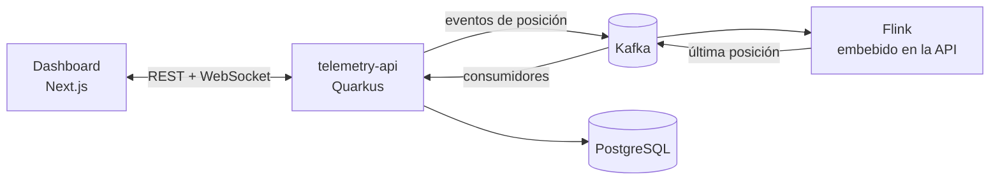

# Telemetría de autos en tiempo real

Demo full-stack de **telemetría en tiempo real**: tres autos compiten por rutas reales de Lima y del Perú, y su posición se ve en vivo sobre un mapa. Cada movimiento viaja por Kafka, lo procesa Flink, se guarda en PostgreSQL y llega al navegador por WebSocket.

Es un proyecto de portafolio para practicar y mostrar cómo se construye un sistema de eventos de punta a punta: desde la simulación hasta la pantalla, con arquitectura limpia, pruebas, documentación y Docker.

## Qué hace

- **Carrera en vivo:** eliges una ruta, inicias la carrera y ves a los autos avanzar con su clasificación. Cada auto tiene un control de velocidad que se puede mover en plena carrera.
- **Historial de viajes:** cada carrera queda guardada y se puede revisar y **repetir** con un reproductor (velocidad 1x, 4x o 16x) y un gráfico de velocidad.
- **Operación:** una pantalla muestra la salud de la API, el flujo de eventos y las métricas de ingesta.

## Cómo está armado



| Parte | Tecnología |
|---|---|
| Backend | Java 17, Quarkus 3.40, Hibernate ORM con Panache, Flyway |
| Streaming | Apache Kafka 4.2, Apache Flink 2.2 (embebido en la misma JVM) |
| Base de datos | PostgreSQL 17 |
| Frontend | Next.js 16, React 19, Carbon Design System v12, MapLibre |
| Infraestructura | Docker Compose, imágenes multietapa con healthchecks |
| Calidad | JUnit con PostgreSQL real, ArchUnit, Vitest |

## Qué demuestra este proyecto

- **Arquitectura hexagonal** en el backend, con una prueba (ArchUnit) que hace cumplir que el dominio no dependa de frameworks.
- **Procesamiento de eventos:** un job de Flink dentro de Quarkus y consumidores de Kafka por lotes que confirman el offset solo después de guardar.
- **Persistencia idempotente:** reentregar un evento no duplica datos, y el esquema lo versiona Flyway.
- **Frontend por features** con un mapa fluido: el estado de los autos vive fuera de React y el movimiento se interpola entre eventos.
- **Decisiones documentadas** como ADR y **diagramas C4** de cada proyecto.

## Cómo ejecutarlo

Solo necesitas **Docker**.

```bash
cp .env.example .env              # credenciales de PostgreSQL para desarrollo local
docker compose up -d --build      # PostgreSQL, Kafka, API y dashboard
```

Abre <http://localhost:3000>, elige una ruta y pulsa **Iniciar carrera**. El primer build tarda unos minutos porque descarga dependencias.

| Servicio | Puerto |
|---|---|
| Dashboard | 3000 |
| API (REST y WebSocket) | 8080 |
| UI de Flink | 8081 |
| PostgreSQL | 5432 |
| Kafka (desde el host) | 9092 |

Para detenerlo: `docker compose down`. Los datos se conservan en volúmenes; `docker compose down -v` los borra.

## Estructura

| Carpeta | Contenido |
|---|---|
| [`telemetry-api/`](telemetry-api/README.md) | Backend: simulación, Flink, Kafka, PostgreSQL, REST y WebSocket |
| [`dashboard-next/`](dashboard-next/README.md) | Frontend: carrera, viajes, repetición y operación |
| [`knowledge/`](knowledge/README.md) | Decisiones de arquitectura (ADR) y estándares |

## Documentación

- **Arquitectura C4** de cada proyecto, con contexto, contenedores, componentes, código y diagramas de secuencia: [`telemetry-api/docs/c4/`](telemetry-api/docs/c4/README.md) y [`dashboard-next/docs/c4/`](dashboard-next/docs/c4/README.md).
- **Decisiones (ADR):** [stack](knowledge/adrs/ADR-003-stack-quarkus-flink-embebido-nextjs.md), [persistencia](knowledge/adrs/ADR-004-persistencia-postgresql-jdbc.md), [interfaz Carbon](knowledge/adrs/ADR-005-ui-carbon-v12.md), [arquitectura hexagonal](knowledge/adrs/ADR-006-arquitectura-hexagonal-backend.md) y [Hibernate con Panache](knowledge/adrs/ADR-007-persistencia-hibernate-panache.md).
- [`CLAUDE.md`](CLAUDE.md): guía para asistentes de código sobre las convenciones del repositorio.

## Pruebas

```bash
cd telemetry-api && ./mvnw test     # requiere JDK 17 y Docker (PostgreSQL de Dev Services)
cd dashboard-next && npm test       # Vitest
```
