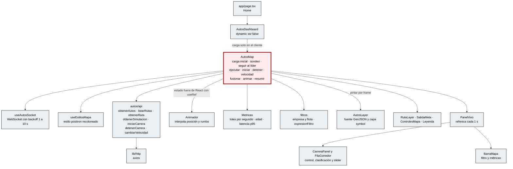

# Código (C4 nivel 4)

**Foco:** el componente `AutosMap` (borde dark red 700), que orquesta la pantalla Carrera.

## Diagrama

Fuente: [`diagrams/code.mmd`](diagrams/code.mmd).

## Elementos del foco

| Elemento | Qué hace | Archivo |
|---|---|---|
| `AutosMap` | Orquesta la pantalla: carga inicial, sondeo de la simulación (1 s en curso, 5 s en reposo), seguir al líder, acciones de la carrera y composición del mapa | [`autos-map.tsx`](../../features/autos/components/autos-map.tsx) |
| `PanelVivo` | Refresca métricas, opciones del filtro y cronómetro una vez por segundo sin rerenderizar el mapa | [`autos-map.tsx`](../../features/autos/components/autos-map.tsx) |
| `AutosDashboard` | Carga `AutosMap` solo en el cliente (`dynamic`, `ssr: false`) | [`autos-dashboard.tsx`](../../features/autos/components/autos-dashboard.tsx) |
| `useAutosSocket` | `WebSocket` a `/ws/autos`; entrega cada lote por callback y reconecta con backoff | [`use-autos-socket.ts`](../../features/autos/hooks/use-autos-socket.ts) |
| `useEstilosMapa` | Descarga el estilo `positron` y lo recolorea con la paleta clara y oscura; cachea la promesa | [`use-estilos-mapa.ts`](../../features/autos/hooks/use-estilos-mapa.ts) |
| `Animador` | Interpola posición y rumbo entre dos eventos; no anima saltos de más de 2 km ni intervalos de más de 3 s | [`animacion.ts`](../../features/autos/animacion.ts) |
| `Metricas` | Lotes por segundo, edad del último dato y latencia p95 del último lote | [`metricas.ts`](../../features/autos/metricas.ts) |
| `AutosLayer` | Una fuente GeoJSON con una capa `symbol` por color de auto, filtrada con `setFilter` | [`autos-layer.tsx`](../../features/autos/components/autos-layer.tsx) |
| `RutaLayer` | Dibuja la ruta dividida en tramo recorrido por el líder y tramo pendiente | [`ruta-layer.tsx`](../../features/autos/components/ruta-layer.tsx) |
| `CarreraPanel · FilaCorredor` | Estado, ruta, botones, clasificación y slider de velocidad (10 a 500 km/h) | [`carrera-panel.tsx`](../../features/autos/components/carrera-panel.tsx) |
| `autos/api` | Siete funciones sobre `axios`: autos, rutas, ruta, simulación, iniciar, detener y velocidad | [`api.ts`](../../features/autos/api.ts) |
| `filtros` | Empresa y flota derivadas de los datos; la misma condición como función y como expresión de MapLibre | [`filtros.ts`](../../features/autos/filtros.ts) |

## Las demás pantallas

| Pantalla | Elementos clave | Archivos |
|---|---|---|
| Viajes | `ViajesPantalla`, `useCarreras` (`useReducer` con cancelación y secuencia de solicitudes), `agruparPorCarrera`, `TarjetaCarrera` | [`viajes-pantalla.tsx`](../../features/viajes/components/viajes-pantalla.tsx), [`use-carreras.ts`](../../features/viajes/hooks/use-carreras.ts) |
| Repetición | `RepeticionPantalla`, `useRepeticion`, `prepararRecorrido`, `estadoEn`, `Reproductor`, `GraficoVelocidad`, `RecorridoLayer` | [`repeticion-pantalla.tsx`](../../features/viajes/components/repeticion-pantalla.tsx), [`repeticion.ts`](../../features/viajes/repeticion.ts) |
| Operación | `OperacionPantalla`, `obtenerSalud` (acepta 503), `parsearPrometheus`, `tasaPorSegundo` | [`operacion-pantalla.tsx`](../../features/operacion/components/operacion-pantalla.tsx), [`prometheus.ts`](../../features/operacion/prometheus.ts) |
| Shell | `Encabezado` (Carbon UI Shell en G100), `SelectorTema` (claro, oscuro, sistema), `FlagsCarbon` | [`encabezado.tsx`](../../components/encabezado.tsx) |

## Notas de diseño verificables en el código

- El estado de los autos vive en `useRef` (`Map` por `carId`), no en estado de React: cada lote del WebSocket actualiza el `Animador` y pide un frame; el repintado ocurre por `requestAnimationFrame` mientras algún auto está en camino.
- `fusionar` solo acepta un evento si su `ts` supera al guardado, tanto para el WebSocket como para la carga inicial.
- Los tipos del contrato (`Auto`, `EstadoSimulacion`, `ViajeVista`…) son copias propias de cada feature, no un paquete compartido.
- Los tokens de color (`--cds-*`, `--auto-N`) los lee MapLibre con `leerToken` al crear cada capa, y un cambio de tema recrea las capas.

## Traceability

- Anterior: [component.md](component.md) · Secuencias: [sequence-e2e.md](sequence-e2e.md)
