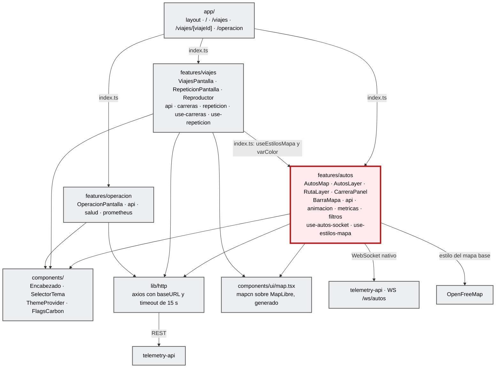

# Componentes (C4 nivel 3)

**Foco:** `features/autos` (borde dark red 700), la feature de la pantalla Carrera. Las otras dos features y las librerías compartidas rodean al foco.

## Diagrama

Fuente: [`diagrams/component.mmd`](diagrams/component.mmd).

## Componentes

| Componente | Responsabilidad | Código |
|---|---|---|
| app/ | Rutas del App Router; páginas delgadas que componen una feature por su `index.ts` | [`app/layout.tsx`](../../app/layout.tsx) · [`app/page.tsx`](../../app/page.tsx) · [`app/viajes/page.tsx`](../../app/viajes/page.tsx) · [`app/viajes/[viajeId]/page.tsx`](../../app/viajes/[viajeId]/page.tsx) · [`app/operacion/page.tsx`](../../app/operacion/page.tsx) |
| components/ (shell) | Cabecera con secciones, estado del WebSocket y tema; proveedores de tema y de flags de Carbon | [`components/encabezado.tsx`](../../components/encabezado.tsx) · [`components/selector-tema.tsx`](../../components/selector-tema.tsx) · [`components/theme-provider.tsx`](../../components/theme-provider.tsx) · [`components/flags-carbon.tsx`](../../components/flags-carbon.tsx) |
| features/autos (foco) | Pantalla Carrera: mapa, ruta, autos en vivo, panel de control, clasificación, filtro y métricas | [`autos/components/autos-map.tsx`](../../features/autos/components/autos-map.tsx) · [`autos/components/autos-layer.tsx`](../../features/autos/components/autos-layer.tsx) · [`autos/components/carrera-panel.tsx`](../../features/autos/components/carrera-panel.tsx) · [`autos/api.ts`](../../features/autos/api.ts) · [`autos/index.ts`](../../features/autos/index.ts) |
| features/autos (lógica pura) | Interpolación, métricas, filtros, GeoJSON, ruta recorrida y paleta, con pruebas de Vitest | [`autos/animacion.ts`](../../features/autos/animacion.ts) · [`autos/metricas.ts`](../../features/autos/metricas.ts) · [`autos/filtros.ts`](../../features/autos/filtros.ts) · [`autos/geojson.ts`](../../features/autos/geojson.ts) · [`autos/ruta-progreso.ts`](../../features/autos/ruta-progreso.ts) |
| features/autos (hooks) | WebSocket con reconexión y estilos del mapa base | [`autos/hooks/use-autos-socket.ts`](../../features/autos/hooks/use-autos-socket.ts) · [`autos/hooks/use-estilos-mapa.ts`](../../features/autos/hooks/use-estilos-mapa.ts) |
| features/viajes | Pantallas Viajes y Repetición: carreras del día, recorrido, reproductor y gráfico de velocidad | [`viajes/components/viajes-pantalla.tsx`](../../features/viajes/components/viajes-pantalla.tsx) · [`viajes/components/repeticion-pantalla.tsx`](../../features/viajes/components/repeticion-pantalla.tsx) · [`viajes/api.ts`](../../features/viajes/api.ts) · [`viajes/index.ts`](../../features/viajes/index.ts) |
| features/viajes (lógica y hooks) | Agrupación en carreras, reductor de carga, recorrido interpolado y reproducción | [`viajes/carreras.ts`](../../features/viajes/carreras.ts) · [`viajes/estado-carreras.ts`](../../features/viajes/estado-carreras.ts) · [`viajes/repeticion.ts`](../../features/viajes/repeticion.ts) · [`viajes/hooks/use-carreras.ts`](../../features/viajes/hooks/use-carreras.ts) · [`viajes/hooks/use-repeticion.ts`](../../features/viajes/hooks/use-repeticion.ts) |
| features/operacion | Pantalla Operación: salud, flujo de eventos y métricas de Prometheus | [`operacion/components/operacion-pantalla.tsx`](../../features/operacion/components/operacion-pantalla.tsx) · [`operacion/api.ts`](../../features/operacion/api.ts) · [`operacion/salud.ts`](../../features/operacion/salud.ts) · [`operacion/prometheus.ts`](../../features/operacion/prometheus.ts) |
| lib/ | Cliente HTTP, secciones de la cabecera y tema | [`lib/http.ts`](../../lib/http.ts) · [`lib/secciones.ts`](../../lib/secciones.ts) · [`lib/tema.ts`](../../lib/tema.ts) |
| components/ui/map.tsx | Componente `Map` de mapcn sobre MapLibre: generado, no se edita | [`components/ui/map.tsx`](../../components/ui/map.tsx) |

## Reglas de dependencia que se cumplen en el código

- `app/` importa cada feature solo por su `index.ts`.
- La única dependencia entre features es `viajes` → `autos` por su `index.ts` (`useEstilosMapa` y `varColor`).
- Cada feature tiene su propio cliente HTTP y sus propios tipos del contrato; `lib/http.ts` solo aporta la instancia de `axios`.
- La lógica sin React (interpolación, filtros, agrupación, reductores y parseo) vive en funciones puras con pruebas; el estado de los autos en vivo vive fuera de React, en `useRef`.
- Las pantallas montan `Encabezado` ellas mismas: el `layout.tsx` solo aporta el tema y los flags de Carbon.

## Traceability

- Anterior: [container.md](container.md) · Siguiente: [code.md](code.md) · Estándar: [`STD-ARCH-001`](../../../knowledge/standards/STD-ARCH-001-arquitectura-por-features.md)
