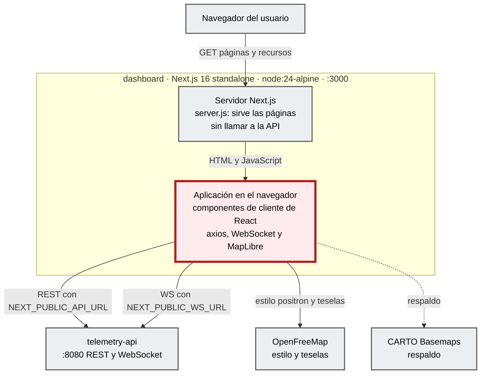

# Contenedores (C4 nivel 2)

**Foco:** la aplicación en el navegador (borde dark red 700): los componentes de cliente de React que hacen todas las llamadas. Se entrega dentro del contenedor `dashboard`.

## Diagrama

Fuente: [`diagrams/container.mmd`](diagrams/container.mmd).

## Contenedores

| Contenedor | Tecnología | Puertos | Notas |
|---|---|---|---|
| `dashboard` · servidor | Next.js 16.4 con `output: "standalone"`, imagen `node:24-alpine`, usuario `node` | 3000 | Servidor mínimo `server.js`; healthcheck con `wget`; `mem_limit: 512m` en el compose. No consulta la API |
| `dashboard` · aplicación en el navegador | React 19.3, Carbon v12, `axios`, `WebSocket`, MapLibre 6 y mapcn | — | Todas las pantallas son componentes de cliente; el mapa se carga con `dynamic(..., { ssr: false })` |
| `telemetry-api` | Quarkus | 8080 | Sistema externo |

## Construcción y configuración

| Aspecto | Detalle |
|---|---|
| Imagen | Tres etapas (`deps`, `build`, `runner`) con `npm ci --ignore-scripts` y caché de `~/.npm` ([`Dockerfile`](../../Dockerfile)) |
| Variables | `NEXT_PUBLIC_API_URL`, `NEXT_PUBLIC_WS_URL` y `NEXT_PUBLIC_FLINK_UI_URL` son `ARG` del build: se incrustan en el bundle y apuntan a la API tal como la ve el navegador del host (`localhost`), no al nombre del servicio de Docker |
| CSS | `npm run carbon:css` compila `app/carbon.scss` a `app/carbon.generated.css` (no se versiona); corre solo en `predev` y `prebuild` |
| Arranque | `depends_on: telemetry-api` con `service_healthy` |

## Relaciones en runtime

| Relación | Mecanismo | Detalle |
|---|---|---|
| Navegador → servidor | HTTP | páginas y recursos estáticos |
| Aplicación → `telemetry-api` | `axios` con `baseURL` y timeout de 15 s | sin BFF ni proxy; requiere CORS |
| Aplicación → `telemetry-api` | `WebSocket` nativo a `/ws/autos` | solo recibe; reconecta con espera de 1 s hasta 10 s |
| Aplicación → OpenFreeMap / CARTO | `fetch` del estilo y teselas por MapLibre | sin clave de API |

## Traceability

- Anterior: [context.md](context.md) · Siguiente: [component.md](component.md)
