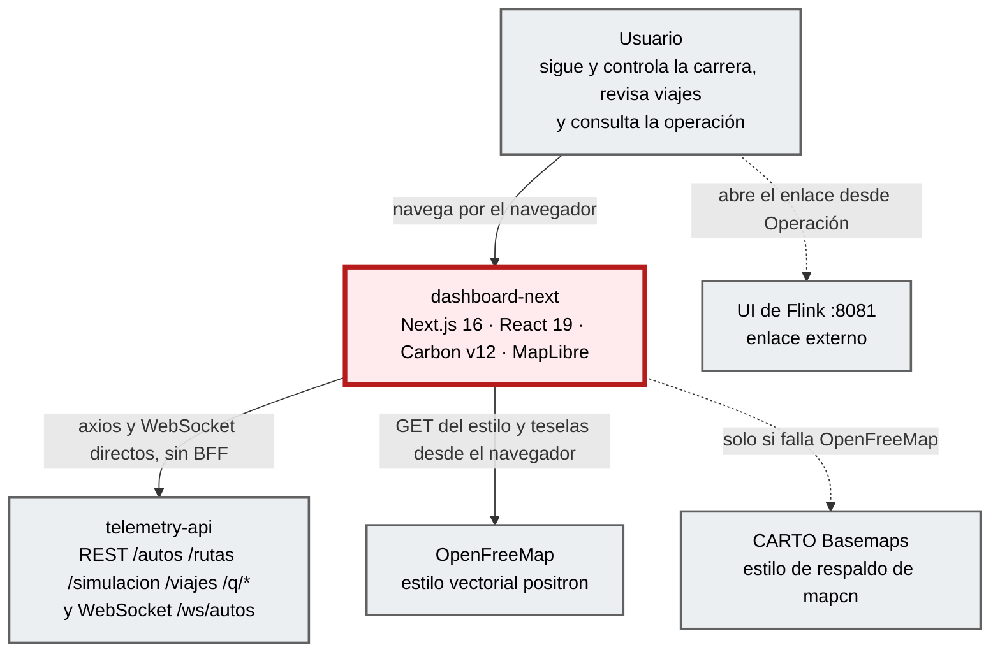

# Contexto (C4 nivel 1)

**Foco:** `dashboard-next` (borde dark red 700).

## Diagrama

Fuente: [`diagrams/context.mmd`](diagrams/context.mmd).

## Elementos

| Elemento | Tipo | Rol | Procedencia |
|---|---|---|---|
| Usuario | Persona | Elige la ruta, inicia y detiene la carrera, ajusta velocidades, filtra por empresa y flota, revisa viajes y consulta la operación | `EXTRACTED` ([`autos-map.tsx`](../../features/autos/components/autos-map.tsx)) |
| `dashboard-next` | Sistema foco | Interfaz web de la carrera, los viajes y la operación | `EXTRACTED` |
| `telemetry-api` | Sistema externo | REST y WebSocket que alimentan todas las pantallas | `EXTRACTED` ([`lib/http.ts`](../../lib/http.ts), [`use-autos-socket.ts`](../../features/autos/hooks/use-autos-socket.ts)) |
| OpenFreeMap | Sistema externo | Estilo vectorial `positron` del mapa base, que el navegador recolorea con los grises de Carbon | `EXTRACTED` ([`use-estilos-mapa.ts`](../../features/autos/hooks/use-estilos-mapa.ts)) |
| CARTO Basemaps | Sistema externo | Estilo de respaldo que usa mapcn si falla OpenFreeMap | `EXTRACTED` ([`map.tsx`](../../components/ui/map.tsx)) |
| UI de Flink | Sistema externo | Enlace que abre la pantalla Operación en otra pestaña | `EXTRACTED` ([`operacion-pantalla.tsx`](../../features/operacion/components/operacion-pantalla.tsx)) |

## Límites y supuestos

- El pack cubre solo `dashboard-next`. Kafka, Flink y PostgreSQL no se relacionan con él directamente: llegan a través de `telemetry-api`.
- No hay autenticación ni sesión. El navegador necesita que `telemetry-api` permita su origen por CORS.
- Las URL de la API y del WebSocket son variables `NEXT_PUBLIC_*`: se incrustan al construir la imagen y las usa el navegador del host.

## Traceability

- Siguiente nivel: [container.md](container.md) · Resumen: [README.md](README.md)
