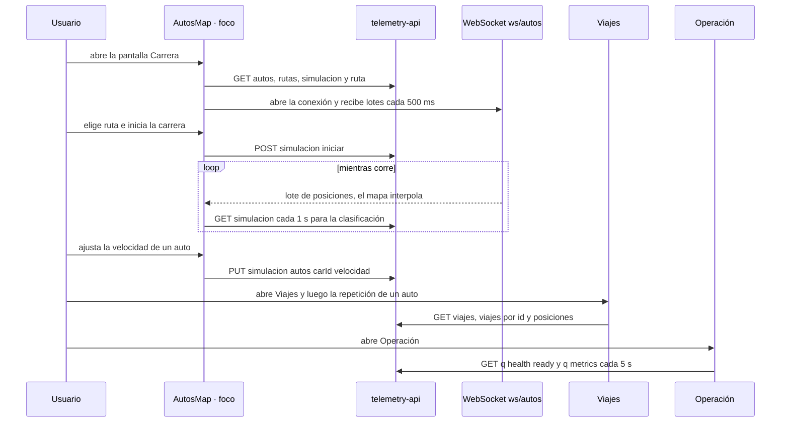

# Secuencias E2E

El dashboard es un cliente web, no una API REST: no se documenta un endpoint por secuencia, sino los **recorridos críticos del usuario** que cruzan pantalla, estado, cliente HTTP o WebSocket y `telemetry-api`. Cada recorrido muestra también sus errores. Estado: `READY_FOR_DEV`.

## Recorrido de punta a punta

Fuente: [`diagrams/sequence-e2e.mmd`](diagrams/sequence-e2e.mmd).

## Índice de recorridos

| # | Recorrido | Ruta | Foco | Secuencia | Pruebas de funciones puras |
|---|---|---|---|---|---|
| 1 | Carrera: carga inicial de la pantalla | `/` | AutosMap | [`carrera-carga-inicial.md`](sequences/carrera-carga-inicial.md) · [`.mmd`](diagrams/sequences/carrera-carga-inicial.mmd) | estilo-mapa, ruta-progreso, geojson |
| 2 | Carrera: iniciar y detener | `/` | AutosMap | [`carrera-iniciar-detener.md`](sequences/carrera-iniciar-detener.md) · [`.mmd`](diagrams/sequences/carrera-iniciar-detener.mmd) | — |
| 3 | Carrera: cambiar la velocidad de un auto | `/` | AutosMap | [`carrera-cambiar-velocidad.md`](sequences/carrera-cambiar-velocidad.md) · [`.mmd`](diagrams/sequences/carrera-cambiar-velocidad.mmd) | — |
| 4 | Carrera: posiciones en tiempo real por WebSocket | `/` | AutosMap | [`carrera-tiempo-real.md`](sequences/carrera-tiempo-real.md) · [`.mmd`](diagrams/sequences/carrera-tiempo-real.mmd) | estilo-mapa, geojson, formato |
| 5 | Viajes: carreras del día | `/viajes` | ViajesPantalla | [`viajes-listado.md`](sequences/viajes-listado.md) · [`.mmd`](diagrams/sequences/viajes-listado.mmd) | carreras, estado-carreras, presentacion |
| 6 | Viaje: repetición del recorrido | `/viajes/[viajeId]` | RepeticionPantalla | [`viaje-repeticion.md`](sequences/viaje-repeticion.md) · [`.mmd`](diagrams/sequences/viaje-repeticion.mmd) | repeticion, api, presentacion |
| 7 | Operación: salud y métricas | `/operacion` | OperacionPantalla | [`operacion.md`](sequences/operacion.md) · [`.mmd`](diagrams/sequences/operacion.mmd) | salud, prometheus |

Total: 7 recorridos y 7 secuencias.

## Cobertura de las llamadas a `telemetry-api`

Cada endpoint que el dashboard consume aparece en al menos un recorrido:

| Método | Endpoint de `telemetry-api` | Función del cliente | Archivo | Secuencias |
|---|---|---|---|---|
| GET | `/autos` | `obtenerAutos` | features/autos/api.ts | carrera-carga-inicial |
| GET | `/rutas` | `listarRutas` | features/autos/api.ts y features/viajes/api.ts | carrera-carga-inicial, viajes-listado |
| GET | `/rutas/{id}` | `obtenerRuta y obtenerGeometria` | features/autos/api.ts y features/viajes/api.ts | carrera-carga-inicial, viajes-listado |
| GET | `/simulacion` | `obtenerSimulacion` | features/autos/api.ts | carrera-carga-inicial, carrera-iniciar-detener |
| POST | `/simulacion/iniciar` | `iniciarCarrera` | features/autos/api.ts | carrera-iniciar-detener |
| POST | `/simulacion/detener` | `detenerCarrera` | features/autos/api.ts | carrera-iniciar-detener |
| PUT | `/simulacion/autos/{carId}/velocidad` | `cambiarVelocidad` | features/autos/api.ts | carrera-cambiar-velocidad |
| GET | `/viajes` | `listarViajes` | features/viajes/api.ts | viajes-listado, viaje-repeticion |
| GET | `/viajes/{viajeId}` | `obtenerViaje y obtenerResumenes` | features/viajes/api.ts | viajes-listado, viaje-repeticion |
| GET | `/viajes/{viajeId}/posiciones` | `listarPosiciones` | features/viajes/api.ts | viaje-repeticion |
| GET | `/q/health/ready` | `obtenerSalud` | features/operacion/api.ts | operacion |
| GET | `/q/metrics` | `obtenerMetricas` | features/operacion/api.ts | operacion |
| WS | `/ws/autos` | `useAutosSocket` | features/autos/hooks/use-autos-socket.ts | carrera-carga-inicial, carrera-tiempo-real |

Total: 13 llamadas (12 REST y 1 WebSocket) y 13 con secuencia.

## Qué no se cubre

El cambio de tema (claro, oscuro, sistema) y los controles del mapa (zoom, encuadre, orientación al norte) son locales: no llaman a la API y no tienen secuencia propia.

## Traceability

- Anterior: [code.md](code.md) · Trazabilidad: [traceability-report.md](traceability-report.md)
