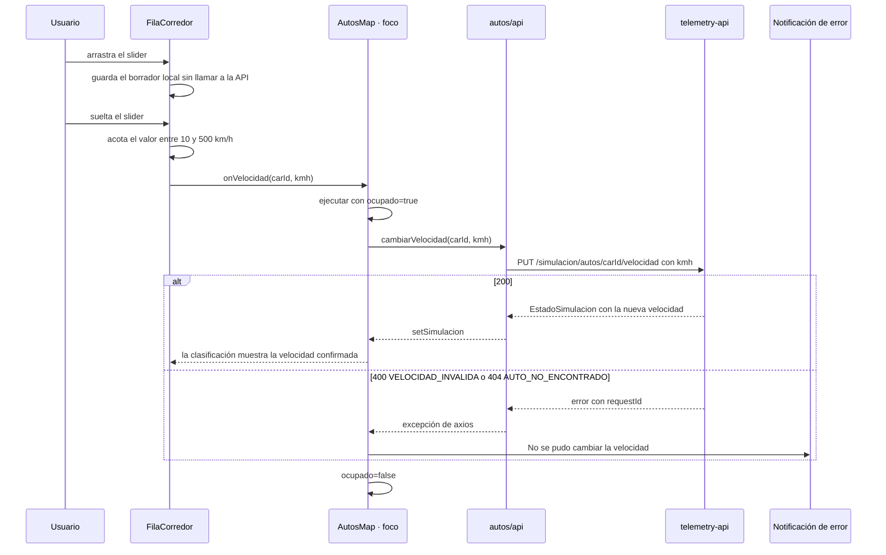

# Secuencia · Carrera: cambiar la velocidad de un auto

**Pantalla o ruta:** `/` · **Foco:** `AutosMap` (borde dark red 700) · **procedencia:** `EXTRACTED` del código de `features/`.

## Capas que atraviesa

| Capa | Elemento | Código |
|---|---|---|
| features/autos (componente) | FilaCorredor: Slider de Carbon, `onRelease` envía | [`fila-corredor.tsx`](../../../features/autos/components/fila-corredor.tsx) |
| features/autos (orquestador) | AutosMap.velocidad y ejecutar | [`autos-map.tsx`](../../../features/autos/components/autos-map.tsx) |
| features/autos (cliente HTTP) | cambiarVelocidad | [`api.ts`](../../../features/autos/api.ts) |

## Llamadas a telemetry-api

| Método | Path | Función del cliente |
|---|---|---|
| PUT | `/simulacion/autos/{carId}/velocidad` | `cambiarVelocidad` |

## Errores y estados relevantes

| Situación | Qué ve el usuario |
|---|---|
| 400 `VELOCIDAD_INVALIDA` | `No se pudo cambiar la velocidad: …` |
| 404 `AUTO_NO_ENCONTRADO` | el mismo mensaje con el detalle del backend |
| eco del sondeo | Carbon llama `onChange` cuando cambia la prop `value`; el componente lo ignora si coincide con la velocidad confirmada |

## Pruebas que lo cubren

- Sin prueba automatizada (ver [documentation-review.md](../documentation-review.md)).

## Notas

- No hay BFF: el navegador llama a `telemetry-api` directamente con `axios` (`NEXT_PUBLIC_API_URL`) y al WebSocket con `WebSocket` nativo (`NEXT_PUBLIC_WS_URL`); no se envía ningún `correlation ID`.
- Sin autenticación ni sesión.

## Traceability

- Índice: [sequence-e2e.md](../sequence-e2e.md) · Diagrama: [`carrera-cambiar-velocidad.mmd`](../diagrams/sequences/carrera-cambiar-velocidad.mmd)
