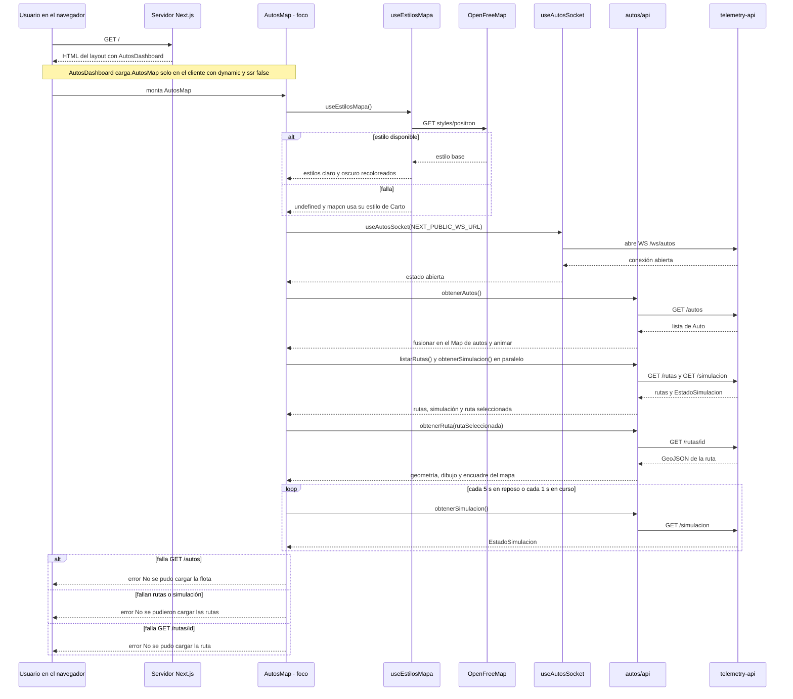

# Secuencia · Carrera: carga inicial de la pantalla

**Pantalla o ruta:** `/` · **Foco:** `AutosMap` (borde dark red 700) · **procedencia:** `EXTRACTED` del código de `features/`.

## Capas que atraviesa

| Capa | Elemento | Código |
|---|---|---|
| app (ruta) | app/page.tsx compone AutosDashboard | [`page.tsx`](../../../app/page.tsx) |
| features/autos (componente) | AutosDashboard → AutosMap (`dynamic`, `ssr: false`) | [`autos-dashboard.tsx`](../../../features/autos/components/autos-dashboard.tsx) |
| features/autos (orquestador) | AutosMap: estado en `useRef`, cargas y sondeo | [`autos-map.tsx`](../../../features/autos/components/autos-map.tsx) |
| features/autos (hooks) | useAutosSocket, useEstilosMapa | [`use-autos-socket.ts`](../../../features/autos/hooks/use-autos-socket.ts) |
| features/autos (cliente HTTP) | obtenerAutos, listarRutas, obtenerSimulacion, obtenerRuta | [`api.ts`](../../../features/autos/api.ts) |
| lib | cliente `axios` con `baseURL` y timeout de 15 s | [`http.ts`](../../../lib/http.ts) |

## Llamadas a telemetry-api

| Método | Path | Función del cliente |
|---|---|---|
| GET | `/autos` | `obtenerAutos` |
| GET | `/rutas` | `listarRutas` |
| GET | `/simulacion` | `obtenerSimulacion` (carga y sondeo) |
| GET | `/rutas/{id}` | `obtenerRuta` |
| WS | `/ws/autos` | `useAutosSocket` |

## Errores y estados relevantes

| Situación | Qué ve el usuario |
|---|---|
| `GET /autos` falla | notificación `No se pudo cargar la flota: …` |
| `GET /rutas` o `/simulacion` falla | `No se pudieron cargar las rutas: …` |
| `GET /rutas/{id}` falla | `No se pudo cargar la ruta: …` |
| el sondeo de `/simulacion` falla | se ignora y se reintenta en el siguiente ciclo |
| el estilo de OpenFreeMap falla | `useEstilosMapa` devuelve `undefined` y el mapa usa Carto |

## Pruebas que lo cubren

- [`estilo-mapa.test.ts`](../../../features/autos/estilo-mapa.test.ts)
- [`ruta-progreso.test.ts`](../../../features/autos/ruta-progreso.test.ts)
- [`geojson.test.ts`](../../../features/autos/geojson.test.ts)

## Notas

- No hay BFF: el navegador llama a `telemetry-api` directamente con `axios` (`NEXT_PUBLIC_API_URL`) y al WebSocket con `WebSocket` nativo (`NEXT_PUBLIC_WS_URL`); no se envía ningún `correlation ID`.
- Sin autenticación ni sesión.

## Traceability

- Índice: [sequence-e2e.md](../sequence-e2e.md) · Diagrama: [`carrera-carga-inicial.mmd`](../diagrams/sequences/carrera-carga-inicial.mmd)
