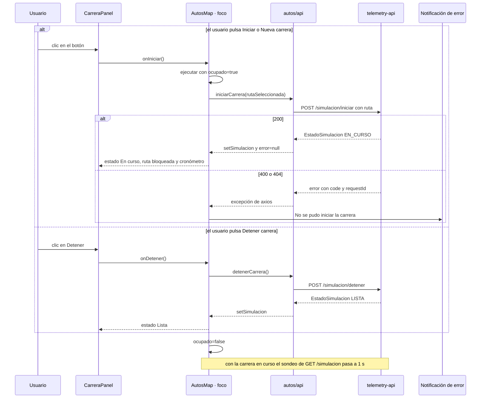

# Secuencia · Carrera: iniciar y detener

**Pantalla o ruta:** `/` · **Foco:** `AutosMap` (borde dark red 700) · **procedencia:** `EXTRACTED` del código de `features/`.

## Capas que atraviesa

| Capa | Elemento | Código |
|---|---|---|
| features/autos (componente) | CarreraPanel: botones, ruta y estado | [`carrera-panel.tsx`](../../../features/autos/components/carrera-panel.tsx) |
| features/autos (orquestador) | AutosMap.iniciar, detener y ejecutar | [`autos-map.tsx`](../../../features/autos/components/autos-map.tsx) |
| features/autos (cliente HTTP) | iniciarCarrera, detenerCarrera | [`api.ts`](../../../features/autos/api.ts) |
| lib | cliente `axios` | [`http.ts`](../../../lib/http.ts) |

## Llamadas a telemetry-api

| Método | Path | Función del cliente |
|---|---|---|
| POST | `/simulacion/iniciar` | `iniciarCarrera` |
| POST | `/simulacion/detener` | `detenerCarrera` |
| GET | `/simulacion` | `obtenerSimulacion` (sondeo cada 1 s) |

## Errores y estados relevantes

| Situación | Qué ve el usuario |
|---|---|
| 400 `RUTA_REQUERIDA` o 404 `RUTA_NO_ENCONTRADA` | `No se pudo iniciar la carrera: …` en una `InlineNotification` |
| error al detener | `No se pudo detener la carrera: …` |
| mientras la petición está en curso | los botones quedan deshabilitados (`ocupado`) |

## Pruebas que lo cubren

- Sin prueba automatizada (ver [documentation-review.md](../documentation-review.md)).

## Notas

- No hay BFF: el navegador llama a `telemetry-api` directamente con `axios` (`NEXT_PUBLIC_API_URL`) y al WebSocket con `WebSocket` nativo (`NEXT_PUBLIC_WS_URL`); no se envía ningún `correlation ID`.
- Sin autenticación ni sesión.

## Traceability

- Índice: [sequence-e2e.md](../sequence-e2e.md) · Diagrama: [`carrera-iniciar-detener.mmd`](../diagrams/sequences/carrera-iniciar-detener.mmd)
