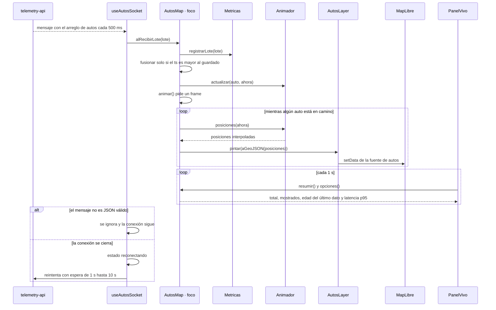

# Secuencia · Carrera: posiciones en tiempo real por WebSocket

**Pantalla o ruta:** `/` · **Foco:** `AutosMap` (borde dark red 700) · **procedencia:** `EXTRACTED` del código de `features/`.

## Capas que atraviesa

| Capa | Elemento | Código |
|---|---|---|
| features/autos (hook) | useAutosSocket: `WebSocket` nativo con backoff | [`use-autos-socket.ts`](../../../features/autos/hooks/use-autos-socket.ts) |
| features/autos (orquestador) | AutosMap.alRecibirLote, fusionar y animar; PanelVivo | [`autos-map.tsx`](../../../features/autos/components/autos-map.tsx) |
| features/autos (lógica pura) | Animador, Metricas, aGeoJSON | [`animacion.ts`](../../../features/autos/animacion.ts) |
| features/autos (capa de mapa) | AutosLayer: una fuente GeoJSON y una capa `symbol` | [`autos-layer.tsx`](../../../features/autos/components/autos-layer.tsx) |

## Llamadas a telemetry-api

| Método | Path | Función del cliente |
|---|---|---|
| WS | `/ws/autos` | `useAutosSocket` (solo recibe; el cliente no envía mensajes) |

## Errores y estados relevantes

| Situación | Comportamiento |
|---|---|
| conexión caída | etiqueta `Reconectando` en la cabecera y reintentos con espera de 1 s duplicada hasta 10 s |
| mensaje malformado | se descarta sin cerrar la conexión |
| evento atrasado | `fusionar` lo descarta si su `ts` no supera al guardado |
| salto mayor de 2 km o de 3 s entre eventos | el `Animador` no interpola: el auto aparece en su sitio |

## Pruebas que lo cubren

- [`estilo-mapa.test.ts`](../../../features/autos/estilo-mapa.test.ts)
- [`geojson.test.ts`](../../../features/autos/geojson.test.ts)
- [`formato.test.ts`](../../../features/autos/formato.test.ts)

## Notas

- No hay BFF: el navegador llama a `telemetry-api` directamente con `axios` (`NEXT_PUBLIC_API_URL`) y al WebSocket con `WebSocket` nativo (`NEXT_PUBLIC_WS_URL`); no se envía ningún `correlation ID`.
- Sin autenticación ni sesión.

## Traceability

- Índice: [sequence-e2e.md](../sequence-e2e.md) · Diagrama: [`carrera-tiempo-real.mmd`](../diagrams/sequences/carrera-tiempo-real.mmd)
