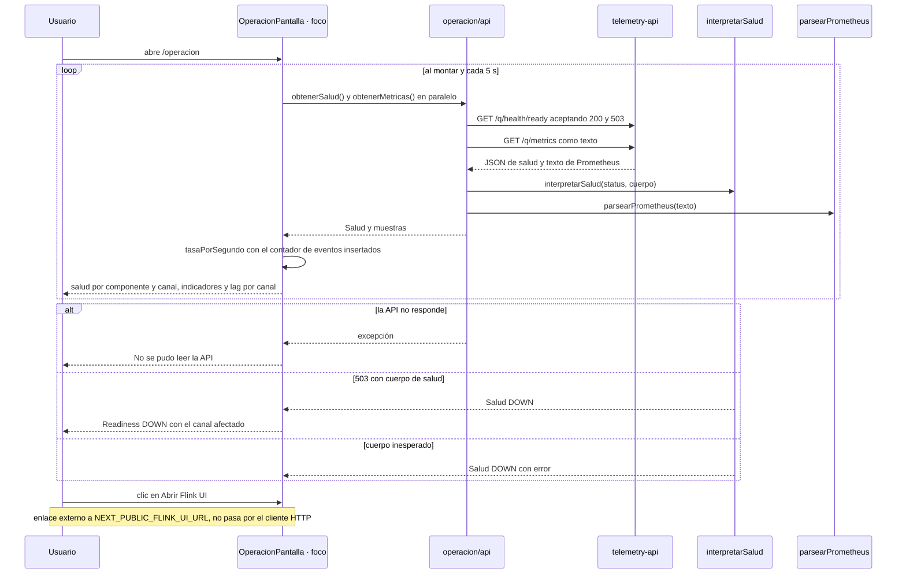

# Secuencia · Operación: salud y métricas de la API

**Pantalla o ruta:** `/operacion` · **Foco:** `OperacionPantalla` (borde dark red 700) · **procedencia:** `EXTRACTED` del código de `features/`.

## Capas que atraviesa

| Capa | Elemento | Código |
|---|---|---|
| app (ruta) | app/operacion/page.tsx | [`page.tsx`](../../../app/operacion/page.tsx) |
| features/operacion (componente) | OperacionPantalla: sondeo cada 5 s | [`operacion-pantalla.tsx`](../../../features/operacion/components/operacion-pantalla.tsx) |
| features/operacion (cliente HTTP) | obtenerSalud (acepta 200 y 503), obtenerMetricas | [`api.ts`](../../../features/operacion/api.ts) |
| features/operacion (lógica pura) | interpretarSalud, filasSalud, parsearPrometheus, tasaPorSegundo | [`prometheus.ts`](../../../features/operacion/prometheus.ts) |

## Llamadas a telemetry-api

| Método | Path | Función del cliente |
|---|---|---|
| GET | `/q/health/ready` | `obtenerSalud` (`validateStatus` acepta 200 y 503) |
| GET | `/q/metrics` | `obtenerMetricas` (texto de Prometheus) |

## Errores y estados relevantes

| Situación | Qué ve el usuario |
|---|---|
| la API no responde | `InlineNotification` `No se pudo leer la API` |
| readiness 503 | etiqueta `Readiness DOWN` y la fila del canal afectado en DOWN |
| contador reiniciado o primera lectura | `Eventos por segundo` muestra `—` |

## Pruebas que lo cubren

- [`salud.test.ts`](../../../features/operacion/salud.test.ts)
- [`prometheus.test.ts`](../../../features/operacion/prometheus.test.ts)

## Notas

- No hay BFF: el navegador llama a `telemetry-api` directamente con `axios` (`NEXT_PUBLIC_API_URL`) y al WebSocket con `WebSocket` nativo (`NEXT_PUBLIC_WS_URL`); no se envía ningún `correlation ID`.
- Sin autenticación ni sesión.

## Traceability

- Índice: [sequence-e2e.md](../sequence-e2e.md) · Diagrama: [`operacion.mmd`](../diagrams/sequences/operacion.mmd)
