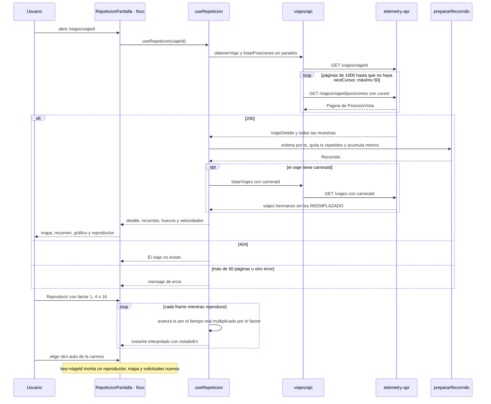

# Secuencia · Viaje: repetición del recorrido

**Pantalla o ruta:** `/viajes/[viajeId]` · **Foco:** `RepeticionPantalla` (borde dark red 700) · **procedencia:** `EXTRACTED` del código de `features/`.

## Capas que atraviesa

| Capa | Elemento | Código |
|---|---|---|
| app (ruta) | app/viajes/[viajeId]/page.tsx con `Suspense` | [`page.tsx`](../../../app/viajes/[viajeId]/page.tsx) |
| features/viajes (componente) | RepeticionPantalla, Reproductor, GraficoVelocidad, RecorridoLayer | [`repeticion-pantalla.tsx`](../../../features/viajes/components/repeticion-pantalla.tsx) |
| features/viajes (hook) | useRepeticion: carga, reproducción por `requestAnimationFrame` | [`use-repeticion.ts`](../../../features/viajes/hooks/use-repeticion.ts) |
| features/viajes (lógica pura) | prepararRecorrido, estadoEn, huecos, velocidades | [`repeticion.ts`](../../../features/viajes/repeticion.ts) |
| features/viajes (cliente HTTP) | obtenerViaje, listarPosiciones, listarViajes | [`api.ts`](../../../features/viajes/api.ts) |
| features/autos (por su `index.ts`) | useEstilosMapa y varColor | [`index.ts`](../../../features/autos/index.ts) |

## Llamadas a telemetry-api

| Método | Path | Función del cliente |
|---|---|---|
| GET | `/viajes/{viajeId}` | `obtenerViaje` |
| GET | `/viajes/{viajeId}/posiciones` | `listarPosiciones` (páginas de 1000, tope de 50) |
| GET | `/viajes` | `listarViajes` con `carreraId` |

## Errores y estados relevantes

| Situación | Qué ve el usuario |
|---|---|
| 404 | `El viaje no existe.` |
| más de 50 páginas | error `El viaje supera el límite de 50 páginas de muestras…` |
| huecos de más de 1,5 s entre muestras | se resaltan en el mapa y en el gráfico |

## Pruebas que lo cubren

- [`repeticion.test.ts`](../../../features/viajes/repeticion.test.ts)
- [`api.test.ts`](../../../features/viajes/api.test.ts)
- [`presentacion.test.ts`](../../../features/viajes/presentacion.test.ts)

## Notas

- No hay BFF: el navegador llama a `telemetry-api` directamente con `axios` (`NEXT_PUBLIC_API_URL`) y al WebSocket con `WebSocket` nativo (`NEXT_PUBLIC_WS_URL`); no se envía ningún `correlation ID`.
- Sin autenticación ni sesión.

## Traceability

- Índice: [sequence-e2e.md](../sequence-e2e.md) · Diagrama: [`viaje-repeticion.mmd`](../diagrams/sequences/viaje-repeticion.mmd)
