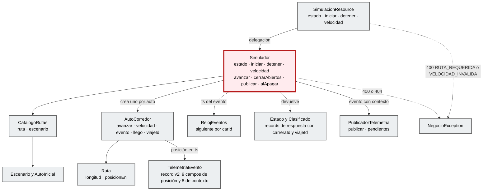
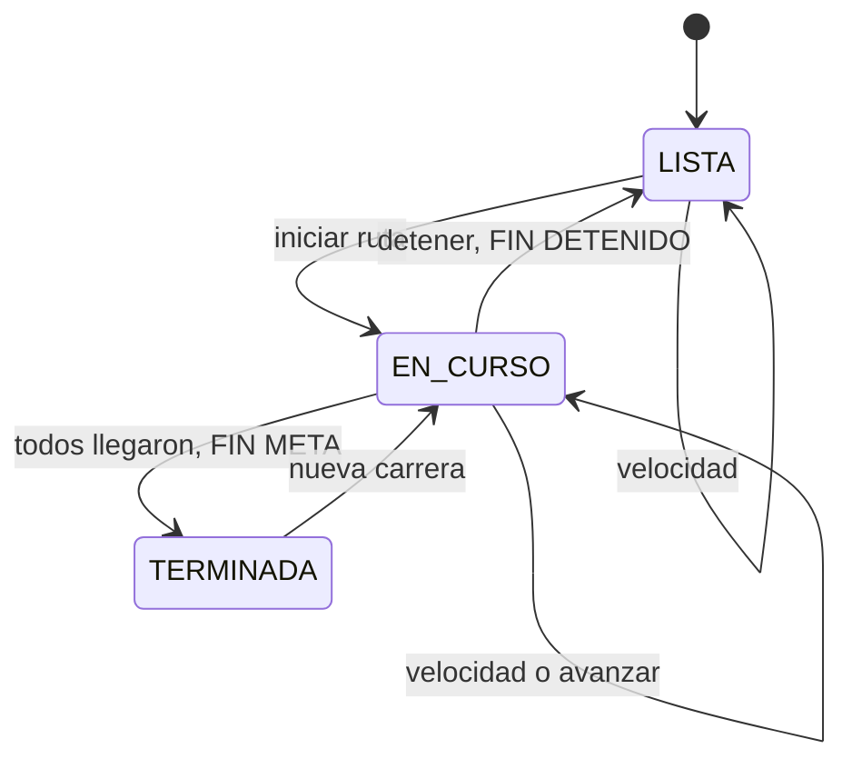

# Código (C4 nivel 4)

**Componente:** `simulacion` · **Foco:** la clase `Simulador` (borde dark red 700). Todo lo descrito sale del código real (`EXTRACTED`).

## Diagrama de clases del foco

## Simulador

[`Simulador.java`](../../telemetry-api/src/main/java/dev/bryan/simulacion/Simulador.java) · `@ApplicationScoped`, métodos públicos `synchronized`.

| Método | Qué hace |
|---|---|
| `estado()` | Ordena los autos con `ordenDeCarrera()` (primero los que llegaron, por tiempo; después por distancia). Devuelve `Estado` con `carreraId` y un `Clasificado` por auto con su `viajeId`. Antes de la primera carrera devuelve los autos del escenario en la salida (sin `viajeId`). |
| `iniciar(idRuta)` | `catalogo.ruta(id)` (404 si no existe, sin cerrar nada), cierra con `FIN`/`REEMPLAZADO` los viajes aún abiertos de la carrera anterior, cancela el temporizador previo, crea un `AutoCorredor` por auto (cada uno con su `viajeId`), genera un `carreraId` nuevo, publica `INICIO` de cada auto (su `ts` es `inicioViajeTs`) y programa `vertx.setPeriodic(intervaloMs, avanzar)`. Estado `EN_CURSO`. |
| `detener()` | Si está `EN_CURSO`, publica `FIN`/`DETENIDO` de los viajes abiertos, cancela el temporizador y vuelve a `LISTA`. Los autos quedan donde están. |
| `velocidad(carId, kmh)` | Valida el rango 10–500 (400 `VELOCIDAD_INVALIDA`) y que el auto exista en el escenario (404 `AUTO_NO_ENCONTRADO`). Guarda la velocidad para las siguientes carreras y la aplica en caliente. |
| `avanzar()` | Cada `simulacion.intervalo-ms` (1000): avanza a los que siguen en pista y publica `POSICION`, o `FIN`/`META` (motor `OFF`) para quien acaba de llegar. Pasa a `TERMINADA` cuando llegan todos. |
| `publicar(auto, tipo, motivo, ts)` | Arma el `TelemetriaEvento` v2 (`schemaVersion=2`, `eventId` aleatorio, `carreraId`, `viajeId`, `rutaId`, `inicioViajeTs`, `tipoEvento`, `motivoFin`), marca el viaje como cerrado si es `FIN` y lo entrega a `PublicadorTelemetria`. |
| `alApagar(ShutdownEvent)` | Llama a `detener()` y espera hasta 5 s a que Kafka confirme los envíos pendientes. |

Estados de la carrera (RF-S5):

## Clases por feature

### simulacion
| Clase | Rol | Pruebas |
|---|---|---|
| [`SimulacionResource.java`](../../telemetry-api/src/main/java/dev/bryan/simulacion/SimulacionResource.java) | Entrada REST `/simulacion`; valida el cuerpo y delega en `Simulador`. Records `Inicio(ruta)` y `Velocidad(kmh)`. | `SimulacionResourceTest` |
| [`RutasResource.java`](../../telemetry-api/src/main/java/dev/bryan/simulacion/RutasResource.java) | Entrada REST `/rutas` y `/rutas/{id}` (`application/geo+json`). | `SimulacionResourceTest` |
| [`CatalogoRutas.java`](../../telemetry-api/src/main/java/dev/bryan/simulacion/CatalogoRutas.java) | Lee `rutas/indice.json`, `rutas/<id>.geojson` y `escenarios/<nombre>.json` del classpath; valida el nombre con `[a-z0-9-]{1,40}`. | `SimulacionResourceTest` |
| [`AutoCorredor.java`](../../telemetry-api/src/main/java/dev/bryan/simulacion/AutoCorredor.java) | Avance a velocidad constante e interpolación del instante de llegada; genera la posición y tiene su propio `viajeId`. | `AutoCorredorTest` |
| [`Ruta.java`](../../telemetry-api/src/main/java/dev/bryan/simulacion/Ruta.java) | Distancias acumuladas de la polilínea; `posicionEn(m)` devuelve lat, lon y rumbo del tramo. | `RutaTest` |
| [`RelojEventos.java`](../../telemetry-api/src/main/java/dev/bryan/simulacion/RelojEventos.java) | `ts` en ms UTC, estrictamente creciente por auto aunque el reloj no avance. | `RelojEventosTest` |
| [`PublicadorTelemetria.java`](../../telemetry-api/src/main/java/dev/bryan/simulacion/PublicadorTelemetria.java) | `Emitter<Record<String,String>>` en `telemetria-out` (key `carId`); serializa una vez, encadena los envíos de cada auto y registra los fallos de Kafka con `eventId` y `viajeId`. | `PublicadorTelemetriaTest` |
| [`Escenario.java`](../../telemetry-api/src/main/java/dev/bryan/simulacion/Escenario.java) · [`TelemetriaEvento.java`](../../telemetry-api/src/main/java/dev/bryan/simulacion/TelemetriaEvento.java) | Escenario de autos y copia propia del contrato del evento v2 (spec de persistencia §4). | `SimuladorViajesTest` |

### flink
| Clase | Rol | Pruebas |
|---|---|---|
| [`FlinkJobRunner.java`](../../telemetry-api/src/main/java/dev/bryan/flink/FlinkJobRunner.java) | En `StartupEvent` crea el MiniCluster con UI, `pipeline.classpaths` y `parent-first`, reinicio `exponential-delay` y heartbeat de 3 min; `executeAsync`. Lo cancela en `ShutdownEvent`. | — |
| [`UltimaPosicionJob.java`](../../telemetry-api/src/main/java/dev/bryan/flink/UltimaPosicionJob.java) | `KafkaSource` (`latest`, auto-commit 100 ms, sin checkpoints) → `keyBy(carId)` → función → `KafkaSink` at-least-once. | `UltimaPosicionJobTest` |
| [`UltimaPosicionFunction.java`](../../telemetry-api/src/main/java/dev/bryan/flink/UltimaPosicionFunction.java) | `KeyedProcessFunction` con `ValueState<Long>`; emite solo si el `ts` es mayor (RF-F3). | `UltimaPosicionJobTest` |
| [`PosicionJson.java`](../../telemetry-api/src/main/java/dev/bryan/flink/PosicionJson.java) · [`EventoJson.java`](../../telemetry-api/src/main/java/dev/bryan/flink/EventoJson.java) · [`Posicion.java`](../../telemetry-api/src/main/java/dev/bryan/flink/Posicion.java) | (De)serialización JSON propia: un mensaje inválido lanza `IOException`, el job falla y se reinicia. `Posicion` es el record con el contexto v2, que se conserva hacia `ultima-posicion`. | `PosicionJsonTest`, `PosicionV2Test` |

### autos
| Clase | Rol | Pruebas |
|---|---|---|
| [`AutosConsumer.java`](../../telemetry-api/src/main/java/dev/bryan/autos/AutosConsumer.java) | `@Incoming("ultima-posicion")`, `@Blocking`, `@Acknowledgment(POST_PROCESSING)`, lotes `List<AutoEvento>` → `store.guardarLote` → `cambios.registrar`. Ante un fallo cuenta `autos.persistencia.fallos` y relanza. | `AutosConsumerTest` |
| [`AutosStore.java`](../../telemetry-api/src/main/java/dev/bryan/autos/AutosStore.java) | JDBC sobre `tb_ultima_posicion`: consolida el lote por `carId`, upsert `ON CONFLICT(car_id) … WHERE excluded.ts > tb_ultima_posicion.ts RETURNING *` en una transacción; `todos()` y `enBbox()` consultan la BD. | `AutosStoreTest` |
| [`AutosCambios.java`](../../telemetry-api/src/main/java/dev/bryan/autos/AutosCambios.java) | Pendientes de difusión por `carId` (gana el `ts` mayor); `drenar()` los entrega una sola vez. | `AutosCambiosTest` |
| [`AutosResource.java`](../../telemetry-api/src/main/java/dev/bryan/autos/AutosResource.java) · [`Bbox.java`](../../telemetry-api/src/main/java/dev/bryan/autos/Bbox.java) | `GET /autos` (`@Blocking`) con filtro opcional `bbox` (400 `INVALID_BBOX`). | `AutosResourceTest`, `BboxTest` |
| [`AutosBroadcaster.java`](../../telemetry-api/src/main/java/dev/bryan/autos/AutosBroadcaster.java) · [`AutosWs.java`](../../telemetry-api/src/main/java/dev/bryan/autos/AutosWs.java) | Temporizador Vert.x de 500 ms que drena `AutosCambios` y envía un único arreglo a todas las conexiones de `/ws/autos`. | `AutosWsTest` |
| [`AutoEvento.java`](../../telemetry-api/src/main/java/dev/bryan/autos/AutoEvento.java) · [`AutoEventoDeserializer.java`](../../telemetry-api/src/main/java/dev/bryan/autos/AutoEventoDeserializer.java) · [`EventoJson.java`](../../telemetry-api/src/main/java/dev/bryan/autos/EventoJson.java) | Record de entrada con contexto v2 opcional, deserializador del canal y validación local (v1 y v2). | `ContratoV2Test` |
| [`Auto.java`](../../telemetry-api/src/main/java/dev/bryan/autos/Auto.java) · [`AutoDeserializer.java`](../../telemetry-api/src/main/java/dev/bryan/autos/AutoDeserializer.java) | JSON público de 9 campos (REST y WebSocket). `AutoDeserializer` ya no lo usa el canal; solo queda su prueba. | `AutoDeserializerTest` |

### viajes
| Clase | Rol | Pruebas |
|---|---|---|
| [`ViajesConsumer.java`](../../telemetry-api/src/main/java/dev/bryan/viajes/ViajesConsumer.java) | `@Incoming("historial-telemetria")` (topic `telemetria`), `@Blocking`, `POST_PROCESSING`, lotes `List<EventoViaje>`; registra métricas y relanza los fallos. | `ViajesConsumerTest` |
| [`ViajesStore.java`](../../telemetry-api/src/main/java/dev/bryan/viajes/ViajesStore.java) | Ingesta transaccional e idempotente por `eventId` en `tb_viaje` y `tb_posicion_historial`; detecta conflictos de contenido, identidad, intervalo y cierre; excluye legados. Devuelve `ResultadoIngesta`. | `ViajesStoreTest`, `RecuperacionTest` |
| [`ViajesConsulta.java`](../../telemetry-api/src/main/java/dev/bryan/viajes/ViajesConsulta.java) · [`CursorViajes.java`](../../telemetry-api/src/main/java/dev/bryan/viajes/CursorViajes.java) | Listado `(inicio_viaje_ts DESC, viaje_id DESC)`, posiciones `(ts, event_id)`, detalle en una transacción de solo lectura `REPEATABLE READ`; cursor opaco Base64 validado contra tipo, filtros y `limit`. | `ViajesResourceTest`, `CursorViajesTest` |
| [`ViajesResource.java`](../../telemetry-api/src/main/java/dev/bryan/viajes/ViajesResource.java) | `GET /viajes`, `/viajes/{viajeId}`, `/viajes/{viajeId}/posiciones` (`@Blocking`); valida UUID, números y `limit` (400 `CONSULTA_VIAJES_INVALIDA`, 404 `VIAJE_NO_ENCONTRADO`). | `ViajesResourceTest` |
| [`ResumenViajeCalculador.java`](../../telemetry-api/src/main/java/dev/bryan/viajes/ResumenViajeCalculador.java) · [`ResumenViaje.java`](../../telemetry-api/src/main/java/dev/bryan/viajes/ResumenViaje.java) · [`ViajeDetalle.java`](../../telemetry-api/src/main/java/dev/bryan/viajes/ViajeDetalle.java) | Resumen del viaje (spec de persistencia §7) con Haversine y radio 6.371.000 m. | `ResumenViajeTest`, `ViajeDetalleTest` |
| [`ViajesMetricas.java`](../../telemetry-api/src/main/java/dev/bryan/viajes/ViajesMetricas.java) | Contadores Micrometer sin etiquetas por auto ni viaje y gauge `viajes.sin_cierre`. | `ViajesMetricasTest` |
| [`EventoViaje.java`](../../telemetry-api/src/main/java/dev/bryan/viajes/EventoViaje.java) · [`EventoViajeDeserializer.java`](../../telemetry-api/src/main/java/dev/bryan/viajes/EventoViajeDeserializer.java) · [`EventoViajeFailureHandler.java`](../../telemetry-api/src/main/java/dev/bryan/viajes/EventoViajeFailureHandler.java) · [`EventoJson.java`](../../telemetry-api/src/main/java/dev/bryan/viajes/EventoJson.java) | Record de entrada, deserializador, handler `historial-invalido` (cuenta y relanza) y validación local. | `ViajesConsumerTest` |
| `ViajeVista`, `PosicionVista`, `Pagina`, `ConsultaPagina`, `FiltroViajes`, `FiltroPosiciones`, `EstadoViaje`, `ResultadoIngesta` y excepciones | DTOs `record` de la API (`{items, nextCursor}`) y estados `SIN_CIERRE`, `FINALIZADO`, `DETENIDO`, `REEMPLAZADO`. | `ViajesResourceTest` |

### Esquema PostgreSQL

[`V1__posiciones_y_viajes.sql`](../../telemetry-api/src/main/resources/db/migration/V1__posiciones_y_viajes.sql) (Flyway, `migrate-at-start`). Prueba: `MigracionesTest`.

| Tabla | Dueña | Clave e invariantes |
|---|---|---|
| `tb_ultima_posicion` | `autos` | PK `car_id`; `CHECK` de rangos de posición; contexto v2 opcional (admite legados). |
| `tb_viaje` | `viajes` | PK `viaje_id`; `estado` coherente con `fin_ts` y `motivo_fin`; `ultimo_ts >= inicio_viaje_ts`. Índices por auto, por carrera y por inicio. |
| `tb_posicion_historial` | `viajes` | PK `event_id`, FK a `tb_viaje`; solo `schema_version = 2`; `ts >= inicio_viaje_ts`; `motivo_fin` solo en `FIN`; `received_at` por defecto `now()`. Índice `(viaje_id, ts, event_id)`. |

### shared/error
| Clase | Rol |
|---|---|
| [`GlobalExceptionMapper.java`](../../telemetry-api/src/main/java/dev/bryan/shared/error/GlobalExceptionMapper.java) | `@ServerExceptionMapper` para `NegocioException` (status y código propios), `WebApplicationException` (`HTTP_<status>`) y `Throwable` (500 `INTERNAL_ERROR`, sin SQL ni detalles de BD). |
| [`ErrorResponse.java`](../../telemetry-api/src/main/java/dev/bryan/shared/error/ErrorResponse.java) · [`NegocioException.java`](../../telemetry-api/src/main/java/dev/bryan/shared/error/NegocioException.java) | Contrato `timestamp, status, code, message, path, requestId` y excepción de negocio. |

### dashboard (`features/autos`)
| Módulo | Rol |
|---|---|
| [`autos-map.tsx`](../../dashboard-next/features/autos/components/autos-map.tsx) | `fusionar` (acepta un evento solo si su `ts` es mayor), `animar` (rAF mientras haya movimiento), sondeo de `/simulacion`, `ejecutar` de acciones con manejo de error. |
| [`api.ts`](../../dashboard-next/features/autos/api.ts) | `obtenerAutos`, `listarRutas`, `obtenerRuta`, `obtenerSimulacion`, `iniciarCarrera`, `detenerCarrera`, `cambiarVelocidad`. |
| [`use-autos-socket.ts`](../../dashboard-next/features/autos/hooks/use-autos-socket.ts) | Estados `conectando`, `abierta` y `reconectando`; backoff 1 s → 10 s. |
| [`animacion.ts`](../../dashboard-next/features/autos/animacion.ts) · [`metricas.ts`](../../dashboard-next/features/autos/metricas.ts) | `Animador` (posiciones interpoladas) y `Metricas` (lotes/s, edad del último dato, latencia p95). |
| [`carrera-panel.tsx`](../../dashboard-next/features/autos/components/carrera-panel.tsx) | UI del panel con componentes shadcn (Base UI `Select` y `Slider`). |

## Traceability

- sources: archivos enlazados en las tablas
- related_artifacts: [component.md](component.md), [sequence-e2e.md](sequence-e2e.md)
- assumptions: ninguna
