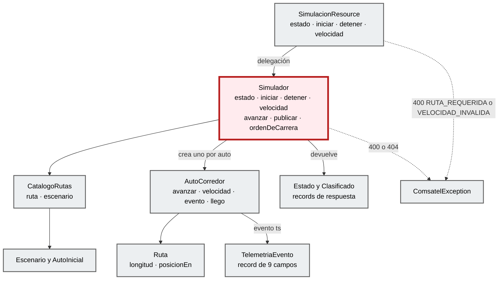
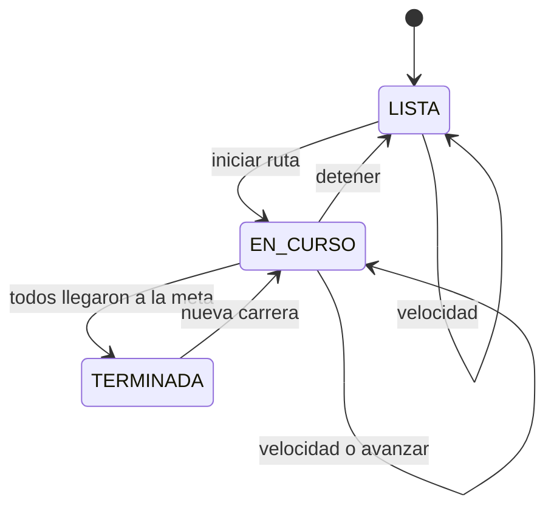

# Código (C4 nivel 4)

**Componente:** `simulacion` · **Foco:** la clase `Simulador` (borde dark red 700). Todo lo descrito sale del código real (`EXTRACTED`).

## Diagrama de clases del foco

## Simulador

[`Simulador.java`](../../telemetry-api/src/main/java/dev/bryan/simulacion/Simulador.java) · `@ApplicationScoped`, métodos públicos `synchronized`.

| Método | Qué hace |
|---|---|
| `estado()` | Ordena los autos con `ordenDeCarrera()` (primero los que llegaron, por tiempo; después por distancia). Antes de la primera carrera devuelve los autos del escenario en la salida. |
| `iniciar(idRuta)` | `catalogo.ruta(id)` (404 si no existe), cancela el temporizador previo, crea un `AutoCorredor` por auto con la velocidad elegida, publica la posición de salida y programa `vertx.setPeriodic(intervaloMs, avanzar)`. Estado `EN_CURSO`. |
| `detener()` | Si está `EN_CURSO`, cancela el temporizador y vuelve a `LISTA`. Los autos quedan donde están. |
| `velocidad(carId, kmh)` | Valida el rango 10–500 (400 `VELOCIDAD_INVALIDA`) y que el auto exista en el escenario (404 `AUTO_NO_ENCONTRADO`). Guarda la velocidad para las siguientes carreras y la aplica en caliente. |
| `avanzar()` | Cada `simulacion.intervalo-ms` (1000): avanza a los que siguen en pista, publica sus eventos (incluido el `engine=OFF` de quien acaba de llegar) y pasa a `TERMINADA` cuando llegan todos. |
| `publicar(lista)` | `Emitter<Record<String,String>>` en el canal `telemetria-out`: key `carId`, valor `TelemetriaEvento` en JSON. |

Estados de la carrera (RF-S5):

## Clases por feature

### simulacion
| Clase | Rol | Pruebas |
|---|---|---|
| [`SimulacionResource.java`](../../telemetry-api/src/main/java/dev/bryan/simulacion/SimulacionResource.java) | Entrada REST `/simulacion`; valida el cuerpo y delega en `Simulador`. Records `Inicio(ruta)` y `Velocidad(kmh)`. | `SimulacionResourceTest` |
| [`RutasResource.java`](../../telemetry-api/src/main/java/dev/bryan/simulacion/RutasResource.java) | Entrada REST `/rutas` y `/rutas/{id}` (`application/geo+json`). | `SimulacionResourceTest` |
| [`CatalogoRutas.java`](../../telemetry-api/src/main/java/dev/bryan/simulacion/CatalogoRutas.java) | Lee `rutas/indice.json`, `rutas/<id>.geojson` y `escenarios/<nombre>.json` del classpath; valida el nombre con `[a-z0-9-]{1,40}`. | `SimulacionResourceTest` |
| [`AutoCorredor.java`](../../telemetry-api/src/main/java/dev/bryan/simulacion/AutoCorredor.java) | Avance a velocidad constante e interpolación del instante de llegada; genera el `TelemetriaEvento`. | `AutoCorredorTest` |
| [`Ruta.java`](../../telemetry-api/src/main/java/dev/bryan/simulacion/Ruta.java) | Distancias acumuladas de la polilínea; `posicionEn(m)` devuelve lat, lon y rumbo del tramo. | `RutaTest` |
| [`Escenario.java`](../../telemetry-api/src/main/java/dev/bryan/simulacion/Escenario.java) · [`TelemetriaEvento.java`](../../telemetry-api/src/main/java/dev/bryan/simulacion/TelemetriaEvento.java) | Escenario de autos y copia propia del contrato del evento (spec §4). | — |

### flink
| Clase | Rol | Pruebas |
|---|---|---|
| [`FlinkJobRunner.java`](../../telemetry-api/src/main/java/dev/bryan/flink/FlinkJobRunner.java) | En `StartupEvent` crea el MiniCluster con UI, `pipeline.classpaths` y `parent-first`, reinicio `exponential-delay` y heartbeat de 3 min; `executeAsync`. Lo cancela en `ShutdownEvent`. | — |
| [`UltimaPosicionJob.java`](../../telemetry-api/src/main/java/dev/bryan/flink/UltimaPosicionJob.java) | `KafkaSource` (`latest`, auto-commit 100 ms) → `keyBy(carId)` → función → `KafkaSink` at-least-once. | `UltimaPosicionJobTest` |
| [`UltimaPosicionFunction.java`](../../telemetry-api/src/main/java/dev/bryan/flink/UltimaPosicionFunction.java) | `KeyedProcessFunction` con `ValueState<Long>`; emite solo si el `ts` es mayor (RF-F3). | `UltimaPosicionJobTest` |
| [`PosicionJson.java`](../../telemetry-api/src/main/java/dev/bryan/flink/PosicionJson.java) · [`Posicion.java`](../../telemetry-api/src/main/java/dev/bryan/flink/Posicion.java) | (De)serialización JSON propia (descarta mensajes inválidos) y record del evento. | `PosicionJsonTest` |

### autos
| Clase | Rol | Pruebas |
|---|---|---|
| [`AutosConsumer.java`](../../telemetry-api/src/main/java/dev/bryan/autos/AutosConsumer.java) | `@Incoming("ultima-posicion")`, `@NonBlocking`, lotes `List<Auto>` → `store.actualizar`. | — |
| [`ReconstruirEstadoListener.java`](../../telemetry-api/src/main/java/dev/bryan/autos/ReconstruirEstadoListener.java) | `seekToBeginning` al asignar particiones para reconstruir el estado (RF-Q5). | — |
| [`AutosStore.java`](../../telemetry-api/src/main/java/dev/bryan/autos/AutosStore.java) | `ConcurrentHashMap` por `carId` (reemplaza solo si `ts` es mayor) y set de "sucios" que drena el broadcaster. | `AutosStoreTest` |
| [`AutosResource.java`](../../telemetry-api/src/main/java/dev/bryan/autos/AutosResource.java) · [`Bbox.java`](../../telemetry-api/src/main/java/dev/bryan/autos/Bbox.java) | `GET /autos` con filtro opcional `bbox` (400 `INVALID_BBOX`). | `AutosResourceTest`, `BboxTest` |
| [`AutosBroadcaster.java`](../../telemetry-api/src/main/java/dev/bryan/autos/AutosBroadcaster.java) · [`AutosWs.java`](../../telemetry-api/src/main/java/dev/bryan/autos/AutosWs.java) | Temporizador Vert.x de 500 ms que envía un único arreglo a todas las conexiones de `/ws/autos`. | `AutosWsTest` |
| [`Auto.java`](../../telemetry-api/src/main/java/dev/bryan/autos/Auto.java) · [`AutoDeserializer.java`](../../telemetry-api/src/main/java/dev/bryan/autos/AutoDeserializer.java) | Record del evento y deserializador del consumidor. | `AutoDeserializerTest` |

### shared/error
| Clase | Rol |
|---|---|
| [`GlobalExceptionMapper.java`](../../telemetry-api/src/main/java/dev/bryan/shared/error/GlobalExceptionMapper.java) | `@ServerExceptionMapper` para `ComsatelException` (status y código propios), `WebApplicationException` (`HTTP_<status>`) y `Throwable` (500 `INTERNAL_ERROR`). |
| [`ErrorResponse.java`](../../telemetry-api/src/main/java/dev/bryan/shared/error/ErrorResponse.java) · [`ComsatelException.java`](../../telemetry-api/src/main/java/dev/bryan/shared/error/ComsatelException.java) | Contrato `timestamp, status, code, message, path, requestId` y excepción de negocio. |

### dashboard (`features/autos`)
| Módulo | Rol |
|---|---|
| [`autos-map.tsx`](../../dashboard-next/features/autos/components/autos-map.tsx) | `fusionar` (acepta un evento solo si su `ts` es mayor), `animar` (rAF mientras haya movimiento), sondeo de `/simulacion`, `ejecutar` de acciones con manejo de error. |
| [`api.ts`](../../dashboard-next/features/autos/api.ts) | `obtenerAutos`, `listarRutas`, `obtenerRuta`, `obtenerSimulacion`, `iniciarCarrera`, `detenerCarrera`, `cambiarVelocidad`. |
| [`use-autos-socket.ts`](../../dashboard-next/features/autos/hooks/use-autos-socket.ts) | Estados `conectando`, `abierta` y `reconectando`; backoff 1 s → 10 s. |
| [`animacion.ts`](../../dashboard-next/features/autos/animacion.ts) · [`metricas.ts`](../../dashboard-next/features/autos/metricas.ts) | `Animador` (posiciones interpoladas) y `Metricas` (lotes/s, edad del último dato, latencia p95). |
| [`carrera-panel.tsx`](../../dashboard-next/features/autos/components/carrera-panel.tsx) | UI del panel con componentes shadcn (Base UI `Select` y `Slider`). |

## Traceability

- sources: archivos enlazados en las tablas
- related_artifacts: [component.md](component.md), [sequence-e2e.md](sequence-e2e.md)
- assumptions: ninguna
