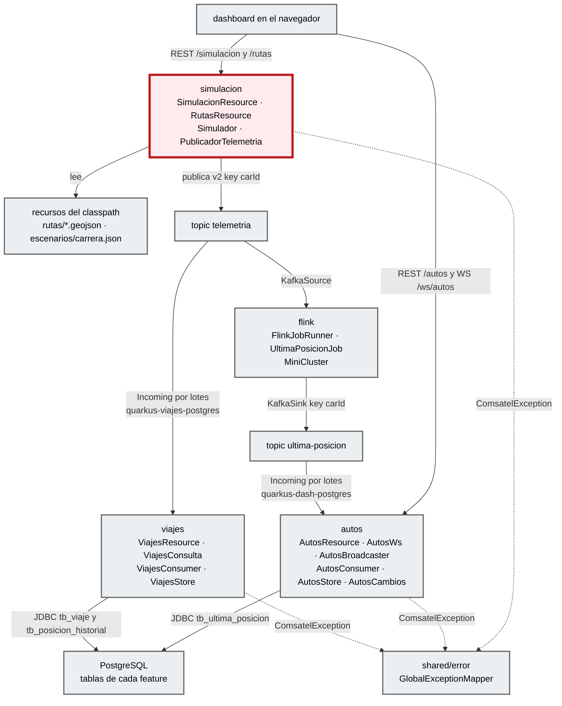
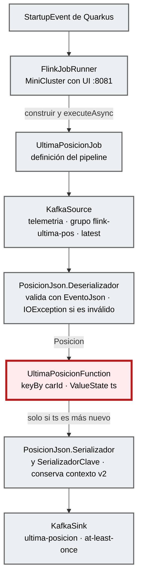
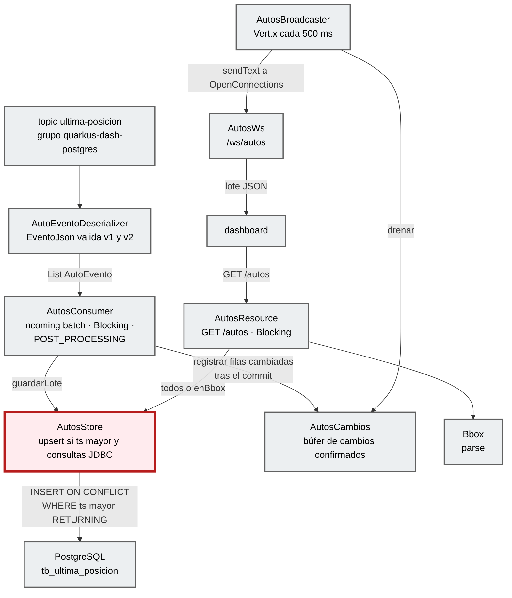
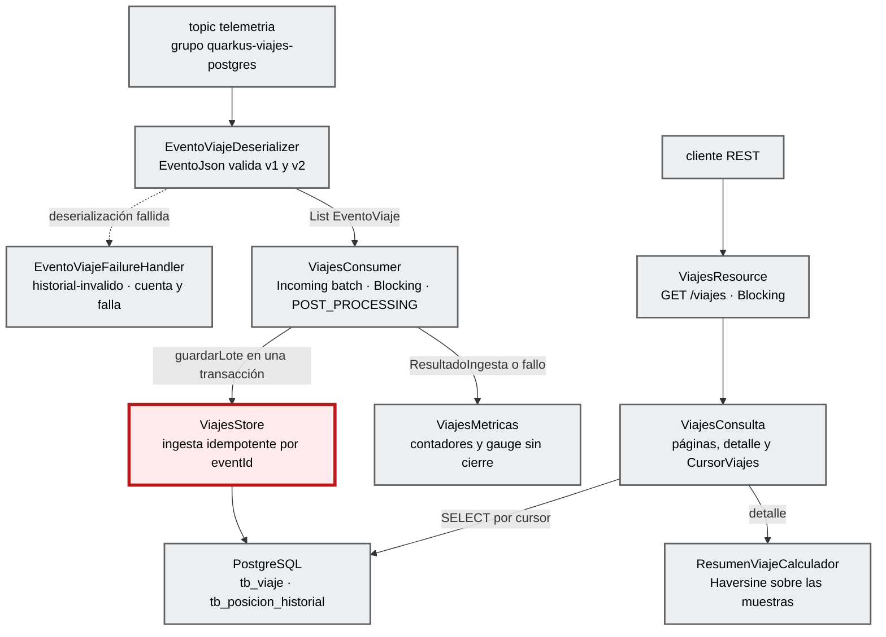
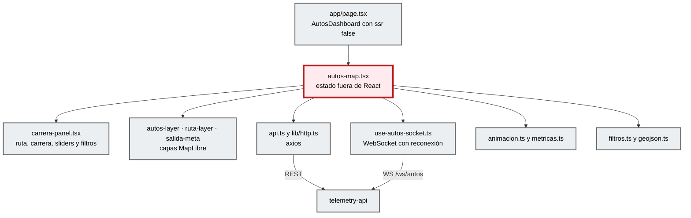

# Componentes (C4 nivel 3)

**Contenedor:** `telemetry-api` · **Foco:** la feature `simulacion` (borde dark red 700).

**Arquitectura descubierta:** *por features* (`STD-ARCH-001`, modular). No hay capas Hexagonal ni Clean: cada feature agrupa su entrada (Resource, WebSocket o `@Incoming`), su lógica y su salida (Kafka o PostgreSQL). Las features solo se comunican por los topics, aunque compartan JVM, y cada una tiene su propio record del evento y su propia validación (`EventoJson` en `autos`, `flink` y `viajes`). En PostgreSQL cada feature es dueña de sus tablas ([`ADR-004`](../../knowledge/adrs/ADR-004-persistencia-postgresql-jdbc.md)).

| Capa del perfil C4 | Equivalente real en este código |
|---|---|
| REST API / Controller | `*Resource` (JAX-RS), `AutosWs` (websockets-next), `AutosConsumer` y `ViajesConsumer` (`@Incoming`) |
| Application / Use case | `Simulador`, `AutosBroadcaster`, `FlinkJobRunner`, `ViajesConsulta` |
| Domain | `AutoCorredor`, `Ruta`, `Escenario`, `UltimaPosicionFunction`, `ResumenViajeCalculador`, `EstadoViaje` |
| Port / Adapter | No hay interfaces de puerto. Los adaptadores son el `Emitter` de SmallRye (`PublicadorTelemetria`), `KafkaSource`/`KafkaSink` de Flink, los recursos del classpath (`CatalogoRutas`) y el acceso JDBC directo sobre el `DataSource` de Agroal (`AutosStore`, `ViajesStore`, `ViajesConsulta`), sin ORM. |

## Vista general por features

| Componente | Responsabilidad | Entradas | Salidas |
|---|---|---|---|
| **simulacion** (foco) | Carrera de 3 autos de la salida a la meta, velocidad por auto, clasificación. Asigna `carreraId` por carrera y `viajeId` por auto, y publica `INICIO`, `POSICION` y `FIN` (`META`, `DETENIDO` o `REEMPLAZADO`). | `GET/POST/PUT /simulacion…`, `GET /rutas…`, temporizador Vert.x | Topic `telemetria` (contrato v2) |
| flink | Job `telemetria` → última posición por auto → `ultima-posicion`, dentro de un MiniCluster embebido. Conserva el contexto v2 del evento. | Topic `telemetria` | Topic `ultima-posicion` |
| autos | Proyección persistente de la última posición (`tb_ultima_posicion`); `GET /autos` consulta PostgreSQL y los cambios confirmados salen por WebSocket cada 500 ms. | Topic `ultima-posicion`, `GET /autos`, `WS /ws/autos` | PostgreSQL, JSON REST y WebSocket |
| viajes | Historial de viajes y muestras (`tb_viaje`, `tb_posicion_historial`) leído directamente de `telemetria`, con ingesta idempotente por `eventId`; consultas paginadas y resumen del viaje. | Topic `telemetria`, `GET /viajes…` | PostgreSQL, JSON REST, métricas |
| shared/error | Convierte excepciones en `ErrorResponse` con `requestId`, sin stack traces ni detalles de BD (`STD-ERR-001`). | `ComsatelException`, `WebApplicationException`, `Throwable` | JSON de error |

## Detalle: simulacion

**Foco:** `Simulador`. `RelojEventos` garantiza un `ts` estrictamente creciente por auto; `PublicadorTelemetria` serializa una sola vez, encadena los envíos de cada auto para conservar su orden, observa la confirmación de Kafka y registra los fallos con `eventId` y `viajeId`.

```mermaid
flowchart TB
  web["dashboard"]
  sres["SimulacionResource<br/>/simulacion"]
  rres["RutasResource<br/>/rutas"]
  sim["Simulador<br/>estado de la carrera, carreraId<br/>e INICIO, POSICION y FIN"]
  cat["CatalogoRutas<br/>índice, GeoJSON y escenario"]
  corr["AutoCorredor x3<br/>avance, llegada y viajeId"]
  ruta["Ruta<br/>polilínea y distancias"]
  reloj["RelojEventos<br/>ts estrictamente creciente por auto"]
  timer["Vert.x setPeriodic<br/>simulacion.intervalo-ms"]
  pub["PublicadorTelemetria<br/>orden por auto y confirmación"]
  emit["Emitter telemetria-out<br/>topic telemetria"]
  web --> sres
  web --> rres
  sres --> sim
  rres --> cat
  sim --> cat
  sim --> corr
  sim -->|"siguiente(carId)"| reloj
  corr --> ruta
  timer -->|"avanzar"| sim
  sim -->|"TelemetriaEvento v2"| pub
  pub -->|"Record key carId, JSON"| emit
  classDef other fill:#ECEFF1,stroke:#616161,stroke-width:2px,color:#000
  classDef focus fill:#FFEBEE,stroke:#B71C1C,stroke-width:4px,color:#000
  class web,sres,rres,cat,corr,ruta,reloj,timer,pub,emit other
  class sim focus
```

## Detalle: flink

**Foco:** `UltimaPosicionFunction`. El `KafkaSource` arranca en `OffsetsInitializer.latest()` y sin checkpoints (spec de persistencia §8): persistir la última posición no cambia esa limitación. Un mensaje inválido hace que `PosicionJson.Deserializador` lance `IOException`; el job falla y se reinicia con `exponential-delay` en vez de descartarlo.

## Detalle: autos

**Foco:** `AutosStore`. Ya no hay estado de posiciones en memoria: `GET /autos` lee PostgreSQL. El consumidor del grupo `quarkus-dash-postgres` es `@Blocking` (JDBC fuera del event loop), recibe lotes `List<AutoEvento>`, consolida por auto y hace un upsert condicional (`ON CONFLICT … WHERE excluded.ts > tb_ultima_posicion.ts`). Solo las filas que de verdad cambiaron (`RETURNING`) pasan a `AutosCambios` después del commit; un fallo revierte el lote, incrementa `autos_persistencia_fallos_total` y detiene el canal (`failure-strategy=fail`). La primera vez el grupo lee desde `earliest`; después retoma sus offsets confirmados, sin `seekToBeginning`.

| Componente | Responsabilidad | Evidencia |
|---|---|---|
| **AutosStore** (foco) | `guardarLote` en una transacción (consolida por `carId`, upsert condicional, devuelve las filas cambiadas); `todos()` y `enBbox(bbox)` con `SELECT … ORDER BY car_id` y límites inclusivos. | `EXTRACTED` |
| AutosConsumer | `@Incoming("ultima-posicion")`, `@Blocking`, ack `POST_PROCESSING`; registra en `AutosCambios` solo lo que devolvió el commit. | `EXTRACTED` |
| AutosCambios | Búfer temporal por `carId` (se queda con el `ts` mayor) que `AutosBroadcaster` drena cada 500 ms. No es fuente de consulta. | `EXTRACTED` |
| AutoEvento · AutoEventoDeserializer · EventoJson | Record con contexto v2 opcional y validación local del contrato; un evento inválido lanza `SerializationException` y el canal falla. El JSON público sigue siendo `Auto` (9 campos). | `EXTRACTED` |

## Detalle: viajes

**Foco:** `ViajesStore`. El grupo `quarkus-viajes-postgres` lee `telemetria` directamente para conservar también las muestras atrasadas que Flink descarta. Cada lote se guarda en una transacción: crea el viaje si no existe (aunque llegue antes una posición o el cierre), bloquea su fila (`FOR UPDATE`), inserta la muestra con `ON CONFLICT(event_id) DO NOTHING` y actualiza `ultimo_ts`, `fin_ts`, `estado` y `motivo_fin`. Un `eventId` repetido con el mismo contenido cuenta como duplicado; con contenido distinto, o con identidad, intervalo o cierre contradictorios, es un conflicto que revierte el lote. Los eventos legados (sin `schemaVersion` o v1) se cuentan y no crean viajes.

| Componente | Responsabilidad | Evidencia |
|---|---|---|
| **ViajesStore** (foco) | Ingesta idempotente y transaccional; `sinCierre()` para el gauge. Los mensajes de conflicto solo llevan `eventId` y `viajeId`. | `EXTRACTED` |
| ViajesConsumer | `@Incoming("historial-telemetria")`, `@Blocking`, ack `POST_PROCESSING`; registra el `ResultadoIngesta` y, ante un fallo, cuenta inválidos o fallos de persistencia y relanza. | `EXTRACTED` |
| EventoViajeDeserializer · EventoViajeFailureHandler | Validación del contrato con `EventoJson`; el handler `historial-invalido` incrementa `viajes_eventos_invalidos_total` y vuelve a lanzar, así el canal falla en vez de ignorar el mensaje. | `EXTRACTED` |
| ViajesResource · ViajesConsulta · CursorViajes | `GET /viajes`, `/viajes/{viajeId}` y `/viajes/{viajeId}/posiciones`; `limit` 1–1000 (100 por defecto), intervalo `[desde, hasta)` y cursor opaco Base64 ligado a tipo, filtros y `limit`. | `EXTRACTED` |
| ResumenViajeCalculador | Resumen sobre todas las muestras (orden `ts, event_id`): cantidad, duración observada y del viaje, distancia Haversine, velocidad media y mayor intervalo. Usa una sola muestra por `ts`. | `EXTRACTED` |
| ViajesMetricas | `viajes_eventos_{insertados,duplicados,legados,invalidos}_total`, `viajes_persistencia_fallos_total` y gauge `viajes_sin_cierre`. | `EXTRACTED` |

## Detalle: dashboard (contenedor `dashboard`)

**Foco:** `autos-map.tsx`. La feature `features/autos` expone solo `AutosDashboard` y el tipo `Auto` por `index.ts`. El dashboard no cambió con la persistencia: sigue usando `GET /autos` y `WS /ws/autos`, cuyo JSON público conserva los 9 campos.

| Componente | Responsabilidad | Evidencia |
|---|---|---|
| **autos-map.tsx** (foco) | Orquesta la carga inicial (autos, rutas y estado), el sondeo de la carrera (1 s en curso, 5 s en reposo), "Seguir al líder" y las acciones del panel. Guarda los autos en un `useRef` y repinta con `requestAnimationFrame`. | `EXTRACTED` |
| carrera-panel.tsx | Selector de ruta, botones de carrera, clasificación con sliders (10–500 km/h), filtro empresa → flota, métricas y selector de tema. | `EXTRACTED` |
| autos-layer, ruta-layer, salida-meta | Fuente GeoJSON con capa `symbol` de íconos filtrada con `setFilter`; línea de la ruta; marcadores de Salida y Meta. | `EXTRACTED` |
| api.ts, lib/http.ts | Llamadas REST con axios (`baseURL` = `NEXT_PUBLIC_API_URL`, timeout 15 s). | `EXTRACTED` |
| use-autos-socket.ts | WebSocket nativo con reconexión exponencial y estado de conexión. | `EXTRACTED` |
| animacion.ts, metricas.ts | Interpolación del movimiento entre eventos; edad del último dato y latencia p95. | `EXTRACTED` |
| filtros.ts, geojson.ts | Opciones y expresión de filtro de MapLibre; conversión de autos a `FeatureCollection`. | `EXTRACTED` |

## Traceability

- sources: código de `telemetry-api/src/main/java/dev/bryan/**` y `dashboard-next/features/autos/**`; `application.properties`; `V1__posiciones_y_viajes.sql`; `STD-ARCH-001`; `ADR-004`; spec §7–§10; spec de persistencia §3–§8
- related_artifacts: [container.md](container.md), [code.md](code.md)
- assumptions: la equivalencia de capas de la tabla es una lectura del código (`INFERRED`), no una decisión documentada
