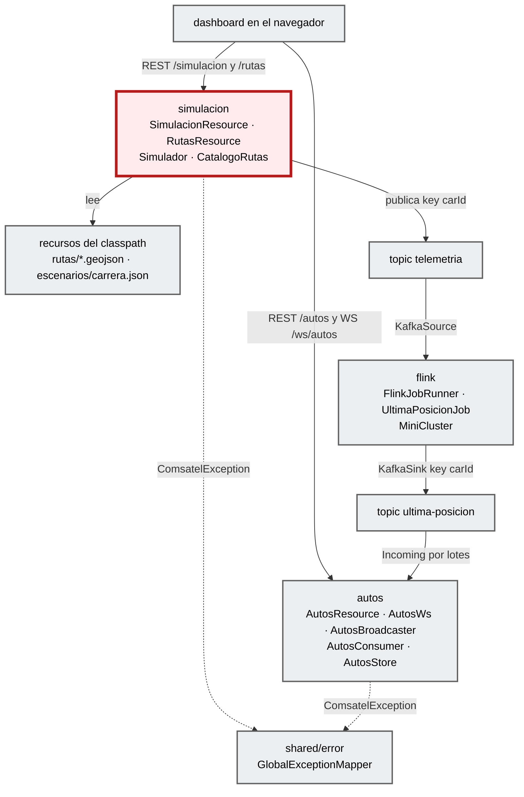
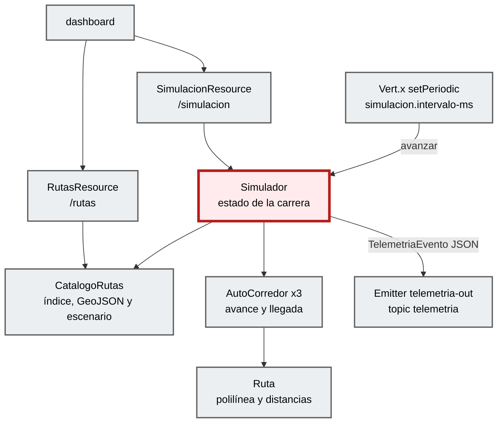
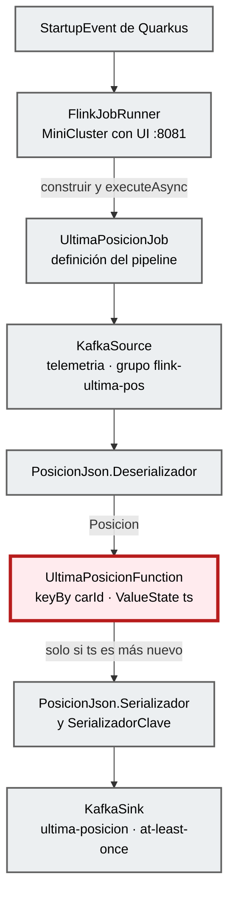
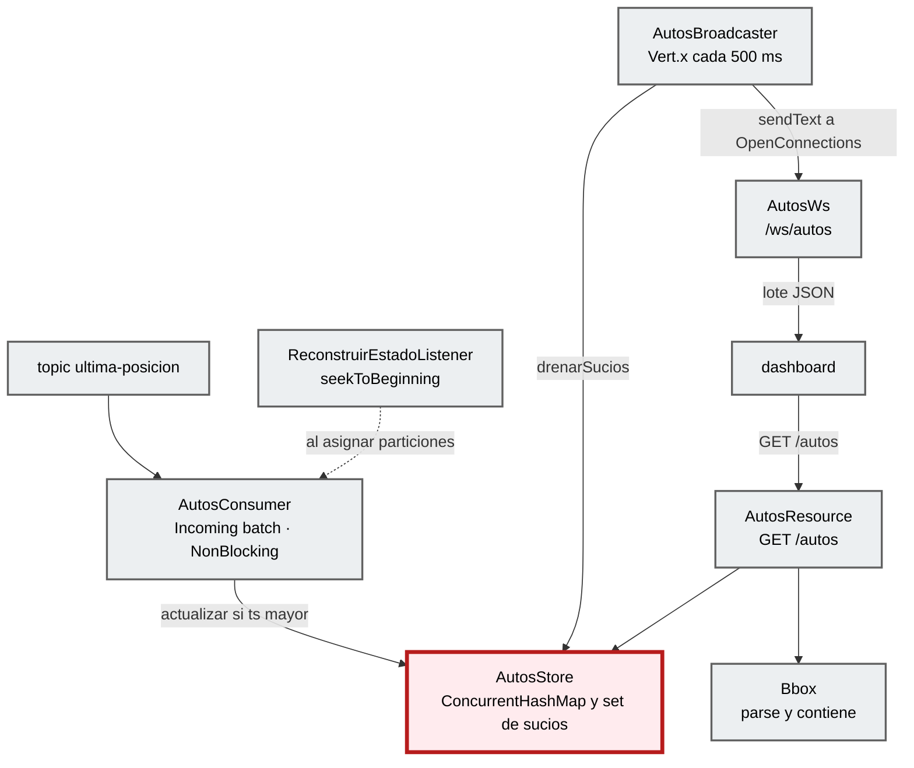
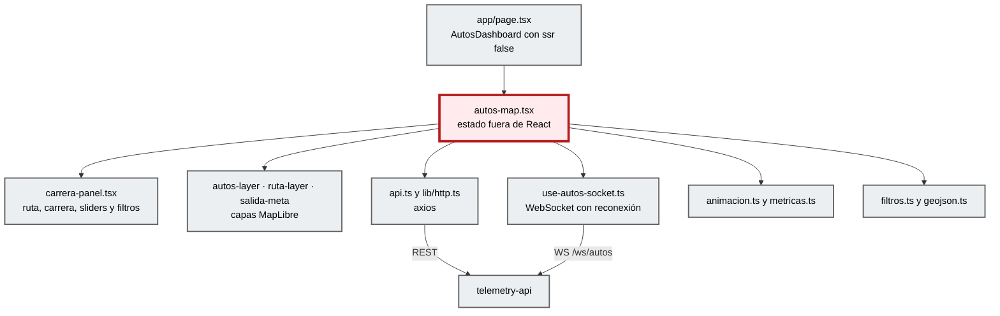

# Componentes (C4 nivel 3)

**Contenedor:** `telemetry-api` · **Foco:** la feature `simulacion` (borde dark red 700).

**Arquitectura descubierta:** *por features* (`STD-ARCH-001`, modular). No hay capas Hexagonal ni Clean: cada feature agrupa su entrada (Resource, WebSocket o `@Incoming`), su lógica y su salida (Kafka). Las features solo se comunican por los topics, aunque compartan JVM.

| Capa del perfil C4 | Equivalente real en este código |
|---|---|
| REST API / Controller | `*Resource` (JAX-RS), `AutosWs` (websockets-next), `AutosConsumer` (`@Incoming`) |
| Application / Use case | `Simulador`, `AutosBroadcaster`, `FlinkJobRunner` |
| Domain | `AutoCorredor`, `Ruta`, `Escenario`, `UltimaPosicionFunction`, `AutosStore` |
| Port / Adapter | No hay interfaces de puerto. Los adaptadores son el `Emitter` de SmallRye, `KafkaSource`/`KafkaSink` de Flink y los recursos del classpath (`CatalogoRutas`). |

## Vista general por features

| Componente | Responsabilidad | Entradas | Salidas |
|---|---|---|---|
| **simulacion** (foco) | Carrera de 3 autos de la salida a la meta, velocidad por auto, clasificación. | `GET/POST/PUT /simulacion…`, `GET /rutas…`, temporizador Vert.x | Topic `telemetria` |
| flink | Job `telemetria` → última posición por auto → `ultima-posicion`, dentro de un MiniCluster embebido. | Topic `telemetria` | Topic `ultima-posicion` |
| autos | Estado en memoria de la última posición; `GET /autos` y lotes por WebSocket cada 500 ms. | Topic `ultima-posicion`, `GET /autos`, `WS /ws/autos` | JSON REST y WebSocket |
| shared/error | Convierte excepciones en `ErrorResponse` con `requestId`, sin stack traces (`STD-ERR-001`). | `ComsatelException`, `WebApplicationException`, `Throwable` | JSON de error |

## Detalle: simulacion

**Foco:** `Simulador`.

## Detalle: flink

**Foco:** `UltimaPosicionFunction`.

## Detalle: autos

**Foco:** `AutosStore`.

## Detalle: dashboard (contenedor `dashboard`)

**Foco:** `autos-map.tsx`. La feature `features/autos` expone solo `AutosDashboard` y el tipo `Auto` por `index.ts`.

| Componente | Responsabilidad | Evidencia |
|---|---|---|
| **autos-map.tsx** (foco) | Orquesta la carga inicial (autos, rutas y estado), el sondeo de la carrera (1 s en curso, 5 s en reposo), "Seguir al líder" y las acciones del panel. Guarda los autos en un `useRef` y repinta con `requestAnimationFrame`. | `EXTRACTED` |
| carrera-panel.tsx | Selector de ruta, botones de carrera, clasificación con sliders (10–500 km/h), filtro empresa → flota, métricas y selector de tema. | `EXTRACTED` |
| autos-layer, ruta-layer, salida-meta | Fuente GeoJSON con capa `symbol` de íconos filtrada con `setFilter`; línea de la ruta; marcadores de Salida y Meta. | `EXTRACTED` |
| api.ts, lib/http.ts | Llamadas REST con axios (`baseURL` = `NEXT_PUBLIC_API_URL`, timeout 15 s). | `EXTRACTED` |
| use-autos-socket.ts | WebSocket nativo con reconexión exponencial y estado de conexión. | `EXTRACTED` |
| animacion.ts, metricas.ts | Interpolación del movimiento entre eventos; edad del último dato y latencia p95. | `EXTRACTED` |
| filtros.ts, geojson.ts | Opciones y expresión de filtro de MapLibre; conversión de autos a `FeatureCollection`. | `EXTRACTED` |

## Traceability

- sources: código de `telemetry-api/src/main/java/dev/bryan/**` y `dashboard-next/features/autos/**`; `STD-ARCH-001`; spec §7–§10
- related_artifacts: [container.md](container.md), [code.md](code.md)
- assumptions: la equivalencia de capas de la tabla es una lectura del código (`INFERRED`), no una decisión documentada
