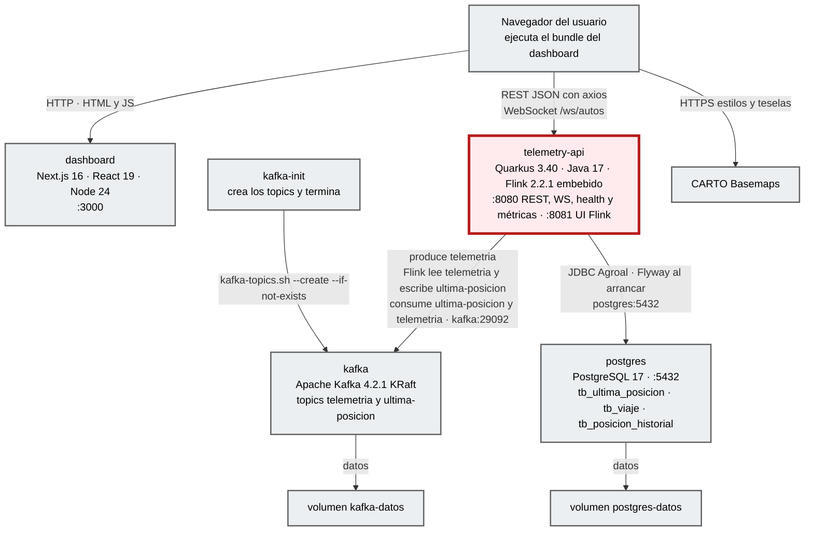

# Contenedores (C4 nivel 2)

**Sistema:** Sistema de telemetría de carreras · **Foco:** `telemetry-api` (borde dark red 700), el contenedor que concentra la simulación, el procesamiento en streaming, la persistencia en PostgreSQL y la entrega en tiempo real.

## Diagrama

## Contenedores

| Contenedor | Tecnología | Responsabilidad | Puertos | Evidencia |
|---|---|---|---|---|
| **telemetry-api** (foco) | Quarkus 3.40.1 LTS, Java 17, Flink 2.2.1 en MiniCluster, SmallRye Reactive Messaging, websockets-next, JDBC con Agroal (`quarkus-jdbc-postgresql`, sin ORM), Flyway, SmallRye Health, Micrometer con Prometheus | Simula la carrera y publica en `telemetria`; el job Flink deja la última posición por auto en `ultima-posicion`; la feature `autos` consume ese topic y lo persiste en `tb_ultima_posicion`; la feature `viajes` consume `telemetria` y guarda el historial en `tb_viaje` y `tb_posicion_historial`. Sirve REST y WebSocket. | 8080 (REST, WS, `/q/health`, `/q/metrics`), 8081 (UI de Flink) | [`telemetry-api/Dockerfile`](../../telemetry-api/Dockerfile), `docker-compose.yml`, [`pom.xml`](../../telemetry-api/pom.xml) · `EXTRACTED` |
| dashboard | Next.js 16.4 (salida `standalone`), React 19, shadcn/ui, mapcn (MapLibre), axios | Sirve la aplicación web. En el navegador: mapa, panel de carrera, filtros y tema. No consume la API de viajes. | 3000 | [`dashboard-next/Dockerfile`](../../dashboard-next/Dockerfile) · `EXTRACTED` |
| kafka | `apache/kafka:4.2.1`, un broker KRaft | Transporte de eventos: `telemetria` (12 particiones, retención 1 h) y `ultima-posicion` (12 particiones, compact), key `carId`. | 9092 (host), 29092 (red interna) | `docker-compose.yml`, spec §6 · `EXTRACTED` |
| kafka-init | `apache/kafka:4.2.1` | Crea los topics de forma idempotente y termina (`Exited (0)`). | — | `docker-compose.yml` · `EXTRACTED` |
| postgres | `postgres:17` | Fuente de consulta persistente: última posición por auto (`tb_ultima_posicion`), viajes (`tb_viaje`) e historial de muestras (`tb_posicion_historial`). El esquema lo crea Flyway desde la API ([`V1__posiciones_y_viajes.sql`](../../telemetry-api/src/main/resources/db/migration/V1__posiciones_y_viajes.sql)). Credenciales `POSTGRES_DB`, `POSTGRES_USER` y `POSTGRES_PASSWORD` por `.env`. Healthcheck `pg_isready`. | 5432 | `docker-compose.yml`, [`ADR-004`](../../knowledge/adrs/ADR-004-persistencia-postgresql-jdbc.md) · `EXTRACTED` |
| volumen `kafka-datos` | Volumen Docker | Persiste los logs de Kafka entre `down` y `up`. | — | `docker-compose.yml` · `EXTRACTED` |
| volumen `postgres-datos` | Volumen Docker | Persiste los datos de PostgreSQL entre `down` y `up`; borrarlo (`down -v`) borra posiciones e historial. | — | `docker-compose.yml`, spec de persistencia §8 · `EXTRACTED` |

> El navegador llama a la API directamente (no hay BFF): las URL `NEXT_PUBLIC_API_URL` y `NEXT_PUBLIC_WS_URL` se incrustan al construir el dashboard y apuntan al puerto publicado `localhost:8080`.

## Relaciones runtime

| Origen → destino | Protocolo y contrato | Notas |
|---|---|---|
| Navegador → telemetry-api | REST JSON (`/rutas`, `/simulacion`, `/autos`), timeout de axios 15 s | CORS limitado a `http://localhost:3000`. Errores según `STD-ERR-001`. `/viajes…` existe en la API pero el dashboard no lo usa. |
| Navegador → telemetry-api | WebSocket `/ws/autos`, lote JSON cada 500 ms | Solo cambios ya confirmados en PostgreSQL. Reconexión con backoff 1 s → 10 s (`use-autos-socket.ts`). |
| telemetry-api → kafka | Kafka, JSON con contrato v2 (spec de persistencia §4: los 9 campos de posición más `schemaVersion`, `eventId`, `carreraId`, `viajeId`, `rutaId`, `inicioViajeTs`, `tipoEvento`, `motivoFin`), key `carId` | Productor de la simulación (`telemetria-out`); `KafkaSource`/`KafkaSink` de Flink (grupo `flink-ultima-pos`); consumidor `quarkus-dash-postgres` sobre `ultima-posicion`; consumidor `quarkus-viajes-postgres` sobre `telemetria`. Los consumidores de la API leen por lotes, sin auto-commit, y confirman offsets después del commit JDBC. Los eventos legados (sin `schemaVersion` o con versión 1) se aceptan. |
| telemetry-api → postgres | JDBC (pool Agroal), `jdbc:postgresql://postgres:5432/${POSTGRES_DB}` | Flyway migra al arrancar (`migrate-at-start`, `clean` deshabilitado). La readiness `/q/health/ready` incluye el datasource y los canales Kafka. |
| kafka-init → kafka | `kafka-topics.sh` | Se ejecuta antes de que arranque la API (`service_completed_successfully`). |

## Despliegue

`docker compose up -d --build` (con un `.env` basado en `.env.example`): `postgres` (healthy) y `kafka` (healthy) → `kafka-init` (exit 0) → `telemetry-api` (healthy, `GET /q/health/ready`) → `dashboard`. Todos con `restart: unless-stopped`, salvo `kafka-init`.

## Traceability

- sources: `docker-compose.yml`, `.env.example`, Dockerfiles, `pom.xml`, `application.properties`, `V1__posiciones_y_viajes.sql`, spec §3, §6, §9, §12; spec de persistencia §3, §5, §8; `ADR-004`
- related_artifacts: [context.md](context.md), [component.md](component.md)
- assumptions: ninguna
