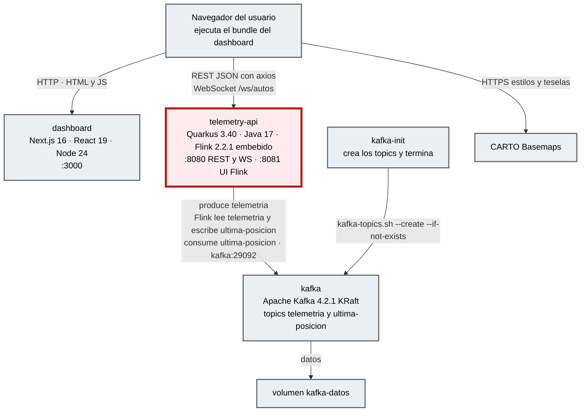

# Contenedores (C4 nivel 2)

**Sistema:** Sistema de telemetría de carreras · **Foco:** `telemetry-api` (borde dark red 700), el contenedor que concentra la simulación, el procesamiento en streaming y la entrega en tiempo real.

## Diagrama

## Contenedores

| Contenedor | Tecnología | Responsabilidad | Puertos | Evidencia |
|---|---|---|---|---|
| **telemetry-api** (foco) | Quarkus 3.40.1 LTS, Java 17, Flink 2.2.1 en MiniCluster, SmallRye Reactive Messaging, websockets-next | Simula la carrera y publica en `telemetria`; el job Flink deja la última posición por auto en `ultima-posicion`; consume ese topic y sirve REST y WebSocket. | 8080 (REST y WS), 8081 (UI de Flink) | [`telemetry-api/Dockerfile`](../../telemetry-api/Dockerfile), `docker-compose.yml` · `EXTRACTED` |
| dashboard | Next.js 16.4 (salida `standalone`), React 19, shadcn/ui, mapcn (MapLibre), axios | Sirve la aplicación web. En el navegador: mapa, panel de carrera, filtros y tema. | 3000 | [`dashboard-next/Dockerfile`](../../dashboard-next/Dockerfile) · `EXTRACTED` |
| kafka | `apache/kafka:4.2.1`, un broker KRaft | Transporte de eventos: `telemetria` (12 particiones, retención 1 h) y `ultima-posicion` (12 particiones, compact), key `carId`. | 9092 (host), 29092 (red interna) | `docker-compose.yml`, spec §6 · `EXTRACTED` |
| kafka-init | `apache/kafka:4.2.1` | Crea los topics de forma idempotente y termina (`Exited (0)`). | — | `docker-compose.yml` · `EXTRACTED` |
| volumen `kafka-datos` | Volumen Docker | Persiste los logs de Kafka entre `down` y `up`. | — | `docker-compose.yml` · `EXTRACTED` |

> El navegador llama a la API directamente (no hay BFF): las URL `NEXT_PUBLIC_API_URL` y `NEXT_PUBLIC_WS_URL` se incrustan al construir el dashboard y apuntan al puerto publicado `localhost:8080`.

## Relaciones runtime

| Origen → destino | Protocolo y contrato | Notas |
|---|---|---|
| Navegador → telemetry-api | REST JSON (`/rutas`, `/simulacion`, `/autos`), timeout de axios 15 s | CORS limitado a `http://localhost:3000`. Errores según `STD-ERR-001`. |
| Navegador → telemetry-api | WebSocket `/ws/autos`, lote JSON cada 500 ms | Reconexión con backoff 1 s → 10 s (`use-autos-socket.ts`). |
| telemetry-api → kafka | Kafka, JSON de 9 campos (spec §4), key `carId` | Productor de la simulación, `KafkaSource`/`KafkaSink` de Flink y consumidor `quarkus-dash`. |
| kafka-init → kafka | `kafka-topics.sh` | Se ejecuta antes de que arranque la API (`service_completed_successfully`). |

## Despliegue

`docker compose up -d --build`: `kafka` (healthy) → `kafka-init` (exit 0) → `telemetry-api` (healthy, `GET /rutas`) → `dashboard`. Todos con `restart: unless-stopped`, salvo `kafka-init`.

## Traceability

- sources: `docker-compose.yml`, Dockerfiles, `application.properties`, spec §3, §6, §9, §12
- related_artifacts: [context.md](context.md), [component.md](component.md)
- assumptions: ninguna
