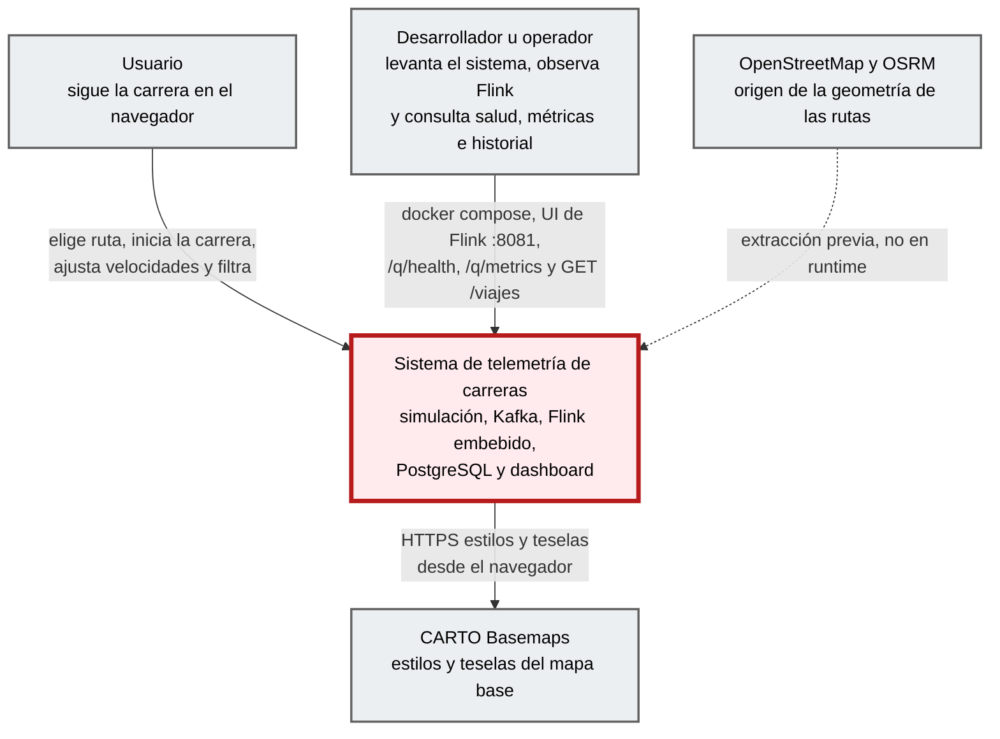

# Contexto (C4 nivel 1)

**Foco:** el sistema de telemetría de carreras (borde dark red 700).

## Diagrama

## Elementos

| Elemento | Tipo | Responsabilidad | Evidencia |
|---|---|---|---|
| Usuario | Persona | Elige una ruta establecida, inicia o detiene la carrera, mueve el slider de velocidad de cada auto, filtra por empresa y flota y elige el tema. | Spec §10 (RF-U1…RF-U12) · `EXTRACTED` |
| Desarrollador u operador | Persona | Levanta el sistema con `docker compose` (credenciales de PostgreSQL en `.env`), consulta la UI de Flink en `:8081`, la readiness `/q/health/ready`, las métricas Prometheus `/q/metrics` y el historial por REST (`GET /viajes…`). | `README.md`, `docker-compose.yml`, spec de persistencia §6 y §8 · `EXTRACTED` |
| **Sistema de telemetría de carreras** | Sistema (foco) | Simula 3 autos que corren por una ruta real, procesa su telemetría en streaming (Kafka + Flink), la muestra en un mapa en tiempo real y conserva en PostgreSQL la última posición de cada auto y el historial de sus viajes. | Spec §1, §3; spec de persistencia §1, §3 · `EXTRACTED` |
| CARTO Basemaps | Sistema externo | Sirve los estilos `dark-matter` y `positron` y las teselas del mapa base; el navegador los pide directamente. | `dashboard-next/components/ui/map.tsx` (`basemaps.cartocdn.com`) · `EXTRACTED` |
| OpenStreetMap y OSRM | Fuente externa (no runtime) | Origen de las `LineString` de las rutas, extraídas una vez y guardadas como GeoJSON en el backend. | Spec §5, `resources/rutas/*.geojson` · `EXTRACTED` |

## Límites y supuestos

- Ejecución 100 % local (RNF-4); sin autenticación ni alta disponibilidad (RNF-5). Una sola instancia de la API (spec de persistencia §8).
- PostgreSQL es un contenedor **interno** del sistema, no un sistema externo: se detalla en [container.md](container.md).
- No hay otros sistemas externos en runtime: los autos los genera la feature `simulacion` dentro del propio sistema.
- No hay pantalla de historial: los viajes se consultan solo por REST (fuera de alcance según la spec de persistencia §1).

## Traceability

- sources: spec §1, §3, §5, §11; spec de persistencia §1, §3, §6, §8; `README.md`; `docker-compose.yml`
- related_artifacts: [container.md](container.md)
- assumptions: ninguna
