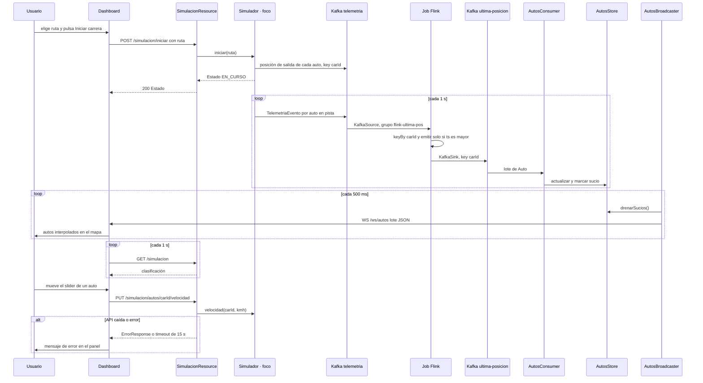
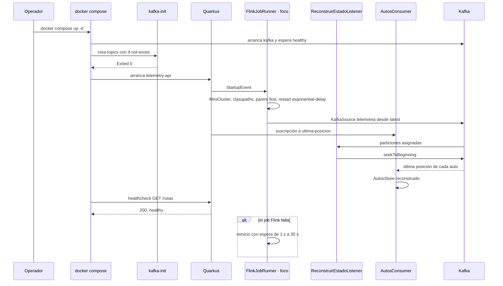

# Secuencias E2E

## Journeys críticos

### J1 · Carrera en vivo: del botón al mapa

Atraviesa todo el sistema: dashboard → REST → `Simulador` → `telemetria` → Flink → `ultima-posicion` → `AutosStore` → WebSocket → mapa. **Foco:** `Simulador` (`S`). Cubre los criterios 2, 3 y 6 de la spec §13.

### J2 · Arranque y reconstrucción del estado

**Foco:** `FlinkJobRunner` (`FR`). Cubre RF-F0 y RF-Q5 y el arranque ordenado de `docker-compose.yml`.

## API REST: una secuencia por endpoint

`REQUIRES_REVIEW`: no existe especificación OpenAPI/Swagger. Se buscaron `*.yaml` y `*.yml` en `telemetry-api/src/main/resources/**` y `telemetry-api/src/**`, sin resultados con `openapi:` o `swagger:`. Los endpoints se derivan de las anotaciones JAX-RS y websockets-next de los controllers reales (`INFERRED`).

| # | Endpoint | operationId (inferido) | Implementación | Secuencia | Diagrama |
|---|---|---|---|---|---|
| 1 | `GET /rutas` | `RutasResource.listar` | [`RutasResource.java`](../../telemetry-api/src/main/java/dev/bryan/simulacion/RutasResource.java) | [get-rutas.md](sequences/get-rutas.md) | [get-rutas.mmd](diagrams/sequences/get-rutas.mmd) |
| 2 | `GET /rutas/{id}` | `RutasResource.ruta` | [`RutasResource.java`](../../telemetry-api/src/main/java/dev/bryan/simulacion/RutasResource.java) | [get-rutas-id.md](sequences/get-rutas-id.md) | [get-rutas-id.mmd](diagrams/sequences/get-rutas-id.mmd) |
| 3 | `GET /simulacion` | `SimulacionResource.estado` | [`SimulacionResource.java`](../../telemetry-api/src/main/java/dev/bryan/simulacion/SimulacionResource.java) | [get-simulacion.md](sequences/get-simulacion.md) | [get-simulacion.mmd](diagrams/sequences/get-simulacion.mmd) |
| 4 | `POST /simulacion/iniciar` | `SimulacionResource.iniciar` | [`SimulacionResource.java`](../../telemetry-api/src/main/java/dev/bryan/simulacion/SimulacionResource.java) | [post-simulacion-iniciar.md](sequences/post-simulacion-iniciar.md) | [post-simulacion-iniciar.mmd](diagrams/sequences/post-simulacion-iniciar.mmd) |
| 5 | `POST /simulacion/detener` | `SimulacionResource.detener` | [`SimulacionResource.java`](../../telemetry-api/src/main/java/dev/bryan/simulacion/SimulacionResource.java) | [post-simulacion-detener.md](sequences/post-simulacion-detener.md) | [post-simulacion-detener.mmd](diagrams/sequences/post-simulacion-detener.mmd) |
| 6 | `PUT /simulacion/autos/{carId}/velocidad` | `SimulacionResource.velocidad` | [`SimulacionResource.java`](../../telemetry-api/src/main/java/dev/bryan/simulacion/SimulacionResource.java) | [put-simulacion-autos-carid-velocidad.md](sequences/put-simulacion-autos-carid-velocidad.md) | [put-simulacion-autos-carid-velocidad.mmd](diagrams/sequences/put-simulacion-autos-carid-velocidad.mmd) |
| 7 | `GET /autos` | `AutosResource.listar` | [`AutosResource.java`](../../telemetry-api/src/main/java/dev/bryan/autos/AutosResource.java) | [get-autos.md](sequences/get-autos.md) | [get-autos.mmd](diagrams/sequences/get-autos.mmd) |
| 8 | `WS /ws/autos` | `AutosWs y AutosBroadcaster.emitir` | [`AutosWs.java`](../../telemetry-api/src/main/java/dev/bryan/autos/AutosWs.java) | [ws-autos.md](sequences/ws-autos.md) | [ws-autos.mmd](diagrams/sequences/ws-autos.mmd) |

**Cobertura:** 7 operaciones REST encontradas en los controllers → 7 secuencias (100 %). Además hay 1 endpoint WebSocket con su secuencia.

## Traceability

- sources: controllers `RutasResource`, `SimulacionResource`, `AutosResource` y `AutosWs`; `docker-compose.yml`; spec §7–§10 y §13
- related_artifacts: [code.md](code.md), [traceability-report.md](traceability-report.md)
- assumptions: los `operationId` son `Clase.método` porque no hay especificación
