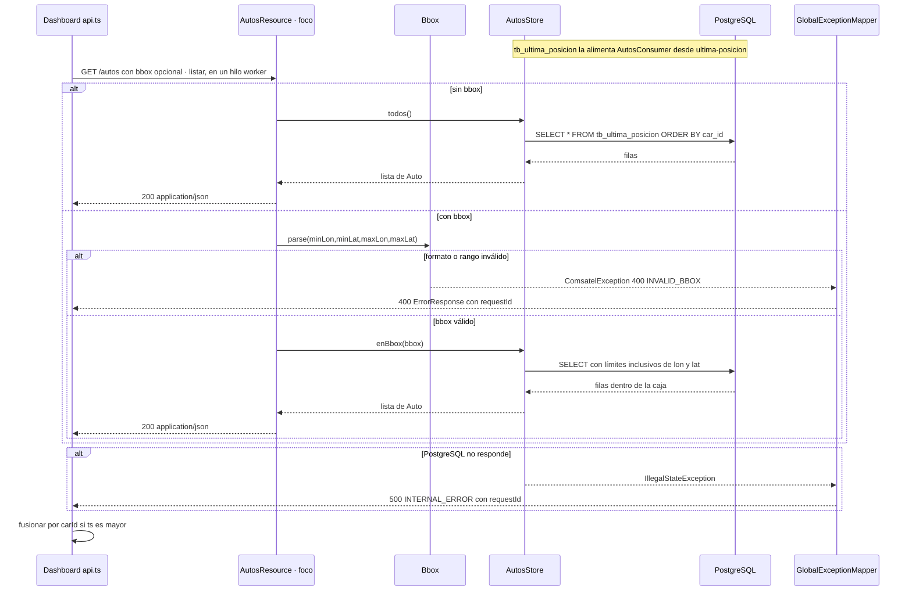

# Secuencia · `GET /autos`

| Campo | Valor |
|---|---|
| Endpoint | `GET /autos` |
| operationId | `AutosResource.listar` (`INFERRED`: no hay especificación OpenAPI) |
| Implementación | [`AutosResource.java`](../../../telemetry-api/src/main/java/dev/bryan/autos/AutosResource.java) (`@Blocking`), [`AutosStore.java`](../../../telemetry-api/src/main/java/dev/bryan/autos/AutosStore.java) |
| Cliente | `dashboard-next` · api.ts obtenerAutos, carga inicial del mapa |
| Respuestas | 200 lista de Auto (9 campos, orden `carId`) · 400 INVALID_BBOX · 500 INTERNAL_ERROR si falla PostgreSQL (sin detalles de BD) |
| Seguridad | Ninguna (RNF-5). CORS solo para `http://localhost:3000`. |
| Correlación | `requestId` generado en la respuesta de error; no se propaga un correlation ID en las respuestas 2xx ni por Kafka. |
| Criterios | RF-Q4, RF-U10, criterio 7 (ts antiguo no reemplaza); spec de persistencia §5.1 y criterios 2, 7 y 11 |
| Foco | Participante `R` (borde dark red 700) |

