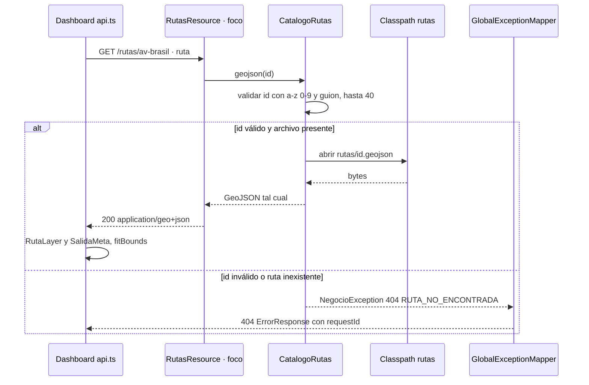

# Secuencia · `GET /rutas/{id}`

| Campo | Valor |
|---|---|
| Endpoint | `GET /rutas/{id}` |
| operationId | `RutasResource.ruta` (`INFERRED`: no hay especificación OpenAPI) |
| Implementación | [`RutasResource.java`](../../../telemetry-api/src/main/java/dev/bryan/simulacion/RutasResource.java) |
| Cliente | `dashboard-next` · api.ts obtenerRuta, al elegir una ruta |
| Respuestas | 200 application/geo+json · 404 RUTA_NO_ENCONTRADA |
| Seguridad | Ninguna (RNF-5). CORS solo para `http://localhost:3000`. |
| Correlación | `requestId` generado en la respuesta de error; no se propaga un correlation ID en las respuestas 2xx ni por Kafka. |
| Criterios | Criterio 1 (ruta dibujada con Salida y Meta), RF-U2 |
| Foco | Participante `R` (borde dark red 700) |

