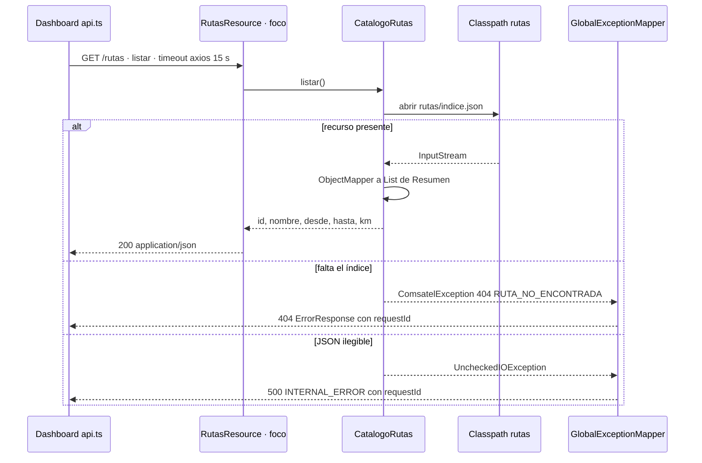

# Secuencia · `GET /rutas`

| Campo | Valor |
|---|---|
| Endpoint | `GET /rutas` |
| operationId | `RutasResource.listar` (`INFERRED`: no hay especificación OpenAPI) |
| Implementación | [`RutasResource.java`](../../../telemetry-api/src/main/java/dev/bryan/simulacion/RutasResource.java) |
| Cliente | `dashboard-next` · api.ts listarRutas, al cargar el mapa |
| Respuestas | 200 lista de rutas · 404 RUTA_NO_ENCONTRADA si falta el índice · 500 INTERNAL_ERROR |
| Seguridad | Ninguna (RNF-5). CORS solo para `http://localhost:3000`. |
| Correlación | `requestId` generado en la respuesta de error; no se propaga un correlation ID en las respuestas 2xx ni por Kafka. |
| Criterios | Criterio 1 (selector de rutas), RF-U2 |
| Foco | Participante `R` (borde dark red 700) |

