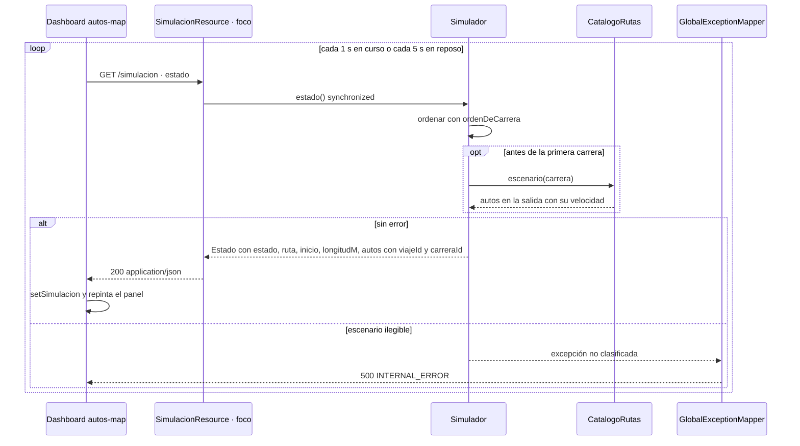

# Secuencia · `GET /simulacion`

| Campo | Valor |
|---|---|
| Endpoint | `GET /simulacion` |
| operationId | `SimulacionResource.estado` (`INFERRED`: no hay especificación OpenAPI) |
| Implementación | [`SimulacionResource.java`](../../../telemetry-api/src/main/java/dev/bryan/simulacion/SimulacionResource.java) |
| Cliente | `dashboard-next` · api.ts obtenerSimulacion, al cargar y en sondeo |
| Respuestas | 200 Estado · 500 INTERNAL_ERROR |
| Seguridad | Ninguna (RNF-5). CORS solo para `http://localhost:3000`. |
| Correlación | `requestId` generado en la respuesta de error; no se propaga un correlation ID en las respuestas 2xx ni por Kafka. |
| Criterios | Criterio 3 (clasificación en vivo), RF-S6, RF-U4; spec de persistencia §4.2 (`carreraId` y `viajeId` en la respuesta) |
| Foco | Participante `R` (borde dark red 700) |

