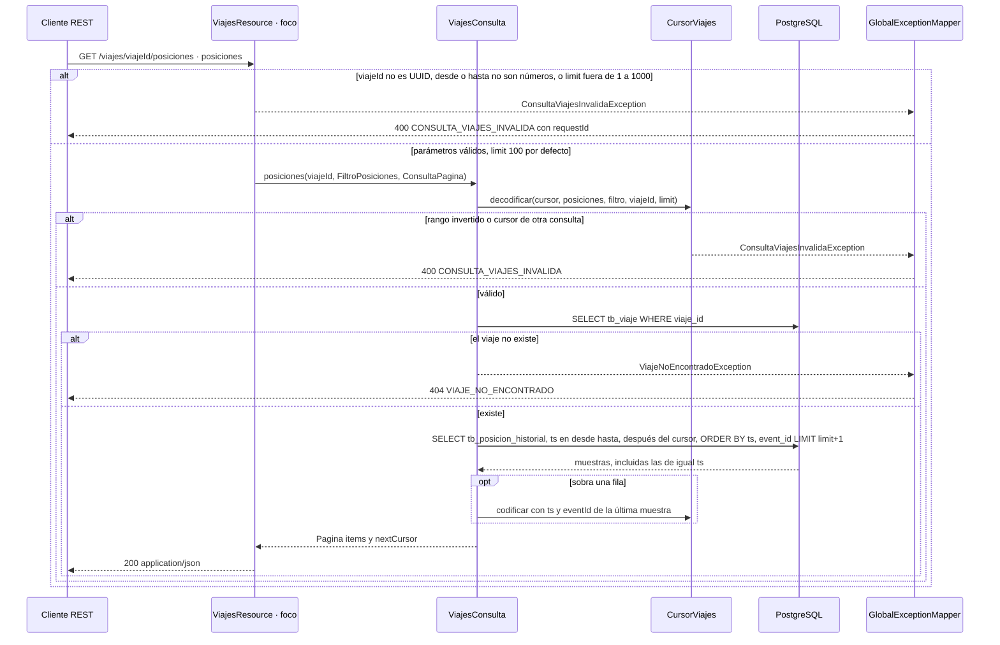

# Secuencia · `GET /viajes/{viajeId}/posiciones`

| Campo | Valor |
|---|---|
| Endpoint | `GET /viajes/{viajeId}/posiciones?desde=&hasta=&limit=&cursor=` (parámetros opcionales) |
| operationId | `ViajesResource.posiciones` (`INFERRED`: no hay especificación OpenAPI) |
| Implementación | [`ViajesResource.java`](../../../telemetry-api/src/main/java/dev/bryan/viajes/ViajesResource.java) (`@Blocking`), [`ViajesConsulta.java`](../../../telemetry-api/src/main/java/dev/bryan/viajes/ViajesConsulta.java), [`CursorViajes.java`](../../../telemetry-api/src/main/java/dev/bryan/viajes/CursorViajes.java) |
| Cliente | Ninguno en el dashboard; operador o cliente REST |
| Respuestas | 200 `{items: PosicionVista[], nextCursor}` con `eventId`, `viajeId`, `tipoEvento`, `receivedAt` y los campos de telemetría · 400 CONSULTA_VIAJES_INVALIDA · 404 VIAJE_NO_ENCONTRADO · 500 INTERNAL_ERROR |
| Seguridad | Ninguna (RNF-5). CORS solo para `http://localhost:3000`. |
| Correlación | `requestId` generado en la respuesta de error; no se propaga un correlation ID en las respuestas 2xx. |
| Criterios | Spec de persistencia §6, §7 y criterios 3, 4 y 9 |
| Foco | Participante `R` (borde dark red 700) |

