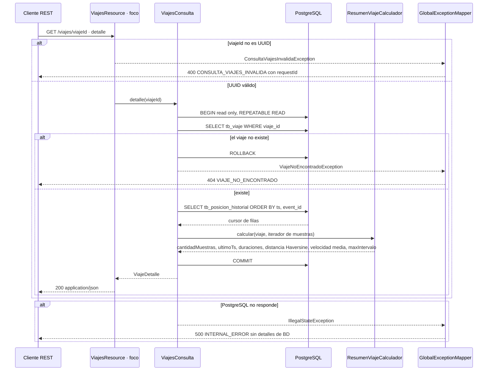

# Secuencia · `GET /viajes/{viajeId}`

| Campo | Valor |
|---|---|
| Endpoint | `GET /viajes/{viajeId}` |
| operationId | `ViajesResource.detalle` (`INFERRED`: no hay especificación OpenAPI) |
| Implementación | [`ViajesResource.java`](../../../telemetry-api/src/main/java/dev/bryan/viajes/ViajesResource.java) (`@Blocking`), [`ViajesConsulta.java`](../../../telemetry-api/src/main/java/dev/bryan/viajes/ViajesConsulta.java), [`ResumenViajeCalculador.java`](../../../telemetry-api/src/main/java/dev/bryan/viajes/ResumenViajeCalculador.java) |
| Cliente | Ninguno en el dashboard; operador o cliente REST |
| Respuestas | 200 `ViajeDetalle {viaje, resumen}` · 400 CONSULTA_VIAJES_INVALIDA (UUID mal formado) · 404 VIAJE_NO_ENCONTRADO · 500 INTERNAL_ERROR |
| Seguridad | Ninguna (RNF-5). CORS solo para `http://localhost:3000`. |
| Correlación | `requestId` generado en la respuesta de error; no se propaga un correlation ID en las respuestas 2xx. |
| Criterios | Spec de persistencia §6, §7 y criterios 5, 6, 7 y 10 |
| Foco | Participante `R` (borde dark red 700) |

El resumen se calcula sobre **todas** las muestras confirmadas, leídas en streaming (`fetchSize` 1000) dentro de una transacción de solo lectura `REPEATABLE READ`, para que viaje y muestras sean coherentes. Con varias muestras en el mismo `ts`, solo la primera en orden `event_id` cuenta para distancia y velocidad.

