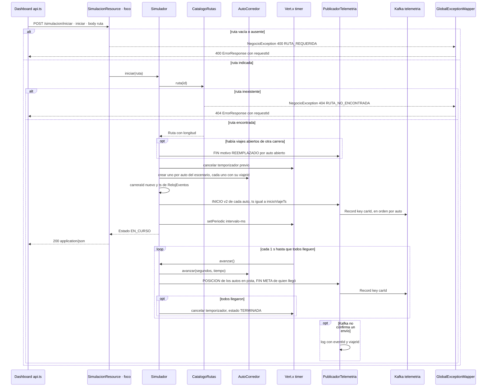

# Secuencia · `POST /simulacion/iniciar`

| Campo | Valor |
|---|---|
| Endpoint | `POST /simulacion/iniciar` |
| operationId | `SimulacionResource.iniciar` (`INFERRED`: no hay especificación OpenAPI) |
| Implementación | [`SimulacionResource.java`](../../../telemetry-api/src/main/java/dev/bryan/simulacion/SimulacionResource.java), [`Simulador.java`](../../../telemetry-api/src/main/java/dev/bryan/simulacion/Simulador.java), [`PublicadorTelemetria.java`](../../../telemetry-api/src/main/java/dev/bryan/simulacion/PublicadorTelemetria.java) |
| Cliente | `dashboard-next` · api.ts iniciarCarrera, botón Iniciar carrera |
| Respuestas | 200 Estado EN_CURSO con `carreraId` y `viajeId` por auto · 400 RUTA_REQUERIDA · 404 RUTA_NO_ENCONTRADA · 400 HTTP_400 si el JSON es inválido |
| Seguridad | Ninguna (RNF-5). CORS solo para `http://localhost:3000`. |
| Correlación | `requestId` generado en la respuesta de error. En Kafka, cada evento lleva `eventId`, `carreraId` y `viajeId`, que también aparecen en los logs de fallo de publicación; no hay correlation ID HTTP. |
| Criterios | Criterio 2 (salida conjunta, llegada y fin), RF-S1, RF-S3, RF-S4, RF-S5; spec de persistencia §4.2 y criterios 1 y 5 |
| Foco | Participante `R` (borde dark red 700) |

