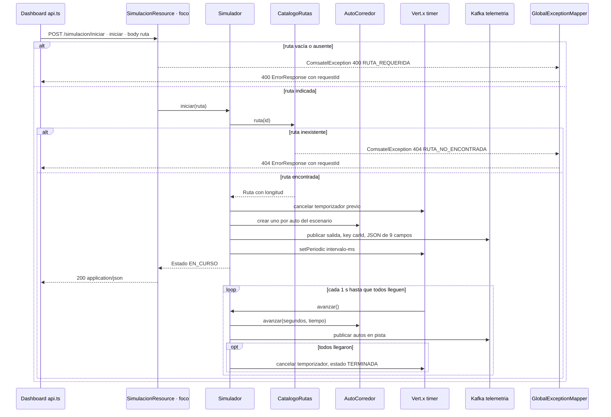

# Secuencia · `POST /simulacion/iniciar`

| Campo | Valor |
|---|---|
| Endpoint | `POST /simulacion/iniciar` |
| operationId | `SimulacionResource.iniciar` (`INFERRED`: no hay especificación OpenAPI) |
| Implementación | [`SimulacionResource.java`](../../../telemetry-api/src/main/java/dev/bryan/simulacion/SimulacionResource.java) |
| Cliente | `dashboard-next` · api.ts iniciarCarrera, botón Iniciar carrera |
| Respuestas | 200 Estado EN_CURSO · 400 RUTA_REQUERIDA · 404 RUTA_NO_ENCONTRADA · 400 HTTP_400 si el JSON es inválido |
| Seguridad | Ninguna (RNF-5). CORS solo para `http://localhost:3000`. |
| Correlación | `requestId` generado en la respuesta de error; no se propaga un correlation ID en las respuestas 2xx ni por Kafka. |
| Criterios | Criterio 2 (salida conjunta, llegada y fin), RF-S1, RF-S3, RF-S4, RF-S5 |
| Foco | Participante `R` (borde dark red 700) |

