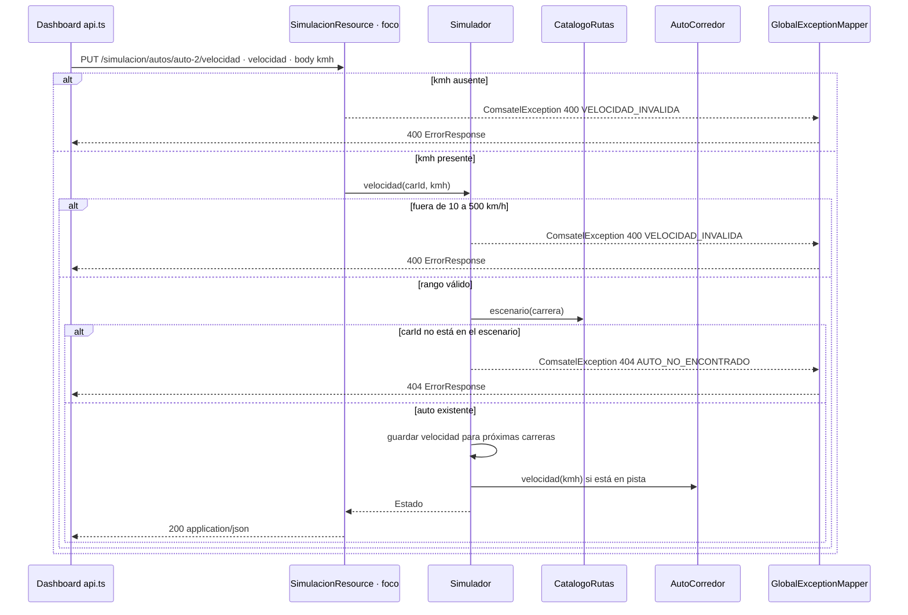

# Secuencia · `PUT /simulacion/autos/{carId}/velocidad`

| Campo | Valor |
|---|---|
| Endpoint | `PUT /simulacion/autos/{carId}/velocidad` |
| operationId | `SimulacionResource.velocidad` (`INFERRED`: no hay especificación OpenAPI) |
| Implementación | [`SimulacionResource.java`](../../../telemetry-api/src/main/java/dev/bryan/simulacion/SimulacionResource.java) |
| Cliente | `dashboard-next` · api.ts cambiarVelocidad, slider de cada auto |
| Respuestas | 200 Estado · 400 VELOCIDAD_INVALIDA · 404 AUTO_NO_ENCONTRADO |
| Seguridad | Ninguna (RNF-5). CORS solo para `http://localhost:3000`. |
| Correlación | `requestId` generado en la respuesta de error; no se propaga un correlation ID en las respuestas 2xx ni por Kafka. |
| Criterios | Criterio 3 (el slider cambia el ritmo y el orden), RF-S2, RF-U5 |
| Foco | Participante `R` (borde dark red 700) |

