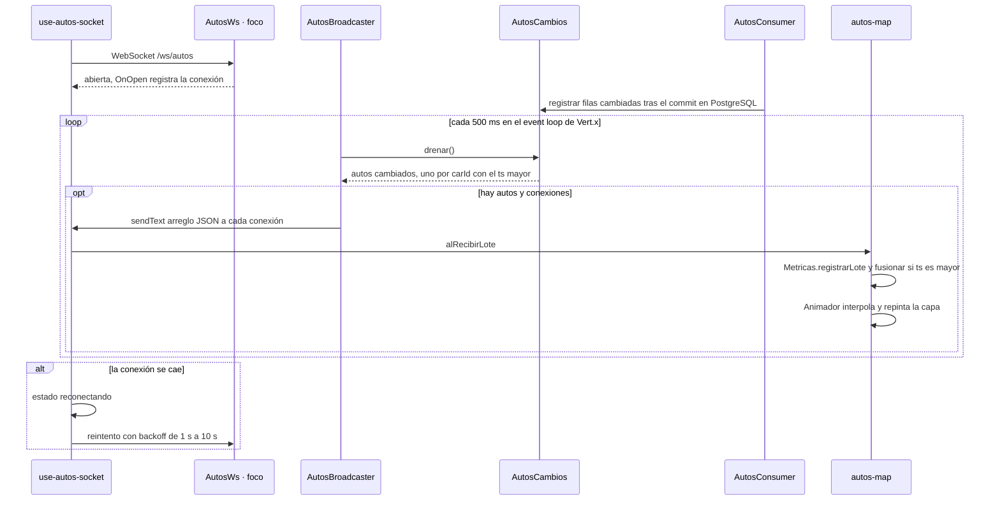

# Secuencia · `WS /ws/autos`

| Campo | Valor |
|---|---|
| Endpoint | `WS /ws/autos` |
| operationId | `AutosWs y AutosBroadcaster.emitir` (`INFERRED`: no hay especificación OpenAPI) |
| Implementación | [`AutosWs.java`](../../../telemetry-api/src/main/java/dev/bryan/autos/AutosWs.java), [`AutosBroadcaster.java`](../../../telemetry-api/src/main/java/dev/bryan/autos/AutosBroadcaster.java), [`AutosCambios.java`](../../../telemetry-api/src/main/java/dev/bryan/autos/AutosCambios.java) |
| Cliente | `dashboard-next` · use-autos-socket.ts |
| Respuestas | Mensajes de texto con un arreglo JSON de Auto (9 campos) · sin códigos de error: el cliente reconecta |
| Seguridad | Ninguna (RNF-5). CORS solo para `http://localhost:3000`. |
| Correlación | `requestId` generado en la respuesta de error; no se propaga un correlation ID en las respuestas 2xx ni por Kafka. |
| Criterios | RF-Q3, RF-U9, RF-U10, RF-U11, criterio 6 (p95 menor a 2 s); spec de persistencia §5.3 y criterio 8 (solo cambios confirmados) |
| Foco | Participante `WS` (borde dark red 700) |

El búfer `AutosCambios` solo recibe las filas que el upsert cambió y después del commit. No es durable: si la API cae entre el commit y el envío, el cambio no se difunde y el cliente se recupera con `GET /autos`.

