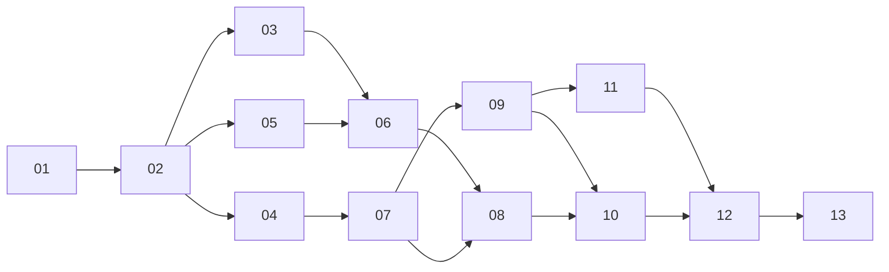

# Planes de implementación

Cada plan es un incremento pequeño, verificable y completable en una sesión. La fuente de verdad es [`docs/specs/telemetria.md`](../specs/telemetria.md).

| # | Plan | Depende de | Resultado |
|---|---|---|---|
| 01 | [Kafka en Docker](01-kafka-docker.md) | — | Broker y topics creados |
| 02 | [Quarkus: consumidor y REST](02-quarkus-rest-consumidor.md) | 01 | `GET /autos` desde `ultima-posicion` |
| 03 | [Quarkus: WebSocket por lotes](03-quarkus-websocket-lotes.md) | 02 | Lotes cada 500 ms |
| 04 | [Flink embebido](04-flink-embebido.md) | 01, 02 | `telemetria` → `ultima-posicion` |
| 05 | [Next.js: mapa inicial](05-next-mapa-inicial.md) | 02 | Mapa con carga inicial |
| 06 | [Next.js: tiempo real](06-next-tiempo-real.md) | 03, 05 | Mapa en vivo |
| 07 | [Empresa, flota y rumbo en el contrato](07-contrato-empresa-flota.md) | 04 | `GET /autos` con los 9 campos |
| 08 | [Íconos de vehículo](08-next-iconos-vehiculo.md) | 06, 07 | Autos orientados y coloreados |
| 09 | [Simulación de 3 autos por la Av. Brasil](09-simulacion-ruta.md) | 04, 07 | Autos en ruta, controlables por REST |
| 10 | [Botón de simulación, filtro empresa → flota y ruta](10-next-filtro-ruta.md) | 08, 09 | Demo completa en el dashboard |
| 11 | [Rutas establecidas y modo carrera (backend)](11-rutas-carrera.md) | 09 | Carreras en 4 rutas, velocidad por auto |
| 12 | [Dashboard de carrera](12-next-carrera.md) | 10, 11 | Selector de ruta, clasificación y sliders |
| 13 | [Modo claro y oscuro](13-tema-claro-oscuro.md) | 12 | Tema claro / oscuro / sistema en toda la interfaz |

## Orden

Los incrementos 02 y 05 no necesitan Flink: se prueban publicando directo en `ultima-posicion`.

## Convención
- Una rama por incremento: `feature/inc-NN-<slug>` desde `develop`, según `STD-GIT-001`.
- Conventional Commits y sin PR/MR; cada plan indica su commit.
- Rutas y estructura según `STD-ARCH-001`; errores según `STD-ERR-001`.
- Un incremento termina cuando cumple su "Hecho cuando" y deja el repositorio funcionando.
