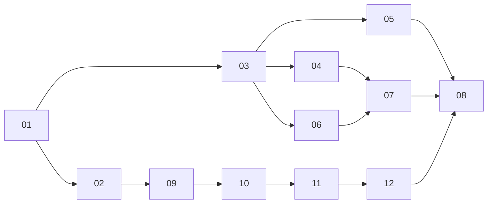

# Planes de implementación

Cada plan es un incremento pequeño, verificable y completable en una sesión. La fuente de verdad es [`docs/specs/telemetria.md`](../specs/telemetria.md).

| # | Plan | Depende de | Resultado |
|---|---|---|---|
| 01 | [Kafka en Docker](01-kafka-docker.md) | — | Broker y topics creados |
| 02 | [Simulador Python](02-simulador-python.md) | 01 | ≥ 4.900 ev/s en `telemetria` |
| 03 | [Quarkus: consumidor y REST](03-quarkus-rest-consumidor.md) | 01 | `GET /autos` desde `ultima-posicion` |
| 04 | [Quarkus: WebSocket por lotes](04-quarkus-websocket-lotes.md) | 03 | Lotes cada 500 ms |
| 05 | [Flink embebido](05-flink-embebido.md) | 01, 03 | `telemetria` → `ultima-posicion` |
| 06 | [Next.js: mapa inicial](06-next-mapa-inicial.md) | 03 | Mapa con carga inicial |
| 07 | [Next.js: tiempo real](07-next-tiempo-real.md) | 04, 06 | Mapa en vivo |
| 08 | [Pruebas de carga](08-pruebas-de-carga.md) | 05, 07 | Criterios de §14 |
| 09 | [Simulador con empresas y flotas](09-simulador-empresas-flotas.md) | 02 | Eventos con `companyId`, `fleetId`, `heading` |
| 10 | [Contrato nuevo en Flink y Quarkus](10-contrato-flink-quarkus.md) | 05, 09 | `GET /autos` con los 9 campos |
| 11 | [Dashboard por empresas y flotas](11-next-empresas-flotas.md) | 07, 10 | Burbujas empresa → flota → autos |
| 12 | [Íconos de vehículo](12-next-iconos-vehiculo.md) | 11 | Autos orientados y coloreados |

## Orden

Las pruebas de carga (08) se cierran después del 12, con el modelo de empresas y flotas. Los incrementos 03 y 06 no necesitan Flink: se prueban publicando directo en `ultima-posicion`. Tras el 03, el 05 y el 06 pueden avanzar en paralelo.

## Convención
- Una rama por incremento: `feature/inc-NN-<slug>` desde `develop`, según `STD-GIT-001`.
- Conventional Commits y sin PR/MR; cada plan indica su commit sugerido.
- Rutas y estructura según `STD-ARCH-001`; errores según `STD-ERR-001`.
- Un incremento termina cuando cumple su "Hecho cuando" y deja el repositorio funcionando.
