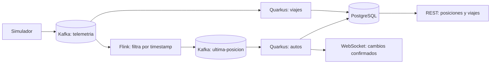

# Especificación: últimas posiciones e historial de viajes en PostgreSQL

**Fecha:** 2026-10-14

**Estado:** propuesta para revisión; no implementada.

**Base:** [Telemetría de autos en tiempo real](telemetria.md).
**Alcance acordado:** persistencia y API de consulta; una pantalla de historial queda para una evolución posterior.

## 1. Propósito y resultados esperados

El sistema debe conservar la última posición conocida de cada auto y registrar las muestras de sus viajes en PostgreSQL. Esto permitirá consultar vehículos después de reiniciar la API, reconstruir recorridos observados y obtener un resumen básico de cada viaje.

Una **última posición** es una sola fila por auto, reemplazada únicamente por una muestra más reciente. Un **historial** conserva las distintas muestras del auto: reemplazar una última posición no debe borrar sus posiciones anteriores.

Un **viaje** corresponde a un auto en una ejecución de carrera. Una **carrera** agrupa los viajes de los autos que salen juntos por una ruta. Iniciar otra carrera genera identificadores nuevos incluso si se repiten los autos y la ruta.

Quedan incluidos el almacenamiento, la consulta REST, los metadatos mínimos para identificar viajes, la continuidad del WebSocket actual y PostgreSQL en Docker Compose. Quedan fuera una interfaz de historial, reproducción animada, detección automática de viajes por motor o movimiento, alertas, autenticación, Redis, PostGIS y reanudación de carreras tras un reinicio.

## 2. Situación actual verificada

La revisión empleó `graphify update .`, consultas del grafo y lectura de los componentes relacionados. El índice inicial contiene 1.012 nodos y 1.650 relaciones.

- `simulacion` genera eventos con `carId`, `companyId`, `fleetId`, `lat`, `lon`, `heading`, `engine`, `battery` y `ts`, y publica en `telemetria` con clave `carId`.
- Flink conserva un `ValueState<Long>` con el mayor timestamp por auto. Publica en `ultima-posicion` solamente eventos cuyo timestamp supera al anterior; no almacena un historial completo.
- Quarkus conserva la última posición completa en un `ConcurrentHashMap` de `AutosStore`, sirve `GET /autos` y envía cambios por WebSocket cada 500 ms.
- Al asignar particiones, `ReconstruirEstadoListener` fuerza la relectura de `ultima-posicion` para reconstruir el mapa. El consumidor tiene `failure-strategy=ignore`.
- `ultima-posicion` es un topic compactado. `telemetria` tiene retención de una hora. Ninguno constituye por sí solo el historial permanente de viajes requerido.
- Los eventos no contienen identificadores de viaje, carrera ni evento. El estado de la carrera y los tiempos de llegada viven en memoria.

Esta especificación amplía el MVP: sustituye sus requisitos de almacenamiento en memoria y reconstrucción obligatoria al arrancar, y añade historial. El resto de la especificación base sigue vigente. Este documento describe el comportamiento futuro, no certifica que ya exista.

## 3. Arquitectura y responsabilidades

- **Simulación:** asigna identidades y comunica inicio, muestras y cierre de cada viaje mediante eventos Kafka.
- **Flink:** mantiene su función de procesamiento y su estado interno. No consulta ni escribe PostgreSQL. Conserva los campos adicionales que necesite el flujo de última posición.
- **Feature `autos`:** consume `ultima-posicion`, mantiene la proyección persistente actual y difunde sus cambios confirmados.
- **Nueva feature `viajes`:** consume directamente `telemetria` con un grupo independiente de Flink, conserva muestras y metadatos de viaje y expone sus consultas.
- **PostgreSQL:** es la fuente de consulta persistente para ambas capacidades. Las features son dueñas de sus tablas y no acceden a las clases internas de otras features.

Se elige el historial desde `telemetria` porque consumir únicamente `ultima-posicion` perdería las muestras atrasadas que Flink descarta. Kafka Connect es una alternativa futura para mover datos, pero por sí solo no define los límites ni el análisis de un viaje. Redis no es necesario para este alcance; se reconsiderará con mediciones de carga.

Las dos proyecciones son independientes y eventualmente consistentes. No se promete una transacción conjunta entre Kafka, última posición e historial. Que una muestra aparezca en una consulta no garantiza que el otro consumidor ya la haya procesado.

## 4. Contrato de eventos y ciclo de vida

### 4.1 Identidad y contexto

El contrato de `telemetria` se amplía con:

| Campo | Significado |
|---|---|
| `schemaVersion` | Versión del contrato; los eventos nuevos usan `2`. |
| `eventId` | UUID generado una vez por evento y reutilizado al reintentar su publicación. |
| `carreraId` | UUID común a los viajes de una carrera. |
| `viajeId` | UUID de un auto dentro de esa carrera. |
| `rutaId` | Identificador de la ruta elegida. |
| `inicioViajeTs` | Inicio del viaje, en milisegundos Unix UTC. |
| `tipoEvento` | `INICIO`, `POSICION` o `FIN`. |
| `motivoFin` | En `FIN`: `META`, `DETENIDO` o `REEMPLAZADO`; ausente en los demás eventos. |

Cada evento incluye también los campos de posición existentes. Un inicio o cierre contiene una muestra real en su ubicación correspondiente. Los tiempos usan la misma referencia UTC; no se almacenan fechas locales sin zona. `ts` es la hora del evento y `receivedAt` será la hora de su primera persistencia.

La clave Kafka continúa siendo `carId`. Los tres modelos de evento siguen siendo propios de sus features; se actualizan sus serializadores y pruebas de contrato. El JSON público de `GET /autos` y del WebSocket conserva los campos actuales; la API de viajes expone el nuevo contexto.

### 4.2 Inicio y cierre

- Al iniciar una carrera se generan `carreraId` y un `viajeId` por auto. Se publica `INICIO` para cada uno y luego sus posiciones periódicas.
- Al alcanzar la meta se publica `FIN` con motivo `META` para ese auto, sin esperar a los otros. El motor apagado por sí solo no identifica un cierre.
- Detener una carrera cierra con `DETENIDO` los viajes aún abiertos y publica su posición final.
- Reemplazar una carrera cierra con `REEMPLAZADO` los viajes anteriores aún abiertos antes de publicar los inicios nuevos. Los ya finalizados mantienen su cierre.
- Un evento `FIN` deja de generar posiciones nuevas para ese viaje. Muestras anteriores que lleguen tarde todavía pueden incorporarse a su historial.
- Se conserva el estado REST actual de la simulación; sus respuestas añaden `carreraId` y el `viajeId` de cada auto para relacionarlas con las consultas históricas.

La publicación debe observar confirmaciones de Kafka y registrar los fallos. No se afirma que un cierre está entregado por el solo hecho de llamar al emisor. No se incorpora un outbox transaccional en esta versión: un apagado abrupto puede impedir publicar un inicio o cierre.

El estado histórico será `SIN_CIERRE`, `FINALIZADO`, `DETENIDO` o `REEMPLAZADO`. `SIN_CIERRE` significa que todavía no se recibió un cierre explícito; puede corresponder a un viaje en ejecución o interrumpido. No se inventa una llegada ni una hora de fin tras un fallo. La API expone también el timestamp de la última muestra para evaluar su antigüedad.

## 5. Persistencia e invariantes

PostgreSQL se incorpora a Compose con volumen persistente, healthcheck y configuración externa. El acceso se realizará con JDBC y pool de conexiones administrado por Quarkus; el esquema se versionará mediante Flyway. No se requiere ORM. Se aplican los estándares del proyecto y la nomenclatura del ADR-002.

### 5.1 Última posición

`tb_ultima_posicion` contiene una fila por `car_id`, con todos los campos actuales de posición y el contexto de viaje disponible. `ts` se conserva como `bigint`; las coordenadas como `double precision`; los identificadores nuevos como UUID. Empresa y flota pueden ser nulos.

- La actualización es atómica: insertar si el auto no existe; reemplazar solamente si `nuevo.ts > almacenado.ts`.
- Un evento antiguo o con timestamp igual no cambia la fila ni produce una notificación WebSocket.
- `GET /autos` consulta PostgreSQL directamente. Se elimina el mapa de posiciones completas en memoria.
- El filtro `bbox` mantiene sus límites inclusivos y su validación actual.
- Las posiciones del lote se consolidan por auto antes del upsert. Esta consolidación no se aplica al historial.
- Los campos opcionales de viaje permiten incorporar últimas posiciones legadas sin fabricar identificadores.

### 5.2 Viajes e historial

| Tabla | Contenido y claves |
|---|---|
| `tb_viaje` | `viaje_id` como PK; `carrera_id`, `car_id`, `ruta_id`, empresa/flota, inicio, fin opcional, estado, motivo de cierre y última muestra observada. |
| `tb_posicion_historial` | `event_id` como PK; FK a viaje, contexto del auto, tipo de evento, posición completa, `ts` y `received_at`. |

- Se conserva cada evento válido distinto; `eventId` hace idempotentes las reentregas. Una repetición no aumenta el número de muestras.
- Un mismo `eventId` con contenido diferente es un conflicto: se registra y se trata como fallo de integridad, sin sobrescribir el original.
- Dos eventos distintos con el mismo `ts` se conservan en el historial. El orden estable es `(ts, eventId)`; no representa un orden físico conocido dentro del mismo milisegundo.
- Crear o actualizar metadatos y guardar el lote histórico ocurre en una transacción. Un fallo revierte el lote completo.
- El contexto repetido en cada evento permite crear el viaje aunque se reciba primero una posición o su cierre. El cierre explícito no se revierte al llegar después un inicio atrasado.
- No se aceptan posiciones fuera del intervalo explícito del viaje, identidades contradictorias ni cierres diferentes para el mismo viaje; se señalan como conflictos.
- Se requieren índices para `(viaje_id, ts, event_id)` en el historial y para búsqueda de viajes por auto e inicio. La consulta por carrera también debe estar indexada.
- No se borra historial automáticamente en esta primera versión. Se debe medir crecimiento antes de adoptar una política de retención; conservar muestras no sustituye una estrategia de copias de seguridad.

### 5.3 Confirmaciones, fallos y memoria

Los consumidores JDBC ejecutan el trabajo fuera del event loop, por lotes ordenados. Confirman mensajes después del commit; el auto-commit de offsets queda deshabilitado. Las reentregas tras un commit y antes de confirmar offsets son esperables y deben ser seguras.

Un fallo de BD o un evento inválido no se ignora ni confirma como procesado. El canal afectado se detiene y la readiness refleja el fallo; después de corregir la causa se reinicia para retomar offsets. Los errores HTTP conservan el contrato de `STD-ERR-001`, sin SQL, credenciales ni detalles internos.

El WebSocket mantiene sus lotes de 500 ms, agrupados por auto, alimentados solamente con cambios confirmados. El búfer es temporal y no sustituye PostgreSQL. No se garantiza entregar por WebSocket cada escritura ante una caída entre el commit y la notificación; el cliente puede recuperar el estado mediante REST. No se añade entrega durable del WebSocket.

## 6. API de consulta

La API es de solo lectura para el historial. Las respuestas conservan nombres JSON en camelCase. Los endpoints existentes de rutas y simulación mantienen su propósito.

| Endpoint | Resultado |
|---|---|
| `GET /autos[?bbox=...]` | Última posición de cada auto, contrato actual. |
| `GET /viajes` | Página de viajes; filtros opcionales `carId`, `carreraId`, `desde`, `hasta`. |
| `GET /viajes/{viajeId}` | Metadatos, estado y resumen calculado del viaje. |
| `GET /viajes/{viajeId}/posiciones` | Página cronológica de muestras; filtros opcionales `desde`, `hasta`. |

`desde` y `hasta` son milisegundos Unix UTC. El intervalo es `[desde, hasta)`; en el listado filtra el inicio del viaje y en posiciones filtra `ts`. Un rango invertido o un identificador mal formado devuelve 400. Un viaje inexistente devuelve 404; una búsqueda válida sin resultados devuelve una página vacía.

Las páginas usan `{items, nextCursor}`; `nextCursor=null` indica fin. `limit` tiene valor predeterminado 100 y rango 1–1000. Los cursores son opacos y conservan el orden y filtros de la consulta; su reutilización con filtros diferentes es inválida. Viajes se ordena por `(inicioViajeTs DESC, viajeId DESC)` y posiciones por `(ts ASC, eventId ASC)`. No hay respuestas ilimitadas ni conteo total obligatorio. El listado no constituye una instantánea: muestras tardías insertadas detrás de un cursor requieren volver a consultar el rango para verlas.

Cada muestra histórica entrega `eventId`, `viajeId`, `tipoEvento`, `receivedAt` y los campos de telemetría. El detalle incluye contexto de carrera, auto y ruta, inicio y fin opcional, estado, última muestra y el resumen descrito a continuación. Las consultas reflejan únicamente datos confirmados; durante la ingesta un viaje nuevo puede tardar en estar disponible.

## 7. Reconstrucción y análisis básico

El recorrido observado se reconstruye con las muestras ordenadas, sin interpolar puntos ausentes ni reemplazarlo por la geometría de la ruta prevista. La API entrega las coordenadas originales; una futura pantalla podrá dibujarlas en ese orden, usando `[lon, lat]` para GeoJSON.

El resumen del viaje se calcula sobre todas sus muestras confirmadas, no solo sobre la página consultada, e incluye:

- `cantidadMuestras` y `ultimoTs`.
- `duracionObservadaMs`: diferencia entre el último y el primer timestamp; cero con una sola muestra.
- `duracionViajeMs`: fin menos inicio únicamente si existe cierre; nulo en `SIN_CIERRE`.
- `distanciaObservadaM`: suma de distancias geodésicas entre muestras consecutivas, usando Haversine y radio terrestre de 6.371.000 m.
- `velocidadMediaObservadaKmh`: distancia observada dividida por duración observada, convertida a km/h; nula si la duración es cero.
- `maxIntervaloMuestrasMs`: mayor diferencia temporal entre muestras consecutivas; cero con una sola muestra.

No se calcula velocidad máxima ni paradas en esta versión. Si existen varias muestras con el mismo timestamp, se conservan todas en la consulta, pero para distancia y velocidad se utiliza una sola por timestamp: la de menor `eventId` en orden UUID canónico. Así no se inventa un desplazamiento de duración cero. El conteo sigue incluyendo todos los eventos distintos.

La distancia y la velocidad son aproximaciones a partir de las muestras, no kilometraje certificado ni velocidad reportada por el vehículo. Los intervalos sin datos pueden ocultar parte del recorrido. Un evento tardío puede cambiar el resumen incluso después de un cierre; no se congela el análisis al terminar el viaje.

## 8. Compatibilidad, recuperación y operación

- Se mantienen Quarkus, Flink embebido, Kafka, Java y el dashboard existentes. El esquema nuevo requiere coordinación entre productor y consumidores, sin borrar topics como procedimiento de migración.
- Para posiciones actuales se utiliza un grupo nuevo, `quarkus-dash-postgres`, que lee `ultima-posicion` desde el primer offset disponible cuando aún no tiene offsets. Los reinicios siguientes retoman offsets confirmados, sin `seekToBeginning` forzado.
- El historial usa el grupo independiente `quarkus-viajes-postgres` sobre `telemetria`, también desde el primer offset disponible en su primera ejecución.
- Los eventos legados válidos sin contexto de viaje pueden alimentar última posición, pero se excluyen del historial de viajes con contador y registro de esa exclusión. No se inventan carreras ni viajes antiguos. Un evento que declara versión 2 y omite sus campos obligatorios es inválido, no legado.
- El historial completo comienza con la activación del contrato nuevo y su consumidor. No es posible reconstruir datos eliminados por retención ni muestras descartadas del topic compactado.
- Se conserva inicialmente la retención actual de una hora en `telemetria`. Una interrupción del consumidor histórico superior a esa ventana puede producir pérdidas; una operación con mayor necesidad de recuperación debe ampliar la retención y su capacidad de disco antes de asumir esa garantía.
- Persistir las posiciones actuales no resuelve la recuperación de Flink: hoy arranca con `OffsetsInitializer.latest()` y sin checkpoints. Este alcance conserva esa limitación y no promete que el flujo actual capture durante un apagado todas las muestras que sí recupere el historial. El respaldo de última posición en BD representa la última muestra confirmada por su consumidor.
- Los volúmenes sobreviven a reinicios normales. Eliminar volúmenes borra los datos; no se ejecutan borrados ni recreaciones para activar esta capacidad.
- Se requieren readiness de BD y canales, y señales de lag, fallos de persistencia, eventos inválidos, eventos legados excluidos y viajes sin cierre. Estar `SIN_CIERRE` no implica por sí solo un fallo.
- Una sola instancia de API queda cubierta. Escalar consumidores o difusores WebSocket requiere una especificación posterior de distribución de cambios.

## 9. Criterios de aceptación

1. Tras una carrera de tres autos existen tres viajes con identificadores distintos y un mismo `carreraId`. Otra carrera crea identidades diferentes.
2. Un auto conserva una sola última posición. Una muestra vieja o igual no la reemplaza; una posterior sí.
3. Una muestra atrasada válida aparece en el historial de su viaje aunque Flink no la publique en `ultima-posicion`.
4. Reentregar un evento no duplica muestras ni altera su contenido. Un conflicto de identidad se hace visible.
5. Llegada, detención y reemplazo producen cierres distintos por auto. Un apagado sin cierre no se presenta como llegada confirmada.
6. Un inicio atrasado no reabre un viaje cerrado; una muestra tardía dentro de su intervalo puede modificar el recorrido y resumen.
7. Reiniciar API y PostgreSQL conservando los volúmenes permite consultar posiciones y viajes sin iniciar otra carrera.
8. Un fallo de persistencia revierte el lote, no confirma sus mensajes y no emite sus cambios como confirmados. La recuperación permite reentrega idempotente.
9. El listado y las posiciones respetan filtros, orden, límites y cursores. Se prueban rangos vacíos, bordes temporales, timestamps iguales y parámetros inválidos.
10. Los cálculos se verifican con trayectos conocidos, una sola muestra, duración cero, muestras tardías y huecos temporales. Se documentan sus aproximaciones.
11. REST de autos, validación `bbox`, contrato de errores y WebSocket conservan su comportamiento público. Las consultas JDBC no bloquean el event loop.
12. Los eventos legados no crean viajes falsos; se comprueba el contrato v2 de extremo a extremo y la independencia de grupos Kafka.

La validación de persistencia se realizará con PostgreSQL real aislado para pruebas. La confirmación y recuperación de offsets requieren también pruebas con Kafka real. Esta especificación no incluye tareas de implementación, comandos de ejecución ni un plan de trabajo.
