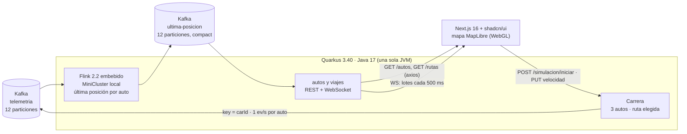
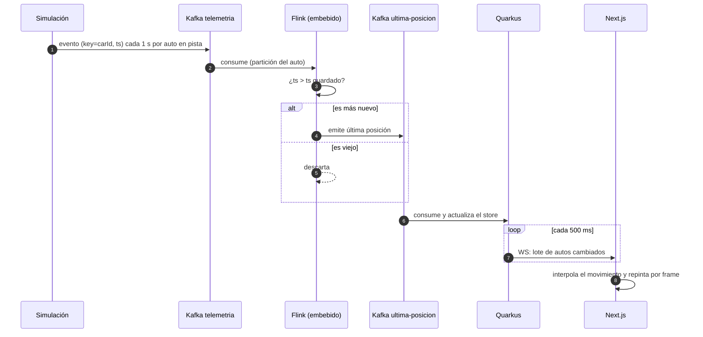
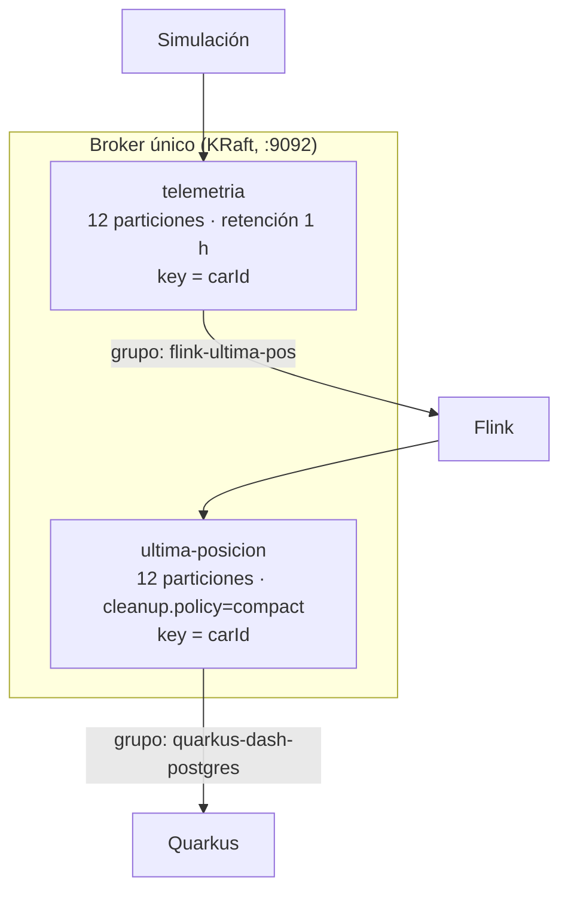
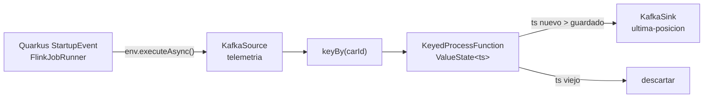
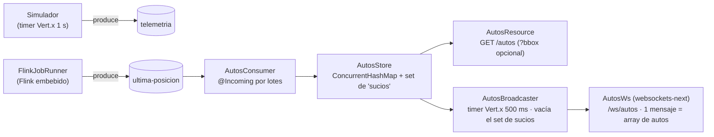
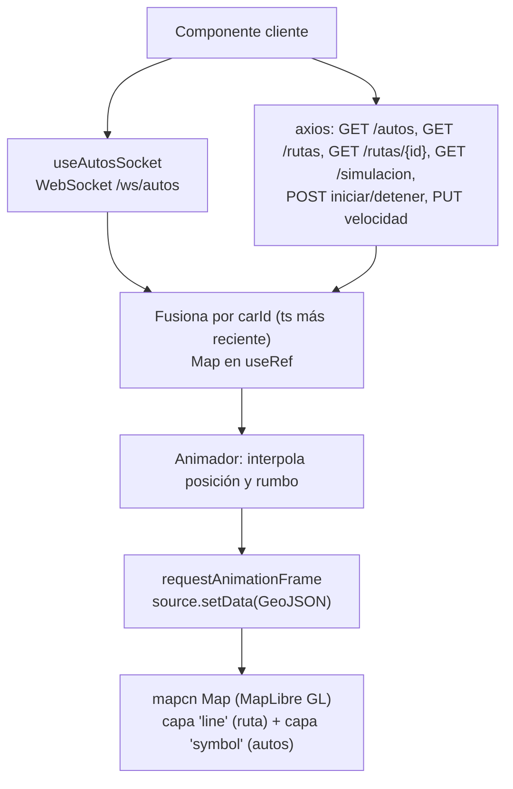
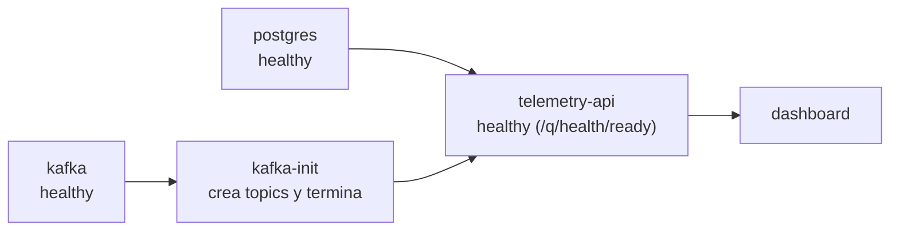
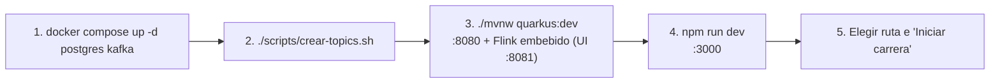
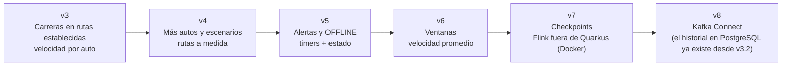

# Especificación del MVP: Telemetría de Autos en Tiempo Real

**Versión:** 3.2
**Stack:** Apache Kafka · Quarkus 3.40 LTS (Java 17) con Apache Flink 2.2 embebido · React 19 + Next.js 16 + shadcn/ui + MapLibre (mapcn) · todo en Docker Compose
**Escenario:** carreras de 3 autos en rutas establecidas (Av. Brasil, Panamericana Sur, Panamericana Norte y Vía Los Libertadores), seguidas en un mapa en tiempo real.

> **Persistencia (v3.2):** la [especificación de persistencia](persistencia-posiciones-viajes.md) reemplaza el store en memoria y la reconstrucción al arrancar por PostgreSQL, y agrega el historial de viajes (feature `viajes`) y el contrato de eventos v2. Las secciones de esta especificación que la contradicen se marcan con **[v3.2]**.

---

## 1. Resumen

El backend corre **carreras** de 3 autos en rutas reales y publica su telemetría en Kafka. Flink calcula la **última posición de cada auto** y Quarkus la expone a un dashboard. Desde el dashboard se elige la ruta, se lanza la carrera (todos salen del mismo punto y en un solo sentido), se ajusta la **velocidad de cada auto** en vivo, se sigue la clasificación hasta la meta y se filtran los autos por **empresa y flota**.

**Objetivos del MVP**
1. Validar el flujo extremo a extremo: simulación → Kafka → Flink → Quarkus → navegador.
2. Seguir en el mapa, con baja latencia, autos que circulan por rutas reales.
3. Servir como base de aprendizaje de Kafka y Flink.

## 2. Alcance

**Incluido:**
- carreras en rutas establecidas, controlables desde el dashboard (ruta, inicio y fin, velocidad por auto);
- ingesta en Kafka;
- job Flink de última posición;
- API REST y WebSocket con actualizaciones por lotes;
- dashboard con mapa, ruta con salida y meta, clasificación en vivo, filtro empresa → flota e íconos de vehículo.

**Fuera de alcance:** autenticación, base de datos (incorporada en v3.2 por la [especificación de persistencia](persistencia-posiciones-viajes.md)), ventanas de tiempo, alertas, clúster Flink (Flink corre **embebido dentro del proceso Quarkus**), Avro/Protobuf, alta disponibilidad y pruebas de carga.

## 3. Arquitectura



> Simulación, Flink y store comparten proceso, pero se comunican **solo por los topics** (`telemetria` y `ultima-posicion`). `ultima-posicion` está compactado. **[v3.2]** El estado ya no se reconstruye desde el topic: vive en PostgreSQL. La feature `viajes` lee `telemetria` directamente para guardar el historial.

### Responsabilidades

| Componente | Responsabilidad |
|---|---|
| **Carrera** (Quarkus) | Mover los autos desde la salida hasta la meta de la ruta elegida, a la velocidad de cada uno, y publicar su posición en `telemetria`. Se controla por REST. |
| **Kafka** | Transportar, retener y ordenar por `carId`. |
| **Flink** (embebido en Quarkus) | Conservar el evento más reciente por auto y descartar los viejos. Arranca con la aplicación. |
| **Quarkus** | Mantener el último estado por auto y servirlo por REST y WebSocket (en lotes); servir el catálogo y la geometría de las rutas. |
| **Next.js** | Selector de ruta, control de la carrera, clasificación con velocidad por auto, filtro empresa → flota, y ruta e íconos de los autos con movimiento interpolado. |

### Flujo de un evento



## 4. Modelo de datos

Mismo esquema en ambos topics, en `GET /autos` y en el WebSocket.

```json
{"carId":"auto-1","companyId":"emp-01","fleetId":"emp-01-f1","lat":-12.0608,"lon":-77.0422,"heading":221,"engine":"ON","battery":87,"ts":1760000000000}
```

| Campo | Tipo | Descripción | Restricciones |
|---|---|---|---|
| `carId` | string | Identificador del auto | No nulo; igual a la key del mensaje |
| `companyId` | string \| null | Empresa dueña del auto | `null` = auto particular |
| `fleetId` | string \| null | Flota dentro de la empresa | `null` si y solo si `companyId` es `null`; empieza por el `companyId` |
| `lat` | double | Latitud | -90 a 90 |
| `lon` | double | Longitud | -180 a 180 |
| `heading` | int | Rumbo en grados desde el norte, sentido horario | 0 a 359 |
| `engine` | string | Estado del motor | `ON` / `OFF` |
| `battery` | int | Batería en % | 0 a 100 |
| `ts` | long | Epoch ms UTC del evento | > 0 |

Jerarquía: **empresa → flotas → autos**. En el MVP los nombres visibles se derivan de los IDs (`emp-01` → "Empresa 01", `emp-01-f1` → "Flota 1"); no hay catálogo aparte.

## 5. Rutas y escenario

Rutas establecidas, elegibles desde el dashboard. Cada una es una sola polilínea en el sentido de la carrera (de la salida a la meta):

| id | Ruta | Salida → Meta | Longitud |
|---|---|---|---|
| `av-brasil` | Av. Brasil | Plaza Bolognesi → Magdalena del Mar | 5,2 km |
| `panamericana-sur` | Panamericana Sur (PE-1S) | Puente Atocongo → Lurín | 20,5 km |
| `panamericana-norte` | Panamericana Norte (PE-1N) | Av. Caquetá (Rímac) → Puente Piedra | 16,8 km |
| `via-los-libertadores` | Vía Los Libertadores (PE-28A) | Pisco (San Clemente) → Ayacucho | 325 km |

**Geometría.** Se tomó de OpenStreetMap (© OpenStreetMap contributors, ODbL). La de las carreteras se calculó con OSRM entre salida y meta y se recortó al tramo de la vía (PE-1S, PE-1N y PE-28A). Para la Vía Los Libertadores se usaron como puntos de paso nodos reales de la PE-28A, de modo que no tome otras carreteras. Las geometrías largas se simplificaron (Douglas-Peucker, 10 m).

**Archivos.** `telemetry-api/src/main/resources/rutas/{id}.geojson` y el índice `rutas/indice.json`.

**Escenario** (`resources/escenarios/carrera.json`):
- `auto-1` y `auto-2` (Empresa 01 · Flota 1) y `auto-3` (Empresa 02 · Flota 1).
- Velocidades iniciales de 60, 70 y 80 km/h, ajustables desde el dashboard entre 10 y 500 km/h.

Para agregar una ruta basta con un GeoJSON de una `LineString` y su entrada en el índice.

## 6. Especificación de Kafka



Creación de topics: `./scripts/crear-topics.sh` (en Windows, `.\scripts\crear-topics.ps1`).
- `telemetria`: 12 particiones, `retention.ms=3600000`.
- `ultima-posicion`: 12 particiones, `cleanup.policy=compact`.
- Con `--recrear` (o `-Recrear`) se borran y se vuelven a crear.

Reglas:
- La key es siempre `carId`: mismo auto, misma partición, orden garantizado.
- Un solo broker, replicación 1 (solo local), imagen `apache/kafka:4.2.1`. No usar 4.0.x: por [KAFKA-19888](https://issues.apache.org/jira/browse/KAFKA-19888), un retroceso del reloj de la VM de Docker deja inutilizable el coordinador de grupos (los consumidores no se unen ni confirman offsets).
- Si cambia el contrato del evento, recrear los topics: `ultima-posicion` está compactado y conserva el último evento de cada auto con el formato anterior.

## 7. Carrera (feature `simulacion` de Quarkus)

### Requisitos funcionales
- **RF-S1:** `iniciar(ruta)` coloca a todos los autos del escenario **en la salida** (km 0), con la velocidad elegida para cada uno. Todos avanzan **en un solo sentido**, hacia la meta.
- **RF-S2:** cada auto avanza a su velocidad, que se puede cambiar en cualquier momento, también en plena carrera, entre **10 y 500 km/h**. El `heading` es el rumbo del tramo.
- **RF-S3:** al cruzar la meta, el auto queda en el último punto con `engine=OFF` y registra su tiempo de llegada, interpolado dentro del intervalo. Cuando llegan todos, la carrera pasa a `TERMINADA`.
- **RF-S4:** un temporizador de Vert.x avanza la carrera cada **1 s** y publica en `telemetria` un evento por cada auto que sigue en pista, más el evento final del que acaba de llegar (key `carId`, canal `telemetria-out`). Al iniciar se publica de inmediato la salida.
- **RF-S5:** estados `LISTA` → `EN_CURSO` → `TERMINADA`. `detener` corta la carrera y los autos quedan donde están. Iniciar de nuevo empieza otra carrera desde la salida. Las velocidades elegidas se conservan entre carreras.
- **RF-S6:** la clasificación ordena primero a los que llegaron (por tiempo) y luego a los que corren (por distancia recorrida).

### Contratos
| Endpoint | Respuesta |
|---|---|
| `GET /rutas` | `[{"id","nombre","desde","hasta","km"}]` |
| `GET /rutas/{id}` | GeoJSON (`application/geo+json`) con una `LineString`; 404 `RUTA_NO_ENCONTRADA` |
| `GET /simulacion` | `{"estado","ruta","inicio","longitudM","autos":[{"posicion","carId","companyId","fleetId","velocidadKmh","recorridoM","llegadaMs"}]}` |
| `POST /simulacion/iniciar` | Cuerpo `{"ruta":"panamericana-sur"}` → estado de la nueva carrera; 400 `RUTA_REQUERIDA`, 404 `RUTA_NO_ENCONTRADA` |
| `POST /simulacion/detener` | Estado tras detener |
| `PUT /simulacion/autos/{carId}/velocidad` | Cuerpo `{"kmh":120}` → estado; 400 `VELOCIDAD_INVALIDA` (fuera de 10–500), 404 `AUTO_NO_ENCONTRADO` |

### Configuración
```properties
mp.messaging.outgoing.telemetria-out.connector=smallrye-kafka
mp.messaging.outgoing.telemetria-out.topic=telemetria
mp.messaging.outgoing.telemetria-out.key.serializer=org.apache.kafka.common.serialization.StringSerializer
mp.messaging.outgoing.telemetria-out.value.serializer=org.apache.kafka.common.serialization.StringSerializer
simulacion.escenario=carrera
simulacion.intervalo-ms=1000
```

## 8. Job de Flink (embebido en Quarkus)



El job vive en el backend Quarkus y se ejecuta en un **MiniCluster local dentro de la misma JVM**. No hay JobManager ni TaskManager externos, ni `flink run`.

### Requisitos funcionales
- **RF-F0:** el job se lanza automáticamente al arrancar Quarkus (`@Observes StartupEvent`) con `env.executeAsync(...)`, sin bloquear el arranque. Se cancela en `@Observes ShutdownEvent` mediante el `JobClient`.
- **RF-F1:** consumir `telemetria` con grupo `flink-ultima-pos`.
- **RF-F2:** `keyBy(carId)`.
- **RF-F3:** `KeyedProcessFunction` con `ValueState<Long>` del último `ts`; emitir solo si el evento es más nuevo.
- **RF-F4:** escribir en `ultima-posicion` con key `carId`.

### Configuración

| Aspecto | Valor |
|---|---|
| Versión | **Flink 2.2.1** + `flink-connector-kafka` **5.0.0-2.2** |
| Java | **17** (versión recomendada por Flink 2.x) |
| Paralelismo | **4** (≤ 12 particiones) |
| Offsets iniciales | `latest` |
| Ejecución | **MiniCluster embebido en Quarkus**, con UI web en `:8081` |
| Checkpoints | Desactivados |
| Reinicio ante fallos | `exponential-delay` (1 s → 30 s, sin límite); heartbeat de 3 min |

> Flink 2.3.0 ya existe, pero el conector Kafka 5.0.0 se publica para la línea 2.2; se usa la pareja 2.2.1 / 5.0.0-2.2 por compatibilidad.

Reglas del código Flink dentro de Quarkus:
- **Serialización:** los operadores (`KeyedProcessFunction`, serializadores) se **serializan** y corren en hilos de Flink. No se inyectan beans CDI dentro de ellos; solo se pasan valores simples (bootstrap servers, nombres de topic).
- **JSON:** se usan `DeserializationSchema`/`SerializationSchema` con un `ObjectMapper` propio, que ignora campos desconocidos. No se depende del `ObjectMapper` de Quarkus.
- **Contrato:** el job usa su propio record (`flink/Posicion`). El contrato con las demás features es el JSON del topic.
- **Offsets:** sin checkpoints, Flink no confirma offsets. El `KafkaSource` activa `enable.auto.commit` (cada 100 ms) para que el lag del grupo `flink-ultima-pos` se pueda consultar.

**Classloaders (imprescindible).** Si el job no declara jars ni classpaths, el JobManager del MiniCluster deserializa el job con `ClassLoader.getSystemClassLoader()`. En Quarkus las dependencias las carga el classloader de Quarkus, así que falla con `ClassNotFoundException`. Por eso:
- se declara `pipeline.classpaths` con la ubicación real de las clases de la app (`target/classes` en dev, el jar al empaquetar);
- se usa orden `parent-first`.

Funciona en `quarkus:dev`, incluida la recarga en caliente (que cancela y relanza el job), y en el jar.

**Flags `--add-opens`.** No hicieron falta con JDK 17.0.20 y Flink 2.2.1. Si apareciera `InaccessibleObjectException`:
- hay que abrir `java.lang`, `java.util`, `java.lang.reflect`, `java.io`, `java.net`, `java.nio`, `sun.nio.ch` y `java.util.concurrent` con `--add-opens=java.base/<paquete>=ALL-UNNAMED`;
- en dev se pasan con `-Djvm.args="..."`, y con el jar, como argumentos de `java ... -jar`.

## 9. Backend (Quarkus)



### Versiones

| Pieza | Versión |
|---|---|
| Java | 17 |
| Quarkus | **3.40.x LTS** (mantenido hasta 2027-09-30) |
| Build | Maven |

### Dependencias

**Extensiones Quarkus:**

| Extensión | Para qué |
|---|---|
| `quarkus-rest` | Endpoints REST |
| `quarkus-rest-jackson` | Serialización JSON |
| `quarkus-websockets-next` | WebSocket `/ws/autos` |
| `quarkus-messaging-kafka` | Consumidor de `ultima-posicion` y productor de `telemetria` (SmallRye Reactive Messaging) |
| `quarkus-arc` | CDI (incluida por defecto) |
| `quarkus-junit` | Tests (scope `test`) |

> Los temporizadores de 500 ms y 1 s usan Vert.x: `@Scheduled` (`quarkus-scheduler`) solo evalúa sus triggers una vez por segundo.

**Dependencias Maven de Flink:** `flink-streaming-java`, `flink-clients`, `flink-runtime-web` (UI :8081) y `flink-connector-base` en `2.2.1`, más `flink-connector-kafka:5.0.0-2.2`. El BOM de Quarkus gobierna la versión de `kafka-clients`. Flink trae sus dependencias sombreadas (`flink-shaded-*`) y no compite con el Jackson ni el Netty de Quarkus.

### Requisitos funcionales
- **RF-Q1 [v3.2]:** consumir `ultima-posicion` por **lotes** (`batch=true`, `List<AutoEvento>`) y guardarlos en `tb_ultima_posicion`. El consumidor es `@Blocking`, porque JDBC no puede ir en el event loop, y confirma offsets después del commit.
- **RF-Q2 [v3.2]:** el upsert solo reemplaza un auto si su `ts` es mayor. Los cambios confirmados pasan al búfer temporal `AutosCambios`.
- **RF-Q3:** cada 500 ms, emitir por WebSocket un único mensaje JSON con el arreglo de autos cambiados (solo los confirmados en BD) y vaciar el búfer; nada si no hay cambios.
- **RF-Q4:** `GET /autos` devuelve el estado completo; `?bbox=minLon,minLat,maxLon,maxLat` filtra (bbox inválido → 400).
- **RF-Q5 [v3.2]:** sin reconstrucción al arrancar. `GET /autos` consulta PostgreSQL, y el grupo `quarkus-dash-postgres` retoma sus offsets confirmados (`earliest` solo en su primera ejecución).
- **RF-Q6:** errores HTTP según `STD-ERR-001` (`requestId`, sin stack traces).

### Configuración

Cada propiedad se puede sobrescribir con su variable de entorno (`kafka.bootstrap.servers` → `KAFKA_BOOTSTRAP_SERVERS`); así la configura `docker-compose.yml` (§12).

```properties
kafka.bootstrap.servers=localhost:9092
mp.messaging.incoming.ultima-posicion.connector=smallrye-kafka
mp.messaging.incoming.ultima-posicion.group.id=quarkus-dash-postgres
mp.messaging.incoming.ultima-posicion.auto.offset.reset=earliest
mp.messaging.incoming.ultima-posicion.batch=true
mp.messaging.incoming.ultima-posicion.enable.auto.commit=false
mp.messaging.incoming.ultima-posicion.commit-strategy=throttled
mp.messaging.incoming.ultima-posicion.failure-strategy=fail
# [v3.2] historial-telemetria (grupo quarkus-viajes-postgres) y el datasource: ver application.properties
quarkus.http.cors.enabled=true
quarkus.http.cors.origins=http://localhost:3000
quarkus.http.enable-compression=true

# Flink embebido (propiedades propias leídas por FlinkJobRunner)
flink.parallelism=4
flink.ui.port=8081
flink.ui.bind-address=localhost   # 0.0.0.0 en Docker (FLINK_UI_BIND_ADDRESS)
flink.kafka.group=flink-ultima-pos
flink.topic.in=telemetria
flink.topic.out=ultima-posicion
```

## 10. Frontend (React 19 + Next.js 16 + shadcn/ui + MapLibre)



### Versiones y librerías

| Pieza | Versión / paquete |
|---|---|
| Next.js | **16.x** (App Router, React 19, TypeScript, Tailwind CSS v4) |
| Componentes UI | **shadcn/ui** (`Card`, `Badge`, `Button`, `Select`, `Slider`, `Tooltip`) |
| Tema | **next-themes** (clase `dark` en `<html>`) |
| Mapa | **mapcn** (`@mapcn/map`, registro shadcn sobre **MapLibre GL**) |
| HTTP | **axios** 1.x |
| Tiempo real | `WebSocket` nativo del navegador |

Variables de entorno (`.env.local`, ver `.env.example`):

```properties
NEXT_PUBLIC_API_URL=http://localhost:8080
NEXT_PUBLIC_WS_URL=ws://localhost:8080/ws/autos
```

> Basemap: mapcn usa por defecto teselas de CARTO (OpenStreetMap). Para uso comercial se requiere licencia de CARTO o cambiar a otro proveedor compatible con MapLibre.

### Requisitos funcionales
- **RF-U1:** interfaz con el patrón *UI Shell* de Carbon: cabecera de 48 px (nombre, pestañas Carrera / Viajes / Operación —las dos últimas deshabilitadas hasta que existan—, estado de conexión y tema), panel lateral fijo de ~360 px y el mapa en el resto. En un celular el panel se apila sobre el mapa, que conserva al menos el 60 % de la altura. El componente del mapa es `"use client"` y se carga con `dynamic(..., { ssr: false })` dentro de un Client Component, porque MapLibre necesita `window`.
- **RF-U2 (ruta):** `Select` de shadcn con las rutas de `GET /rutas` (nombre y km), deshabilitado durante una carrera. Al elegir una ruta:
  - se dibuja su geometría (`GET /rutas/{id}`) con un borde y dos tramos: el **recorrido por el líder** (`--ruta-recorrido`) y el **pendiente** (`--ruta-pendiente`); el mapa se encuadra en ella, aunque no haya carrera;
  - aparecen los marcadores **Salida** y **Meta** (`MapMarker` de mapcn, con íconos de `lucide-react` y el nombre de cada lugar) junto a sus extremos.

  Al cargar la página se preselecciona la ruta de la carrera actual o de la última.
- **RF-U3 (carrera):** botón **"Iniciar carrera" / "Detener" / "Nueva carrera"** según el estado, que llama a `POST /simulacion/iniciar {ruta}` o `POST /simulacion/detener`. `GET /simulacion` se consulta cada 1 s durante la carrera y cada 5 s el resto del tiempo.
- **RF-U4 (clasificación):** un cronómetro de la carrera y una fila por auto con:
  - posición, color del auto, empresa · flota y km recorridos;
  - barra de progreso;
  - al llegar, una bandera y el tiempo de carrera (`m:ss,d` o `h:mm:ss,d`).
- **RF-U5 (velocidad):** `Slider` de shadcn por auto (10–500 km/h, paso de 5). Mientras se arrastra muestra el valor; al soltar envía `PUT /simulacion/autos/{carId}/velocidad`. Funciona antes y durante la carrera.
- **RF-U6 (seguir al líder):** botón que, mientras está activo, centra el mapa cada segundo en el primero de la clasificación (con su posición interpolada). Es imprescindible en la Vía Los Libertadores (325 km).
- **RF-U7:** filtro **empresa → flota** con dos `Select` de shadcn. "Todas las empresas" muestra todos los autos; al elegir una empresa quedan solo sus autos y se habilita el selector de flota; al elegir una flota, solo esa flota. Las opciones salen de los datos recibidos. El filtro se aplica con `setFilter` sobre la capa de autos.
- **RF-U8:** cada auto es un **círculo con su color categórico** de Carbon (`--auto-1..3`, según el número de `auto-N`), su número y una flecha de rumbo (capa `symbol` con `icon-allow-overlap`):
  - la flecha se orienta según `heading` (`icon-rotate` con `icon-rotation-alignment: map`); el número no gira;
  - gris al llegar (motor OFF);
  - tamaño interpolado por zoom.

  Las 4 variantes (tres colores y "off") se dibujan en canvas (`features/autos/vehiculo.ts`) con los colores del tema.
- **RF-U9:** movimiento **interpolado** (`features/autos/animacion.ts`): entre dos eventos de un auto se lo desplaza en línea recta y se gira por el camino corto, repintando con `setData()` en cada `requestAnimationFrame`. Un salto de más de 2 km (p. ej. al empezar una carrera en otra ruta) no se anima.
- **RF-U10:** carga inicial por `GET /autos` (axios) y cambios por WebSocket con reconexión y backoff exponencial. Cada evento se fusiona por `carId` solo si su `ts` es más reciente; el estado vive en `useRef`, fuera de React.
- **RF-U12 (tema):** toda la interfaz admite **modo claro y oscuro**, con los tokens de Carbon G10 (claro) y G100 (oscuro) y la tipografía IBM Plex Sans / Mono.
  - Un selector **Claro / Oscuro / Sistema** en la cabecera del panel; "Sistema" por defecto y la elección se guarda en el navegador.
  - next-themes pone la clase `dark` en `<html>` antes de pintar, sin parpadeo. Los tokens de shadcn (`:root` / `.dark` en `globals.css`) cambian el panel y sus controles, y mapcn observa esa misma clase para alternar el mapa base claro u oscuro de CARTO.
  - El popup de los autos y los marcadores de Salida y Meta usan tokens del tema.
  - La ruta y los íconos se vuelven a crear al cambiar el estilo, así que siguen visibles en plena carrera. MapLibre no entiende `var(--x)`: las capas leen los colores de las variables CSS al crearse (`leerToken`).
- **RF-U13 (controles del mapa):** acercar, alejar, encuadrar la ruta y orientar al norte; escala métrica; centro y zoom actuales; leyenda con el color y la empresa de cada auto y los dos tramos de la ruta; y una etiqueta junto al primer auto que sigue en carrera con su posición, velocidad y km.
- **RF-U11:** popup al pasar el mouse sobre un auto y métricas en el panel: estado de conexión, autos mostrados, edad del último dato y latencia p95 (`Date.now() - ts`), refrescadas una vez por segundo sin rerenderizar el mapa.

## 11. Requisitos no funcionales

| ID | Requisito | Valor objetivo |
|---|---|---|
| RNF-1 | Latencia extremo a extremo (p95) | < 2 s |
| RNF-2 | Orden por auto | Garantizado (key = `carId`) |
| RNF-3 | Movimiento en el mapa | Continuo (interpolado), sin saltos entre eventos |
| RNF-4 | Entorno | Ejecución 100 % local |
| RNF-5 | Seguridad / alta disponibilidad | No incluidas |

## 12. Ejecución

Todo el sistema se levanta con `docker compose up -d --build`:



| Servicio | Imagen | Puertos | Configuración |
|---|---|---|---|
| `postgres` **[v3.2]** | `postgres:17` | 5432 | Credenciales `POSTGRES_DB`, `POSTGRES_USER` y `POSTGRES_PASSWORD` desde `.env`; datos en el volumen `postgres-datos`; healthcheck `pg_isready` |
| `kafka` | `apache/kafka:4.2.1` | 9092 | Listeners `INTERNO://kafka:29092` (contenedores) y `EXTERNO://localhost:9092` (host); datos en el volumen `kafka-datos` |
| `kafka-init` | `apache/kafka:4.2.1` | — | `kafka-topics.sh --create --if-not-exists` de los dos topics (§6) |
| `telemetry-api` | `telemetry-api/Dockerfile`: Maven 3.9 + JDK 17 → JRE 17, fast-jar, usuario no root | 8080, 8081 (UI de Flink) | `QUARKUS_DATASOURCE_JDBC_URL`, `QUARKUS_DATASOURCE_USERNAME`, `QUARKUS_DATASOURCE_PASSWORD`, `KAFKA_BOOTSTRAP_SERVERS=kafka:29092`, `QUARKUS_HTTP_CORS_ORIGINS=http://localhost:3000`, `FLINK_UI_BIND_ADDRESS=0.0.0.0` |
| `dashboard` | `dashboard-next/Dockerfile`: Node 24 Alpine, salida `standalone` de Next.js, usuario no root | 3000 | Build args `NEXT_PUBLIC_API_URL=http://localhost:8080` y `NEXT_PUBLIC_WS_URL=ws://localhost:8080/ws/autos` |

- **Arranque ordenado:** `depends_on` con `service_healthy` y `service_completed_successfully`.
- **Como servicio:** `restart: unless-stopped` en `kafka`, `telemetry-api` y `dashboard`.
- **URLs del navegador:** las variables `NEXT_PUBLIC_*` se incrustan al construir el dashboard y las usa el navegador del host, por eso apuntan a `localhost:8080` (puerto publicado) y no a `telemetry-api:8080`.
- **Persistencia [v3.2]:** con `docker compose down`, los topics (volumen `kafka-datos`) y las posiciones y viajes (volumen `postgres-datos`) sobreviven, y la API lee su estado de PostgreSQL al arrancar. `docker compose down -v` borra ambos volúmenes.

**Desarrollo local** (recarga en caliente):



Estructura del repositorio:

```
telemetria-flink/
├── docker-compose.yml            (postgres, kafka, kafka-init, telemetry-api, dashboard)
├── .env.example                  (credenciales de PostgreSQL para desarrollo)
├── scripts/crear-topics.{sh,ps1}, probar-persistencia.ps1
├── telemetry-api/
│   ├── Dockerfile                    (multi-stage: Maven → JRE 17)
│   ├── pom.xml                       (extensiones Quarkus + Flink 2.2.1)
│   └── src/main/
│       ├── java/dev/bryan/
│       │   ├── simulacion/  (Simulador, AutoCorredor, Ruta, CatalogoRutas, Escenario, SimulacionResource, RutasResource)
│       │   ├── flink/       (FlinkJobRunner, UltimaPosicionJob, UltimaPosicionFunction, Posicion)
│       │   ├── autos/       (Auto, AutoEvento, AutosStore, AutosCambios, AutosConsumer, AutosResource, AutosWs, AutosBroadcaster)
│       │   ├── viajes/      (ViajesConsumer, ViajesStore, ViajesConsulta, ViajesResource, ResumenViajeCalculador, ViajesMetricas)
│       │   └── shared/      (error/)
│       └── resources/       (application.properties, db/migration/, rutas/{indice.json, *.geojson}, escenarios/carrera.json)
├── dashboard-next/
│   ├── Dockerfile                    (multi-stage: npm ci → next build → standalone)
│   ├── app/page.tsx
│   ├── features/autos/      (components/{autos-map, autos-layer, ruta-layer, salida-meta, carrera-panel}, hooks/, api.ts, filtros.ts, animacion.ts, vehiculo.ts, types.ts)
│   ├── components/ui/       (shadcn + mapcn)
│   └── lib/                 (instancia axios, utilidades)
└── README.md
```

Organización **por features** en backend y frontend (ver `knowledge/standards/STD-ARCH-001-arquitectura-por-features.md`). Los DTOs son `record` escritos a mano.

## 13. Criterios de aceptación

- [x] El selector ofrece Av. Brasil, Panamericana Sur, Panamericana Norte y Vía Los Libertadores. Al elegir una, se dibuja sobre su vía real con Salida y Meta.
- [x] "Iniciar carrera" saca a los 3 autos del mismo punto y en un solo sentido. Al cruzar la meta se detienen con su tiempo y la carrera termina cuando llegan todos.
- [x] La clasificación se actualiza en vivo. Mover el slider de un auto cambia su ritmo en plena carrera y, con él, el orden.
- [x] "Seguir al líder" mantiene en pantalla al primero de la clasificación.
- [x] El filtro muestra solo los autos de la empresa o flota elegida (Empresa 01: 2; Empresa 02: 1; todas: 3).
- [x] Latencia extremo a extremo p95 < 2 s.
- [x] Un evento con `ts` antiguo no reemplaza a uno más reciente.
- [x] Al reiniciar Quarkus, el estado se conserva: **[v3.2]** se lee de PostgreSQL, ya no se reconstruye desde `ultima-posicion`. El job Flink se inicia solo y se reinicia solo ante fallos transitorios.

## 14. Riesgos

| Riesgo | Impacto | Mitigación |
|---|---|---|
| Classloaders de Flink dentro de Quarkus | El job no arranca (`ClassNotFoundException`) | `pipeline.classpaths` con las clases de la app y `parent-first` (§8) |
| Flink embebido sin `--add-opens` (no observado con JDK 17.0.20) | `InaccessibleObjectException` al serializar | Pasar los flags JVM de §8 en dev y en el jar |
| Coordinador de grupos de Kafka 4.0.x con el reloj de la VM retrocediendo (KAFKA-19888) | Consumidores sin unirse ni confirmar offsets | Kafka 4.2.1 (§6) |
| Datos con otro formato en `ultima-posicion` | Autos fantasma o sin empresa en el mapa | **[v3.2]** Contrato compatible hacia atrás y validación en cada feature. Recrear topics ya no es la mitigación, porque borra el historial pendiente. |
| Flink y Quarkus comparten heap | GC largos | Subir `-Xmx` o sacar Flink a Docker (§15) |
| Pausa larga de la JVM (heartbeat vencido) | El job Flink falla y no llegan posiciones | Estrategia de reinicio `exponential-delay` y heartbeat de 3 min (§8) |
| Eventos desordenados | Posición vieja | `KeyedProcessFunction` que compara `ts` y store que solo acepta `ts` mayor |

## 15. Evolución


