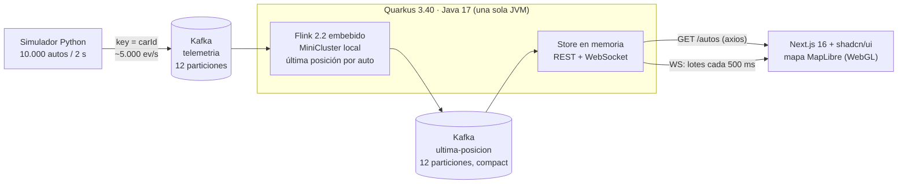
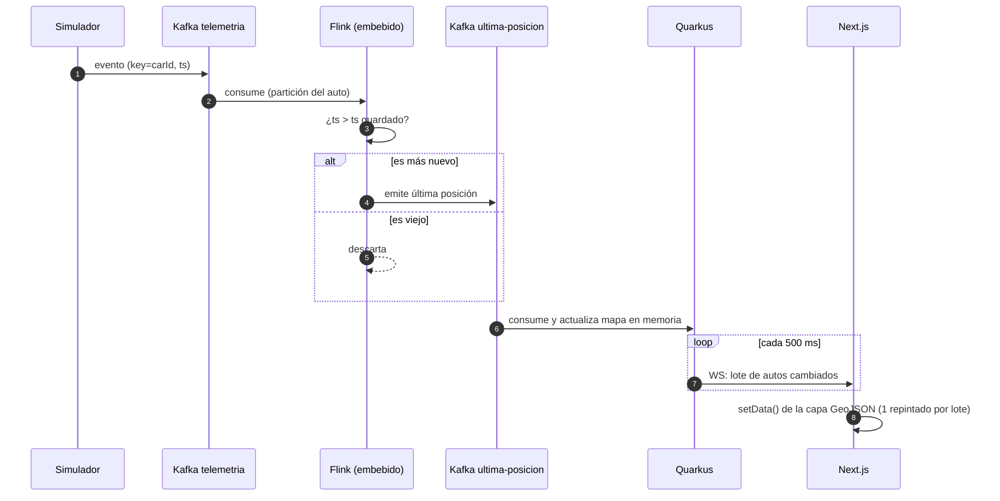
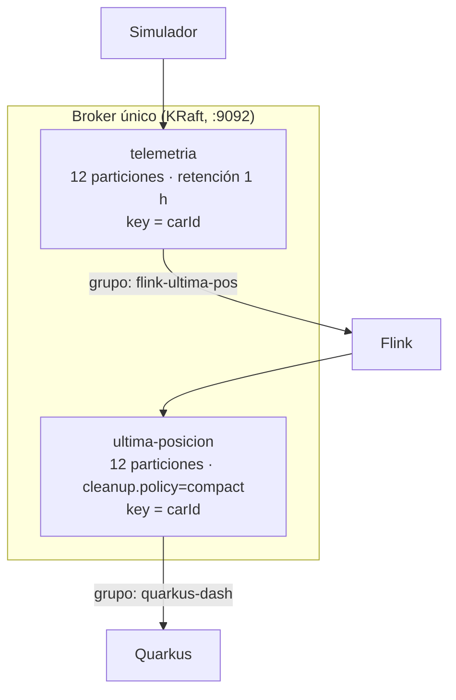
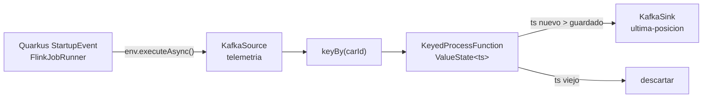
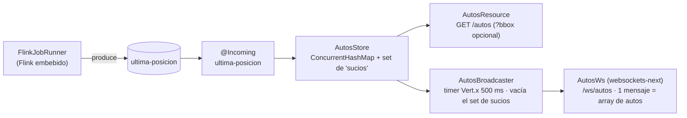
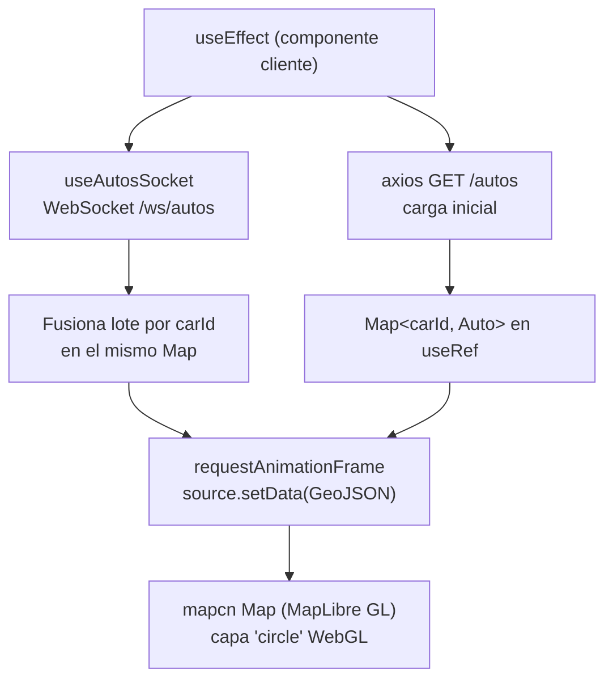
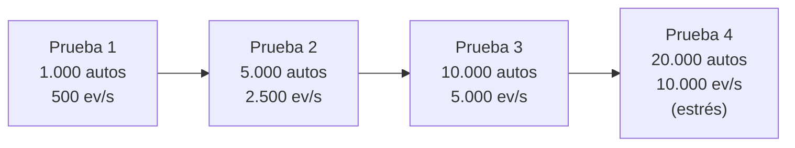
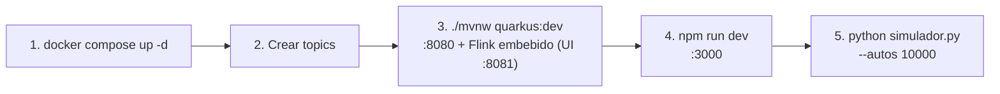
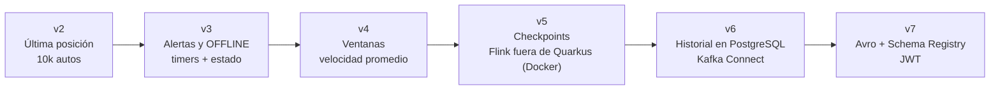

# Especificación del MVP: Telemetría de Autos en Tiempo Real (v2, carga 10.000 autos)

**Versión:** 2.1
**Stack:** Python · Apache Kafka (Docker) · Quarkus 3.40 LTS (Java 17) con Apache Flink 2.2 embebido · React 19 + Next.js 16 + shadcn/ui + MapLibre (mapcn)
**Carga objetivo:** 10.000 autos reportando cada 2 s = **5.000 eventos/s**

---

## 1. Resumen

Sistema que simula una flota de 10.000 autos, transporta su telemetría por Kafka, calcula con Flink la **última posición de cada auto** y la expone a un dashboard que la dibuja en un mapa en tiempo real.

**Objetivos del MVP**
1. Validar el flujo extremo a extremo.
2. Medir cómo se comporta con una carga realista (5.000 ev/s).
3. Servir como base de aprendizaje de Kafka y Flink.

## 2. Alcance

**Incluido:** simulador de flota, ingesta en Kafka, job Flink de última posición, API REST, WebSocket con actualizaciones por lotes, dashboard con mapa, plan de pruebas de carga.

**Fuera de alcance (v2):** autenticación, base de datos, ventanas de tiempo, alertas, clúster Flink (Flink corre **embebido dentro del proceso Quarkus**), Avro/Protobuf, alta disponibilidad.

## 3. Arquitectura



> Flink y Quarkus comparten proceso, pero se **mantiene el topic `ultima-posicion`** entre ambos: conserva la log compaction y permite reconstruir el estado de Quarkus al reiniciar.

### Responsabilidades

| Componente | Responsabilidad |
|---|---|
| **Simulador** | Generar eventos y publicarlos en `telemetria`, repartidos en el tiempo para evitar picos. |
| **Kafka** | Transportar, retener y ordenar por `carId`. |
| **Flink (embebido en Quarkus)** | Conservar el evento más reciente por auto y descartar eventos viejos. Arranca con la aplicación Quarkus. |
| **Quarkus** | Lanzar el job Flink al iniciar, mantener el último estado por auto y servirlo por REST y WebSocket (en lotes). |
| **Next.js** | Estado inicial por REST (axios), actualizaciones por WebSocket, pintado eficiente con una capa WebGL de MapLibre. |

### Flujo de un evento



## 4. Modelo de datos

Mismo esquema en ambos topics, en `GET /autos` y en el WebSocket (≈ **145 bytes** por evento en JSON compacto, medido).

```json
{"carId":"auto-1","companyId":"emp-03","fleetId":"emp-03-f2","lat":-12.0471,"lon":-77.0419,"heading":135,"engine":"ON","battery":87,"ts":1760000000000}
```

| Campo | Tipo | Descripción | Restricciones |
|---|---|---|---|
| `carId` | string | Identificador del auto | No nulo; igual a la key del mensaje |
| `companyId` | string \| null | Empresa dueña del auto | `null` = auto particular |
| `fleetId` | string \| null | Flota dentro de la empresa | `null` si y solo si `companyId` es `null`; empieza por el `companyId` |
| `lat` | double | Latitud | -90 a 90 |
| `lon` | double | Longitud | -180 a 180 |
| `heading` | int | Rumbo en grados desde el norte, sentido horario | 0 a 359; se conserva con el auto detenido |
| `engine` | string | Estado del motor | `ON` / `OFF` |
| `battery` | int | Batería en % | 0 a 100 |
| `ts` | long | Epoch ms UTC del evento | > 0 |

Jerarquía: **empresa → flotas → autos**, más autos particulares sin empresa. En el MVP los nombres visibles se derivan de los IDs (`emp-03` → "Empresa 03", `emp-03-f2` → "Flota 2"); no hay catálogo aparte.

## 5. Dimensionamiento

| Magnitud | Cálculo | Resultado |
|---|---|---|
| Eventos por segundo | 10.000 ÷ 2 s | **5.000 ev/s** |
| Ancho de banda de entrada | 5.000 × 145 B | **≈ 0,7 MB/s** (sin comprimir) |
| Eventos por día | 5.000 × 86.400 | 432 millones |
| Volumen por día en `telemetria` | 432 M × 145 B | **≈ 63 GB/día** |
| Estado de Flink | 10.000 claves × ~100 B | < 2 MB |
| Estado de Quarkus | 10.000 autos × ~150 B | < 3 MB |
| Respuesta de `GET /autos` | 10.000 × 145 B | **≈ 1,5 MB** |

**Decisiones derivadas**
- Retención de `telemetria` en **1 hora** (≈ 2,6 GB) para desarrollo, en vez de 7 días.
- `ultima-posicion` con **log compaction** (queda solo el último valor por auto).
- **12 particiones** en ambos topics, para poder escalar paralelismo hasta 12.
- El cuello de botella no es Kafka ni Flink, es **entregar 5.000 mensajes/s a un navegador**. De ahí el envío por lotes.

## 6. Especificación de Kafka



Creación de topics:

```bash
kafka-topics.sh --create --topic telemetria --partitions 12 --bootstrap-server localhost:9092 \
  --config retention.ms=3600000
kafka-topics.sh --create --topic ultima-posicion --partitions 12 --bootstrap-server localhost:9092 \
  --config cleanup.policy=compact
```

Reglas:
- La key es siempre `carId`: mismo auto, misma partición, orden garantizado.
- Un solo broker, replicación 1 (solo local), imagen `apache/kafka:4.2.1`. No usar 4.0.x: por [KAFKA-19888](https://issues.apache.org/jira/browse/KAFKA-19888), un retroceso del reloj de la VM de Docker deja inutilizable el coordinador de grupos (los consumidores no se unen ni confirman offsets).
- Si cambia el contrato del evento, recrear los topics (`./scripts/crear-topics.sh --recrear`): `ultima-posicion` está compactado y conserva el último evento de cada auto con el formato anterior.

## 7. Simulador (Python)

### Requisitos funcionales
- **RF-S1:** `N` autos (por defecto 10.000). Una fracción `--particulares` (por defecto 20 %) son autos particulares. El resto se reparte entre `--empresas` empresas (por defecto 12) con tamaños sesgados (pocas grandes, muchas chicas), y cada empresa se divide en flotas de 5 a 300 autos, con distribución log-uniforme: abundan las de 10 a 30.
- **RF-S1b:** cada flota opera alrededor de un *hub* situado en un distrito real de Lima y Callao (lista ponderada de 15 centros) y sus autos nacen cerca (σ ≈ 1–2 km). Los particulares se reparten por los distritos con más dispersión (σ ≈ 3 km). `--semilla` repite exactamente las mismas empresas, flotas y posiciones.
- **RF-S2:** cada auto reporta cada `INTERVALO` s (por defecto 2).
- **RF-S3:** el envío se **reparte en 100 rebanadas** (100 autos cada 20 ms) para evitar ráfagas de 10.000 mensajes simultáneos.
- **RF-S4:** cada auto tiene velocidad (20–50 km/h) y rumbo con giros suaves (σ 15° por evento), así que el `heading` es estable. Con motor OFF el auto está detenido. Los autos de flota vuelven hacia su hub si se alejan más de 2,5σ, y ningún auto sale de Lima. El motor cambia de estado con 1 % de probabilidad; la batería baja mientras el auto anda.
- **RF-S5:** key = `carId`, value = JSON compacto.

### Configuración del productor

| Parámetro | Valor | Motivo |
|---|---|---|
| `linger_ms` | 20 | Agrupar mensajes en lotes |
| `batch_size` | 128 KB | Menos peticiones al broker |
| `acks` | 1 | Balance velocidad/seguridad en MVP |
| `compression_type` | gzip | Reduce red y disco |
| `buffer_memory` | 128 MB | Absorbe picos |

### Parámetros de línea de comandos
`--autos 10000 --intervalo 2 --rebanadas 100 --empresas 12 --particulares 0.2 --semilla 7 --bench --duracion 5`

El modo `--bench` mide cuántos eventos/s puede **generar** el simulador sin Kafka.

### Resultado medido (modo `--bench`, 1 hilo)

| Métrica | Valor |
|---|---|
| Eventos generados + serializados | **≈ 170.000–198.000 ev/s** |
| Necesario para 10.000 autos / 2 s | 5.000 ev/s |
| Margen de generación | ≈ 34× |

La generación no es el límite. El límite será el cliente Kafka, que normalmente rinde decenas de miles de mensajes/s con estos ajustes. Si no alcanzara, se lanzan varios procesos con rangos de autos distintos (`--desde` / `--hasta`).

## 8. Job de Flink (embebido en Quarkus)



El job no es un proyecto aparte: vive en el backend Quarkus y se ejecuta en un **MiniCluster local dentro de la misma JVM**. No hay JobManager/TaskManager externos ni `flink run`.

### Requisitos funcionales
- **RF-F0:** el job se lanza automáticamente al arrancar Quarkus (`@Observes StartupEvent`) con `env.executeAsync(...)`, sin bloquear el arranque; se cancela en `@Observes ShutdownEvent` mediante el `JobClient`.
- **RF-F1:** consumir `telemetria` con grupo `flink-ultima-pos`.
- **RF-F2:** `keyBy(carId)`.
- **RF-F3:** `KeyedProcessFunction` con `ValueState<Long>` del último `ts`; emitir solo si el evento es más nuevo (corrige la limitación del `reduce` de v1).
- **RF-F4:** escribir en `ultima-posicion` con key `carId`.

### Configuración

| Aspecto | Valor |
|---|---|
| Versión | **Flink 2.2.1** + `flink-connector-kafka` **5.0.0-2.2** |
| Java | **17** (versión recomendada por Flink 2.x) |
| Paralelismo | **4** (≤ 12 particiones) |
| Offsets iniciales | `latest` |
| Ejecución | **MiniCluster embebido en Quarkus**, con UI web en `:8081` |
| Checkpoints | Desactivados en v2 |

> Flink 2.3.0 ya existe, pero el conector Kafka 5.0.0 se publica para la línea 2.2; se usa la pareja 2.2.1 / 5.0.0-2.2 por compatibilidad.

Esqueleto del lanzador:

```java
@ApplicationScoped
public class FlinkJobRunner {

    @ConfigProperty(name = "flink.parallelism", defaultValue = "4") int parallelism;
    @ConfigProperty(name = "flink.ui.port", defaultValue = "8081") int uiPort;

    private JobClient jobClient;

    void onStart(@Observes StartupEvent ev) throws Exception {
        Configuration conf = new Configuration();
        conf.set(RestOptions.PORT, uiPort);
        conf.set(PipelineOptions.CLASSPATHS, List.of(clasesDeLaAplicacion().toString()));  // ver abajo
        conf.set(CoreOptions.CLASSLOADER_RESOLVE_ORDER, "parent-first");
        var env = StreamExecutionEnvironment.createLocalEnvironmentWithWebUI(conf);
        env.setParallelism(parallelism);
        UltimaPosicionJob.build(env);           // define source → keyBy → process → sink
        jobClient = env.executeAsync("ultima-posicion");
    }

    void onStop(@Observes ShutdownEvent ev) {
        if (jobClient != null) jobClient.cancel().join();
    }
}
```

Reglas del código Flink dentro de Quarkus:
- Los operadores (`KeyedProcessFunction`, serializadores) se **serializan** y corren en hilos de Flink: no inyectar beans CDI dentro de ellos; pasar solo valores simples (bootstrap servers, nombres de topic).
- Usar los (de)serializadores propios de Flink (`DeserializationSchema`/`SerializationSchema` con un `ObjectMapper` propio) y no depender del `ObjectMapper` de Quarkus.
- El job usa su propio record (`flink/Posicion`), no las clases de `autos/`: el contrato entre ambas features es el JSON del topic.
- Sin checkpoints, Flink no confirma offsets; el `KafkaSource` activa `enable.auto.commit` para poder medir el lag del grupo `flink-ultima-pos`.

**Classloaders (imprescindible).** Si el job no declara jars ni classpaths, el JobManager del MiniCluster deserializa el job con `ClassLoader.getSystemClassLoader()`. En Quarkus las dependencias las carga el classloader de Quarkus, así que falla con `ClassNotFoundException` (de clases de Flink en el jar, de clases de la app en `quarkus:dev`). Por eso se declara `pipeline.classpaths` con la ubicación real de las clases de la app (`target/classes` en dev, el jar al empaquetar) y orden `parent-first`. Funciona en `quarkus:dev` (incluida la recarga en caliente, que cancela y relanza el job) y en el jar.

**Flags `--add-opens`.** Los scripts de la distribución de Flink los añaden, pero con JDK 17.0.20 y Flink 2.2.1 no hicieron falta: el job corrió con 10.000 autos sin ellos, tanto en dev como en el jar. Si apareciera `InaccessibleObjectException`, añadir `--add-opens=java.base/java.lang=ALL-UNNAMED`, `java.util`, `java.lang.reflect`, `java.io`, `java.net`, `java.nio`, `sun.nio.ch` y `java.util.concurrent` (`-Djvm.args="..."` en dev, `java --add-opens=... -jar` en el jar).

## 9. Backend (Quarkus)



### Versiones

| Pieza | Versión |
|---|---|
| Java | 17 |
| Quarkus | **3.40.x LTS** (3.40.1 a la fecha; mantenido hasta 2027-09-30) |
| Build | Maven |

### Dependencias

**Extensiones Quarkus** (seleccionarlas en code.quarkus.io o con `quarkus ext add`):

| Extensión | Para qué |
|---|---|
| `quarkus-rest` | Endpoints REST (`GET /autos`) |
| `quarkus-rest-jackson` | Serialización JSON |
| `quarkus-websockets-next` | WebSocket `/ws/autos` |
| `quarkus-messaging-kafka` | `@Incoming` desde `ultima-posicion` (SmallRye Reactive Messaging) |
| `quarkus-arc` | CDI (incluida por defecto) |
| `quarkus-junit` | Tests (scope `test`) |

> El ticker de 500 ms usa un temporizador de Vert.x: `@Scheduled` (`quarkus-scheduler`) solo evalúa sus triggers una vez por segundo y no sirve para periodos menores.

```bash
quarkus ext add rest rest-jackson websockets-next messaging-kafka
```

**Dependencias Maven de Flink** (añadir a mano en `pom.xml`):

```xml
<properties>
  <flink.version>2.2.1</flink.version>
  <flink-kafka.version>5.0.0-2.2</flink-kafka.version>
</properties>

<dependency>
  <groupId>org.apache.flink</groupId>
  <artifactId>flink-streaming-java</artifactId>
  <version>${flink.version}</version>
</dependency>
<dependency>
  <groupId>org.apache.flink</groupId>
  <artifactId>flink-clients</artifactId>
  <version>${flink.version}</version>
</dependency>
<dependency>
  <groupId>org.apache.flink</groupId>
  <artifactId>flink-runtime-web</artifactId>   <!-- UI :8081 -->
  <version>${flink.version}</version>
</dependency>
<dependency>
  <groupId>org.apache.flink</groupId>
  <artifactId>flink-connector-base</artifactId>
  <version>${flink.version}</version>
</dependency>
<dependency>
  <groupId>org.apache.flink</groupId>
  <artifactId>flink-connector-kafka</artifactId>
  <version>${flink-kafka.version}</version>
</dependency>
```

Notas de classpath:
- Dejar que el BOM de Quarkus gobierne la versión de `kafka-clients`; si hay choque con el conector de Flink, excluir `kafka-clients` de `flink-connector-kafka`.
- No añadir `quarkus-kafka-streams` (no se usa).
- Flink trae sus propias dependencias sombreadas (`flink-shaded-*`), así que no compite con el Jackson/Netty de Quarkus.

### Cambios clave respecto a v1

| Tema | v1 | v2 |
|---|---|---|
| WebSocket | 1 mensaje por evento | **Lote cada 500 ms** con solo los autos que cambiaron |
| `GET /autos` | Sin compresión | Con compresión HTTP (`quarkus.http.enable-compression=true`) |
| Filtro espacial | No | `GET /autos?bbox=minLon,minLat,maxLon,maxLat` (opcional) |

### Requisitos funcionales
- **RF-Q1:** consumir `ultima-posicion` y actualizar el mapa en memoria. El consumidor recibe **lotes** (`batch=true`, `List<Auto>`) y es `@NonBlocking`: un `void recibir(Auto)` se ejecuta como bloqueante, con un salto de hilo por mensaje, y medido con 10.000 autos acumulaba ~11 s de atraso.
- **RF-Q2:** marcar cada auto actualizado en un set de "sucios".
- **RF-Q3:** cada 500 ms, emitir por WebSocket un único mensaje JSON con el arreglo de autos sucios y limpiar el set.
- **RF-Q4:** `GET /autos` devuelve el estado completo (≈ 1 MB sin comprimir).

### Contratos

**`GET /autos`** → `200`, array de eventos (esquema §4).

**`WS /ws/autos`** → mensajes de la forma:

```json
[
  {"carId":"auto-1","lat":-12.0471,"lon":-77.0419,"engine":"ON","battery":87,"ts":1760000000000},
  {"carId":"auto-2","lat":-12.0502,"lon":-77.0391,"engine":"OFF","battery":54,"ts":1760000000010}
]
```

Volumen esperado por cliente: ≈ 2.500 autos por lote × 101 B ≈ **250 KB cada 500 ms (≈ 0,5 MB/s)**.

### Configuración

```properties
kafka.bootstrap.servers=localhost:9092
mp.messaging.incoming.ultima-posicion.connector=smallrye-kafka
mp.messaging.incoming.ultima-posicion.group.id=quarkus-dash
mp.messaging.incoming.ultima-posicion.auto.offset.reset=earliest
mp.messaging.incoming.ultima-posicion.batch=true
quarkus.http.cors.enabled=true
quarkus.http.cors.origins=http://localhost:3000
quarkus.http.enable-compression=true

# Flink embebido (propiedades propias leídas por FlinkJobRunner)
flink.parallelism=4
flink.ui.port=8081
flink.kafka.group=flink-ultima-pos
flink.topic.in=telemetria
flink.topic.out=ultima-posicion
```

> WebFlux es de Spring; en Quarkus el modelo reactivo es Mutiny (`Multi`/`Uni`) con `websockets-next`.

## 10. Frontend (React 19 + Next.js 16 + shadcn/ui + MapLibre)



### Versiones y librerías

| Pieza | Versión / paquete |
|---|---|
| Next.js | **16.x** (App Router, React 19, TypeScript, Tailwind CSS v4) |
| Componentes UI | **shadcn/ui** (`shadcn@latest`) |
| Mapa | **mapcn** (`@mapcn/map`, registro shadcn sobre **MapLibre GL**; instala `maplibre-gl`) |
| HTTP | **axios** 1.x (carga inicial) |
| Tiempo real | `WebSocket` nativo del navegador |

Creación del proyecto (lo hace el usuario):

```bash
npx create-next-app@latest dashboard-next --ts --tailwind --app --eslint
cd dashboard-next
npx shadcn@latest init
npx shadcn@latest add card badge tooltip @mapcn/map
npm i axios
```

Variables de entorno (`.env.local`):

```properties
NEXT_PUBLIC_API_URL=http://localhost:8080
NEXT_PUBLIC_WS_URL=ws://localhost:8080/ws/autos
```

> Basemap: mapcn usa por defecto teselas de CARTO (OpenStreetMap). Para uso comercial se requiere licencia de CARTO o cambiar a otro proveedor compatible con MapLibre.

### Requisitos funcionales
- **RF-U1:** mapa a pantalla completa centrado en Lima (`[-77.0428, -12.0464]`), zoom 11. El componente del mapa es `"use client"` y se carga con `dynamic(..., { ssr: false })`, porque MapLibre necesita `window`.
- **RF-U2:** **no usar un marcador React/DOM por auto** (10.000 nodos DOM no son viables). Usar **una sola fuente GeoJSON** y una **capa `circle`** de MapLibre (WebGL, `circle-radius` 3-4), accediendo a la instancia del mapa que expone mapcn.
- **RF-U3:** instancia axios en `lib/` (`baseURL = NEXT_PUBLIC_API_URL`) usada por `features/autos/api.ts` para `GET /autos`; hook `features/autos/hooks/use-autos-socket.ts` con WebSocket nativo y reconexión con backoff. Cada lote se **fusiona por `carId`** en un `Map<carId, Auto>` guardado en `useRef` (no en estado React, para no re-renderizar 10.000 elementos) y se aplica con un único `source.setData()` por `requestAnimationFrame`.
- **RF-U4:** color por `engine` con una expresión de estilo: `["match", ["get","engine"], "ON", "#16a34a", "#dc2626"]` (verde `ON`, rojo `OFF`).
- **RF-U5:** el popup/tooltip se crea solo en `mouseenter` sobre la capa (`map.on('mouseenter', 'autos', ...)`), no para los 10.000.
- **RF-U6:** contador en pantalla con un `Card` de shadcn: autos en pantalla, lotes/s, edad del último dato y latencia p95; empresas, flotas y particulares, o, con una empresa seleccionada, sus autos, flotas y % de motor encendido.
- **RF-U7 (empresas y flotas):** nunca se pintan todos los autos de empresa a la vez.
  - **Sin selección:** una burbuja por empresa (marcador de mapcn) anclada en su flota más grande, con el total y una barra de % de motor encendido. Los particulares siempre se ven sueltos.
  - **Al elegir una empresa** (con el `Select` del panel o con clic en su burbuja): se ven sus flotas como burbujas y el mapa se encuadra en la empresa.
  - **Desde zoom 14:** las burbujas de flota dan paso a los autos individuales de esa empresa. Clic en una flota acerca el zoom a ella.
  - **Burbujas solapadas:** si quedarían a menos de 70 px en pantalla, se fusionan ("3 flotas"), con borde punteado y una lista para elegir. Se recalculan al terminar cada movimiento del mapa.
- **RF-U8:** la agregación por empresa y por flota (`features/autos/agrupar.ts`) son funciones puras O(n) que se ejecutan en el mismo `requestAnimationFrame` del repintado y se publican al estado de React como mucho cada 500 ms.

> Si hiciera falta más rendimiento, la alternativa es deck.gl `ScatterplotLayer` sobre el mismo mapa MapLibre.

## 11. Plan de pruebas de carga



Cada prueba dura **10 minutos** con `python simulador.py --autos N --intervalo 2`.

### Qué medir y cómo

| Métrica | Herramienta | Objetivo (10.000 autos) |
|---|---|---|
| Ritmo real del productor | Log del simulador (cada 5 s) | ≥ 4.900 ev/s |
| Techo de Kafka (línea base) | `kafka-producer-perf-test.sh` | ≫ 5.000 ev/s |
| Lag de Flink | `kafka-consumer-groups.sh --describe` (grupo `flink-ultima-pos`) | < 1.000 mensajes |
| Lag de Quarkus | Igual (grupo `quarkus-dash`) | < 1.000 mensajes |
| Backpressure y throughput Flink | UI de Flink `:8081` (servida por el proceso Quarkus) | Operadores en "OK", sin backpressure |
| Latencia extremo a extremo | `Date.now() - ts` en el navegador | p95 < 2 s |
| CPU y memoria | Monitor del sistema / `docker stats` / heap de la JVM Quarkus+Flink | Sin saturación sostenida |
| Fluidez del mapa | FPS del navegador (DevTools) | ≥ 30 FPS |

### Línea base de Kafka

```bash
kafka-producer-perf-test.sh --topic telemetria --num-records 1000000 --record-size 101 \
  --throughput -1 --producer-props bootstrap.servers=localhost:9092 linger.ms=20 batch.size=131072
```

### Estado de las pruebas

| Prueba | Estado |
|---|---|
| Generación del simulador a 10.000 autos | **Ejecutada:** ≈ 163.000 ev/s (1 hilo) |
| Pruebas con Kafka, Quarkus + Flink embebido y Next.js | **Pendientes:** requieren Docker, JDK 17 y Node.js en tu máquina; ejecuta las pruebas 1 a 4 y compara con los objetivos |

## 12. Requisitos no funcionales

| ID | Requisito | Valor objetivo |
|---|---|---|
| RNF-1 | Latencia extremo a extremo (p95) | < 2 s |
| RNF-2 | Capacidad sostenida | 10.000 autos / 2 s (5.000 ev/s) |
| RNF-3 | Orden por auto | Garantizado (key = `carId`) |
| RNF-4 | Fluidez del dashboard | ≥ 30 FPS con 10.000 puntos en el mapa |
| RNF-5 | Entorno | Ejecución 100 % local |
| RNF-6 | Seguridad / alta disponibilidad | No incluidas |

## 13. Ejecución



| Servicio | Puerto |
|---|---|
| Kafka (Docker) | 9092 |
| Quarkus | 8080 |
| Flink UI (dentro de Quarkus) | 8081 |
| Next.js | 3000 |

Estructura del repositorio:

```
telemetria-mvp/
├── docker-compose.yml
├── simulador/simulador.py
├── telemetry-api/
│   ├── pom.xml                       (extensiones Quarkus + Flink 2.2.1)
│   └── src/main/java/dev/bryan/
│       ├── autos/     (Auto, AutosStore, AutosConsumer, AutosResource, AutosWs, AutosBroadcaster)
│       ├── flink/     (FlinkJobRunner, UltimaPosicionJob, UltimaPosicionFunction)
│       └── shared/    (error/, config/)
├── dashboard-next/
│   ├── app/page.tsx
│   ├── features/autos/               (components/autos-map.tsx "use client", hooks/use-autos-socket.ts, api.ts, types.ts, index.ts)
│   ├── components/ui/                (shadcn + mapcn)
│   └── lib/                          (instancia axios, utilidades)
└── README.md
```

Organización **por features** en backend y frontend (ver `knowledge/standards/STD-ARCH-001-arquitectura-por-features.md`). Los DTOs son `record` escritos a mano.

## 14. Criterios de aceptación

- [ ] El simulador mantiene ≥ 4.900 ev/s durante 10 minutos con 10.000 autos.
- [ ] El lag de Flink y de Quarkus se mantiene < 1.000 mensajes.
- [ ] `GET /autos` devuelve exactamente un registro por auto (10.000).
- [ ] El mapa muestra los 10.000 autos y se mueve a ≥ 30 FPS.
- [ ] Latencia extremo a extremo p95 < 2 s.
- [ ] Un evento con `ts` antiguo no reemplaza a uno más reciente.
- [ ] Al reiniciar Quarkus, el estado se reconstruye desde `ultima-posicion`.
- [ ] Al arrancar Quarkus, el job Flink embebido se inicia solo y la UI `:8081` responde; al detenerlo, el job se cancela limpiamente.

## 15. Riesgos

| Riesgo | Impacto | Mitigación |
|---|---|---|
| Navegador saturado por 5.000 msg/s | UI congelada | Lotes de 500 ms, capa WebGL de MapLibre, estado fuera de React, `requestAnimationFrame` |
| Productor Python limitado | No llega a 5.000 ev/s | Ajustar `linger_ms`/`batch_size`; varios procesos |
| Disco lleno por 43 GB/día | Kafka se detiene | Retención de 1 h en `telemetria` |
| Flink y Quarkus comparten heap | Backpressure, GC largos | Subir `-Xmx`, paralelismo 2-4, o sacar Flink a Docker (v5) |
| Classloaders de Flink dentro de Quarkus | El job no arranca (`ClassNotFoundException`) | `pipeline.classpaths` con las clases de la app y `parent-first` (§8) |
| Flink embebido sin `--add-opens` (no observado con JDK 17.0.20) | `InaccessibleObjectException` al serializar | Pasar los flags JVM de §8 en dev y en el jar |
| Coordinador de grupos de Kafka 4.0.x con el reloj de la VM retrocediendo (KAFKA-19888) | Consumidores sin unirse ni confirmar offsets, lag que crece sin fin | Kafka 4.2.1 (§6) |
| `ultima-posicion` sin compactar en desarrollo | Al arrancar, Quarkus relee todo el historial del topic | La compactación solo actúa sobre segmentos cerrados; si molesta, bajar `segment.ms` del topic |
| Conflictos de classpath Flink/Quarkus | Errores al arrancar (`kafka-clients`, classloader de dev mode) | Excluir `kafka-clients` del conector; si dev mode falla, ejecutar con el jar (`quarkus-run.jar`) |
| `GET /autos` de 1 MB en cada carga | Arranque lento | Compresión HTTP y filtro `bbox` |
| Eventos desordenados | Posición vieja | `KeyedProcessFunction` que compara `ts` |

## 16. Evolución


