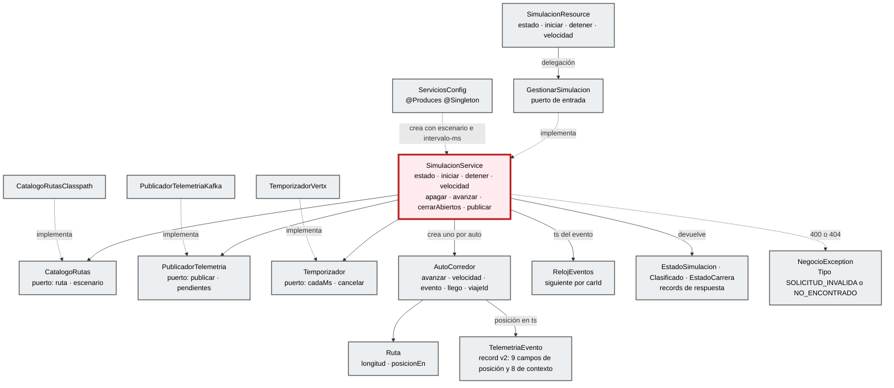

# Código (C4 nivel 4)

**Foco:** la clase `SimulacionService` (borde dark red 700), la de más lógica del núcleo y la que cruza todas las capas.

## Diagrama

Fuente: [`diagrams/code.mmd`](diagrams/code.mmd).

## Elementos del foco

| Elemento | Qué hace | Archivo |
|---|---|---|
| `SimulacionService` | Orquesta la carrera: inicia, detiene, cambia velocidades, avanza cada intervalo y publica `INICIO`, `POSICION` y `FIN`; sincronizado | [`SimulacionService.java`](../../src/main/java/dev/bryan/application/service/SimulacionService.java) |
| `GestionarSimulacion` | Puerto de entrada de la simulación (`estado`, `iniciar`, `detener`, `velocidad`, `apagar`) | [`GestionarSimulacion.java`](../../src/main/java/dev/bryan/application/port/in/GestionarSimulacion.java) |
| `CatalogoRutas · PublicadorTelemetria · Temporizador` | Puertos de salida que usa el servicio | [`CatalogoRutas.java`](../../src/main/java/dev/bryan/application/port/out/CatalogoRutas.java) |
| `AutoCorredor` | Avanza por la ruta a la velocidad elegida (10 a 500 km/h) y calcula el instante de llegada | [`AutoCorredor.java`](../../src/main/java/dev/bryan/domain/service/AutoCorredor.java) |
| `Ruta` | Polilínea con distancias acumuladas; `posicionEn(metros)` | [`Ruta.java`](../../src/main/java/dev/bryan/domain/model/Ruta.java) |
| `RelojEventos` | `ts` estrictamente creciente por `carId` | [`RelojEventos.java`](../../src/main/java/dev/bryan/domain/service/RelojEventos.java) |
| `TelemetriaEvento` | Record del evento v2: 9 campos de posición y 8 de contexto | [`TelemetriaEvento.java`](../../src/main/java/dev/bryan/domain/model/TelemetriaEvento.java) |
| `EstadoSimulacion · Clasificado · EstadoCarrera` | Respuesta pública de `/simulacion` | [`EstadoSimulacion.java`](../../src/main/java/dev/bryan/domain/model/EstadoSimulacion.java) |
| `NegocioException` | Error de negocio con `Tipo` independiente de HTTP | [`NegocioException.java`](../../src/main/java/dev/bryan/domain/exception/NegocioException.java) |
| `ServiciosConfig` | `@Produces @Singleton` de los seis servicios; lee `simulacion.escenario` e `intervalo-ms` | [`ServiciosConfig.java`](../../src/main/java/dev/bryan/infrastructure/config/ServiciosConfig.java) |
| `CatalogoRutasClasspath` | Lee `rutas/*.geojson` y `escenarios/*.json`; valida el id con un patrón | [`CatalogoRutasClasspath.java`](../../src/main/java/dev/bryan/infrastructure/out/classpath/CatalogoRutasClasspath.java) |
| `PublicadorTelemetriaKafka` | Serializa una vez y encadena las publicaciones por auto | [`PublicadorTelemetriaKafka.java`](../../src/main/java/dev/bryan/infrastructure/out/kafka/PublicadorTelemetriaKafka.java) |
| `TemporizadorVertx` | `vertx.setPeriodic` detrás del puerto `Temporizador` | [`TemporizadorVertx.java`](../../src/main/java/dev/bryan/infrastructure/out/vertx/TemporizadorVertx.java) |
| `SimulacionResource` | Valida el cuerpo y delega en `GestionarSimulacion` | [`SimulacionResource.java`](../../src/main/java/dev/bryan/infrastructure/in/rest/SimulacionResource.java) |

## Las demás capacidades

| Capacidad | Elementos clave | Archivos |
|---|---|---|
| flink | `FlinkJobRunner` lanza el job con `executeAsync` y declara `pipeline.classpaths` con `parent-first`; `UltimaPosicionJob` arma `KafkaSource` → `keyBy` → `KafkaSink`; `UltimaPosicionFunction` guarda el `ts` mayor | [`infrastructure/flink/`](../../src/main/java/dev/bryan/infrastructure/flink/) |
| autos | `AutosConsumer` → `IngestaAutosService` → `AutosStore` (upsert `RETURNING`) → `AutosCambios` → `AutosBroadcaster` | [`AutosStore`](../../src/main/java/dev/bryan/infrastructure/out/persistence/autos/AutosStore.java), [`AutosBroadcaster`](../../src/main/java/dev/bryan/infrastructure/out/ws/AutosBroadcaster.java) |
| viajes | `ViajesConsumer` → `IngestaViajesService` → `ViajesStore` (bloqueo por viaje, idempotencia por `eventId`); `ViajesConsulta` con keyset y snapshot de solo lectura | [`ViajesStore`](../../src/main/java/dev/bryan/infrastructure/out/persistence/viajes/ViajesStore.java), [`ViajesConsulta`](../../src/main/java/dev/bryan/infrastructure/out/persistence/viajes/ViajesConsulta.java) |
| esquema | `tb_ultima_posicion`, `tb_viaje`, `tb_posicion_historial` con sus `CHECK`; entities que Hibernate valida | [`V1__posiciones_y_viajes.sql`](../../src/main/resources/db/migration/V1__posiciones_y_viajes.sql) |

## Notas de diseño verificables en el código

- `SimulacionService` mantiene el estado de la carrera en memoria y es `synchronized`; reiniciar la API reinicia la carrera, pero los viajes ya guardados se conservan.
- El avance de la carrera lo dispara el puerto `Temporizador` (Vert.x), no `@Scheduled`, porque el planificador de Quarkus solo evalúa una vez por segundo.
- Los tipos de `domain` son `record`; las entities de persistencia son clases escritas a mano y no salen de `infrastructure/out/persistence`.

## Traceability

- Anterior: [component.md](component.md) · Secuencias: [sequence-e2e.md](sequence-e2e.md)
