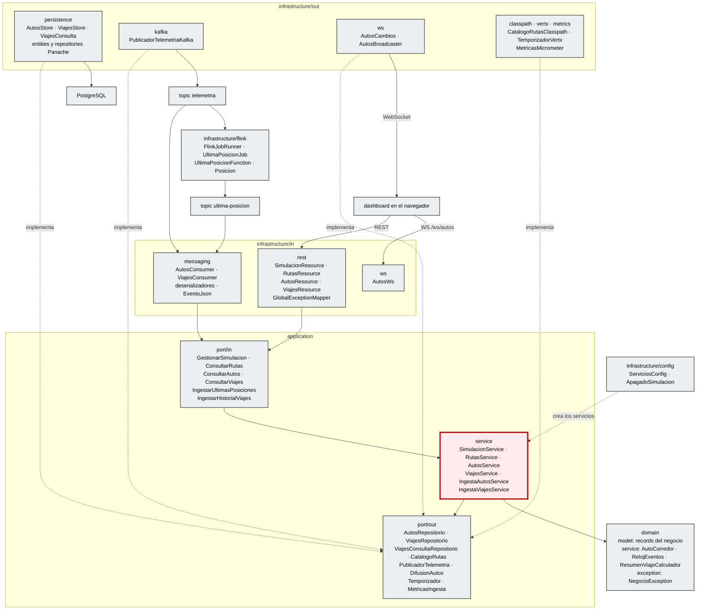

# Componentes (C4 nivel 3)

**Foco:** los servicios de `application` (borde dark red 700), que implementan los casos de uso entre los puertos.

## Diagrama

Fuente: [`diagrams/component.mmd`](diagrams/component.mmd).

## Componentes

| Componente | Responsabilidad | Código |
|---|---|---|
| rest | Recursos HTTP, validación de entrada y traducción de errores (`GlobalExceptionMapper`, `ErrorResponse`) | [`SimulacionResource.java`](../../src/main/java/dev/bryan/infrastructure/in/rest/SimulacionResource.java) · [`RutasResource.java`](../../src/main/java/dev/bryan/infrastructure/in/rest/RutasResource.java) · [`AutosResource.java`](../../src/main/java/dev/bryan/infrastructure/in/rest/AutosResource.java) · [`ViajesResource.java`](../../src/main/java/dev/bryan/infrastructure/in/rest/ViajesResource.java) · [`GlobalExceptionMapper.java`](../../src/main/java/dev/bryan/infrastructure/in/rest/GlobalExceptionMapper.java) |
| ws | Endpoint `/ws/autos`; solo registra la apertura, los mensajes los envía `AutosBroadcaster` | [`AutosWs.java`](../../src/main/java/dev/bryan/infrastructure/in/ws/AutosWs.java) |
| messaging | Consumidores por lotes, deserializadores y validación del contrato v2 | [`AutosConsumer.java`](../../src/main/java/dev/bryan/infrastructure/in/messaging/autos/AutosConsumer.java) · [`ViajesConsumer.java`](../../src/main/java/dev/bryan/infrastructure/in/messaging/viajes/ViajesConsumer.java) · [`EventoViajeFailureHandler.java`](../../src/main/java/dev/bryan/infrastructure/in/messaging/viajes/EventoViajeFailureHandler.java) |
| port/in | Casos de uso que ofrece el núcleo | [`GestionarSimulacion.java`](../../src/main/java/dev/bryan/application/port/in/GestionarSimulacion.java) · [`ConsultarViajes.java`](../../src/main/java/dev/bryan/application/port/in/ConsultarViajes.java) · [`IngestarHistorialViajes.java`](../../src/main/java/dev/bryan/application/port/in/IngestarHistorialViajes.java) |
| service (foco) | Implementa los casos de uso; no usa CDI, lo crea `ServiciosConfig` | [`SimulacionService.java`](../../src/main/java/dev/bryan/application/service/SimulacionService.java) · [`IngestaViajesService.java`](../../src/main/java/dev/bryan/application/service/IngestaViajesService.java) · [`IngestaAutosService.java`](../../src/main/java/dev/bryan/application/service/IngestaAutosService.java) · [`ViajesService.java`](../../src/main/java/dev/bryan/application/service/ViajesService.java) · [`AutosService.java`](../../src/main/java/dev/bryan/application/service/AutosService.java) · [`RutasService.java`](../../src/main/java/dev/bryan/application/service/RutasService.java) |
| port/out | Lo que el núcleo necesita del exterior | [`AutosRepositorio.java`](../../src/main/java/dev/bryan/application/port/out/AutosRepositorio.java) · [`ViajesRepositorio.java`](../../src/main/java/dev/bryan/application/port/out/ViajesRepositorio.java) · [`PublicadorTelemetria.java`](../../src/main/java/dev/bryan/application/port/out/PublicadorTelemetria.java) · [`Temporizador.java`](../../src/main/java/dev/bryan/application/port/out/Temporizador.java) · [`CatalogoRutas.java`](../../src/main/java/dev/bryan/application/port/out/CatalogoRutas.java) |
| domain | Records del negocio, reglas de la carrera y cálculo del resumen de un viaje | [`AutoCorredor.java`](../../src/main/java/dev/bryan/domain/service/AutoCorredor.java) · [`ResumenViajeCalculador.java`](../../src/main/java/dev/bryan/domain/service/ResumenViajeCalculador.java) · [`RelojEventos.java`](../../src/main/java/dev/bryan/domain/service/RelojEventos.java) · [`NegocioException.java`](../../src/main/java/dev/bryan/domain/exception/NegocioException.java) |
| persistence | Panache para leer; SQL nativo para el upsert atómico, los `INSERT … ON CONFLICT` y el snapshot de lectura | [`AutosStore.java`](../../src/main/java/dev/bryan/infrastructure/out/persistence/autos/AutosStore.java) · [`ViajesStore.java`](../../src/main/java/dev/bryan/infrastructure/out/persistence/viajes/ViajesStore.java) · [`ViajesConsulta.java`](../../src/main/java/dev/bryan/infrastructure/out/persistence/viajes/ViajesConsulta.java) · [`CursorViajes.java`](../../src/main/java/dev/bryan/infrastructure/out/persistence/viajes/CursorViajes.java) |
| kafka · ws · classpath · vertx · metrics | Adaptadores de salida: publicación, difusión, catálogo, temporizador y métricas | [`PublicadorTelemetriaKafka.java`](../../src/main/java/dev/bryan/infrastructure/out/kafka/PublicadorTelemetriaKafka.java) · [`AutosBroadcaster.java`](../../src/main/java/dev/bryan/infrastructure/out/ws/AutosBroadcaster.java) · [`CatalogoRutasClasspath.java`](../../src/main/java/dev/bryan/infrastructure/out/classpath/CatalogoRutasClasspath.java) · [`TemporizadorVertx.java`](../../src/main/java/dev/bryan/infrastructure/out/vertx/TemporizadorVertx.java) · [`MetricasMicrometer.java`](../../src/main/java/dev/bryan/infrastructure/out/metrics/MetricasMicrometer.java) |
| flink | Job `ultima-posicion` en MiniCluster; operadores serializables, sin CDI | [`FlinkJobRunner.java`](../../src/main/java/dev/bryan/infrastructure/flink/FlinkJobRunner.java) · [`UltimaPosicionJob.java`](../../src/main/java/dev/bryan/infrastructure/flink/UltimaPosicionJob.java) · [`UltimaPosicionFunction.java`](../../src/main/java/dev/bryan/infrastructure/flink/UltimaPosicionFunction.java) |
| config | Composición de los servicios y apagado ordenado de la simulación | [`ServiciosConfig.java`](../../src/main/java/dev/bryan/infrastructure/config/ServiciosConfig.java) · [`ApagadoSimulacion.java`](../../src/main/java/dev/bryan/infrastructure/config/ApagadoSimulacion.java) |

## Las cuatro capacidades sobre las capas

`simulacion`, `flink`, `autos` y `viajes` ya no son paquetes de primer nivel: son capacidades que cruzan las capas. Se comunican solo por los topics.

| Capacidad | `in` | `application` | `out` |
|---|---|---|---|
| simulacion | `SimulacionResource`, `RutasResource` | `GestionarSimulacion` / `SimulacionService`, `ConsultarRutas` / `RutasService` | `PublicadorTelemetriaKafka`, `CatalogoRutasClasspath`, `TemporizadorVertx` |
| flink | — (lee `telemetria`) | — | publica en `ultima-posicion`; vive entero en `infrastructure/flink` |
| autos | `AutosResource`, `AutosWs`, `AutosConsumer` | `ConsultarAutos` / `AutosService`, `IngestarUltimasPosiciones` / `IngestaAutosService` | `AutosStore`, `AutosCambios`, `AutosBroadcaster` |
| viajes | `ViajesResource`, `ViajesConsumer` | `ConsultarViajes` / `ViajesService`, `IngestarHistorialViajes` / `IngestaViajesService` | `ViajesStore`, `ViajesConsulta`, `MetricasMicrometer` |

## Reglas que lo mantienen así

- `domain` y `application` no importan Quarkus, Vert.x, Flink, Kafka, Hibernate, JDBC ni Jackson; `infrastructure.in` no usa `infrastructure.out`; solo `out.persistence` conoce Hibernate y JPA; `autos`, `viajes` y `flink` no se ven entre sí ([`ArquitecturaHexagonalTest`](../../src/test/java/dev/bryan/ArquitecturaHexagonalTest.java)).
- Las capacidades no se acoplan por memoria: `simulacion` publica en `telemetria`, `flink` la lee y publica en `ultima-posicion`, `autos` consume `ultima-posicion` y `viajes` consume `telemetria` directamente para guardar también las muestras atrasadas que Flink descarta.

## Traceability

- Anterior: [container.md](container.md) · Siguiente: [code.md](code.md) · Decisiones: [`ADR-006`](../../../knowledge/adrs/ADR-006-arquitectura-hexagonal-backend.md), [`ADR-007`](../../../knowledge/adrs/ADR-007-persistencia-hibernate-panache.md)
