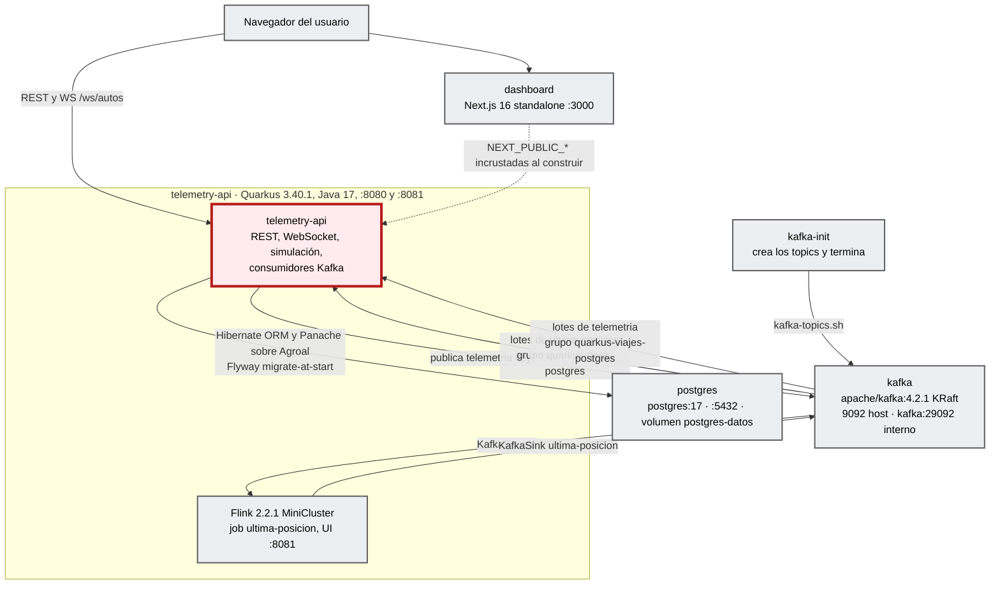

# Contenedores (C4 nivel 2)

**Foco:** `telemetry-api` (borde dark red 700). Contiene el MiniCluster de Flink en la misma JVM.

## Diagrama

Fuente: [`diagrams/container.mmd`](diagrams/container.mmd).

## Contenedores

| Contenedor | Tecnología | Puertos | Notas |
|---|---|---|---|
| `telemetry-api` | Quarkus 3.40.1 LTS, Java 17, Flink 2.2.1 embebido, SmallRye Reactive Messaging, websockets-next, Hibernate ORM con Panache, Flyway, SmallRye Health, Micrometer | 8080 (REST y WS), 8081 (UI de Flink) | Imagen multietapa con el fast-jar por capas, usuario no root, `mem_limit: 2g`, healthcheck `GET /q/health/ready` ([`Dockerfile`](../../Dockerfile)) |
| `postgres` | `postgres:17` | 5432 | Volumen `postgres-datos`; el esquema lo crea Flyway y Hibernate lo valida |
| `kafka` | `apache/kafka:4.2.1` (KRaft) | 9092 host, `kafka:29092` interno | Volumen `kafka-datos`; la 4.0.x se evita por KAFKA-19888 |
| `kafka-init` | `apache/kafka:4.2.1` | — | Crea `telemetria` (12 particiones, retención 1 h) y `ultima-posicion` (12 particiones, compact) y termina |
| `dashboard` | Next.js 16 | 3000 | Fuera del foco |

## Relaciones en runtime

| Relación | Mecanismo | Detalle |
|---|---|---|
| `telemetry-api` → `kafka` | Emitter `telemetria-out`, clave `carId` | Contrato v2 del evento; publicación por auto en orden |
| `kafka` → Flink → `kafka` | `KafkaSource` → `keyBy(carId)` → `KafkaSink` | Grupo `flink-ultima-pos`; solo emite si el `ts` es mayor; arranca en `latest` y sin checkpoints |
| `kafka` → `telemetry-api` | `@Incoming` por lotes | `ultima-posicion` (grupo `quarkus-dash-postgres`) y `telemetria` (grupo `quarkus-viajes-postgres`); `failure-strategy=fail` |
| `telemetry-api` → `postgres` | Hibernate/Panache sobre Agroal | Flyway `migrate-at-start`; `clean-disabled=true` |
| Navegador → `telemetry-api` | REST y WebSocket `/ws/autos` | CORS al origen del dashboard |

## Traceability

- Anterior: [context.md](context.md) · Siguiente: [component.md](component.md)
