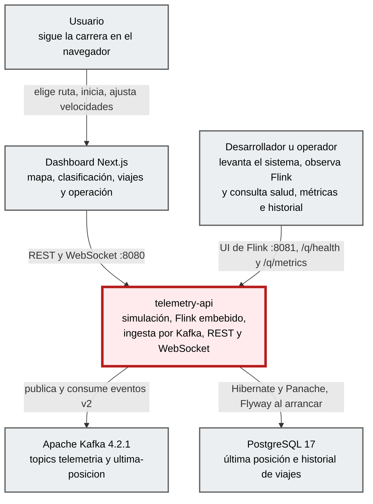

# Contexto (C4 nivel 1)

**Foco:** `telemetry-api`, el sistema bajo documentación (borde dark red 700).

## Diagrama

Fuente: [`diagrams/context.mmd`](diagrams/context.mmd).

## Elementos

| Elemento | Tipo | Rol | Procedencia |
|---|---|---|---|
| Usuario | Persona | Sigue la carrera, elige ruta, inicia y ajusta velocidades desde el dashboard | `EXTRACTED` ([`SimulacionResource`](../../src/main/java/dev/bryan/infrastructure/in/rest/SimulacionResource.java)) |
| Desarrollador u operador | Persona | Levanta el stack, observa Flink en `:8081` y consulta `/q/health/ready`, `/q/metrics` y el historial | `EXTRACTED` ([`docker-compose.yml`](../../../docker-compose.yml), `application.properties`) |
| Dashboard Next.js | Sistema hermano | Cliente REST y WebSocket de `telemetry-api`; no se documenta en este pack | `EXTRACTED` (CORS a `http://localhost:3000`) |
| `telemetry-api` | Sistema foco | Simula la carrera, ejecuta el job de Flink, consume y persiste, expone REST y WebSocket | `EXTRACTED` |
| Apache Kafka | Sistema externo | Bus entre simulación, Flink y los consumidores | `EXTRACTED` (`application.properties`) |
| PostgreSQL | Sistema externo | Última posición e historial de viajes | `EXTRACTED` (`application.properties`, migración `V1`) |

## Límites y supuestos

- El pack cubre solo `telemetry-api`. El dashboard aparece como cliente; sus pantallas y su mapa base no se describen.
- Las rutas salen de archivos GeoJSON dentro del propio servicio (`resources/rutas/`); no hay una llamada externa en runtime.
- No hay autenticación ni autorización (ver [documentation-review.md](documentation-review.md)). CORS solo permite el origen configurado.

## Traceability

- Siguiente nivel: [container.md](container.md) · Resumen: [README.md](README.md)
