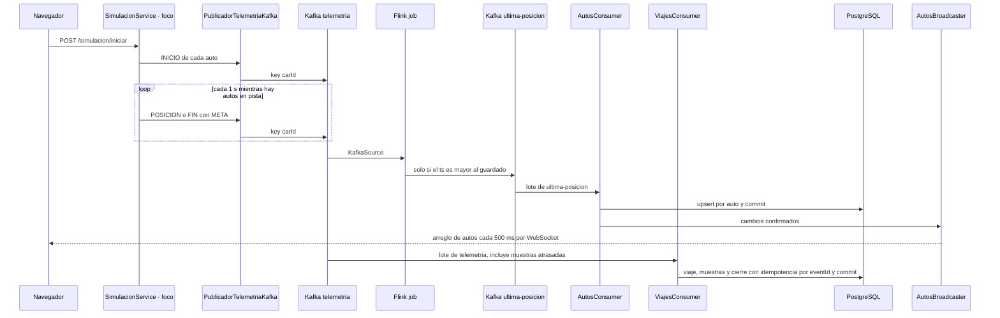

# Secuencias E2E

**Cobertura:** 10 de 10 endpoints REST de `telemetry-api`, más el WebSocket y la ingesta del historial. No hay `openapi:` ni `swagger:` en `telemetry-api/src` (se buscó en todos los `*.yaml` y `*.yml`; el único es `src/test/resources/compose-persistencia.yml`), por lo que los endpoints se **derivaron de los recursos REST** y quedan marcados `INFERRED`. Estado: `REQUIRES_REVIEW`.

## Recorrido de punta a punta

La carrera completa, del botón al mapa y al historial:

Fuente: [`diagrams/sequence-e2e.mmd`](diagrams/sequence-e2e.mmd).

## Índice de cobertura de endpoints REST

| # | Método | Path | `operationId` | Archivo fuente | Foco | Secuencia | Pruebas |
|---|---|---|---|---|---|---|---|
| 1 | GET | `/autos` | `listar` | [`AutosResource.java`](../../src/main/java/dev/bryan/infrastructure/in/rest/AutosResource.java) `INFERRED` | AutosResource | [`get-autos.md`](sequences/get-autos.md) · [`.mmd`](diagrams/sequences/get-autos.mmd) | AutosResourceTest |
| 2 | GET | `/rutas` | `listar` | [`RutasResource.java`](../../src/main/java/dev/bryan/infrastructure/in/rest/RutasResource.java) `INFERRED` | RutasResource | [`get-rutas.md`](sequences/get-rutas.md) · [`.mmd`](diagrams/sequences/get-rutas.mmd) | SimulacionResourceTest |
| 3 | GET | `/rutas/{id}` | `ruta` | [`RutasResource.java`](../../src/main/java/dev/bryan/infrastructure/in/rest/RutasResource.java) `INFERRED` | RutasResource | [`get-rutas-id.md`](sequences/get-rutas-id.md) · [`.mmd`](diagrams/sequences/get-rutas-id.mmd) | SimulacionResourceTest |
| 4 | GET | `/simulacion` | `estado` | [`SimulacionResource.java`](../../src/main/java/dev/bryan/infrastructure/in/rest/SimulacionResource.java) `INFERRED` | SimulacionResource | [`get-simulacion.md`](sequences/get-simulacion.md) · [`.mmd`](diagrams/sequences/get-simulacion.mmd) | SimulacionResourceTest |
| 5 | POST | `/simulacion/iniciar` | `iniciar` | [`SimulacionResource.java`](../../src/main/java/dev/bryan/infrastructure/in/rest/SimulacionResource.java) `INFERRED` | SimulacionService | [`post-simulacion-iniciar.md`](sequences/post-simulacion-iniciar.md) · [`.mmd`](diagrams/sequences/post-simulacion-iniciar.mmd) | SimulacionResourceTest, SimuladorViajesTest |
| 6 | POST | `/simulacion/detener` | `detener` | [`SimulacionResource.java`](../../src/main/java/dev/bryan/infrastructure/in/rest/SimulacionResource.java) `INFERRED` | SimulacionService | [`post-simulacion-detener.md`](sequences/post-simulacion-detener.md) · [`.mmd`](diagrams/sequences/post-simulacion-detener.mmd) | SimulacionResourceTest, SimuladorViajesTest |
| 7 | PUT | `/simulacion/autos/{carId}/velocidad` | `velocidad` | [`SimulacionResource.java`](../../src/main/java/dev/bryan/infrastructure/in/rest/SimulacionResource.java) `INFERRED` | SimulacionService | [`put-simulacion-autos-carid-velocidad.md`](sequences/put-simulacion-autos-carid-velocidad.md) · [`.mmd`](diagrams/sequences/put-simulacion-autos-carid-velocidad.mmd) | SimulacionResourceTest |
| 8 | GET | `/viajes` | `listar` | [`ViajesResource.java`](../../src/main/java/dev/bryan/infrastructure/in/rest/ViajesResource.java) `INFERRED` | ViajesResource | [`get-viajes.md`](sequences/get-viajes.md) · [`.mmd`](diagrams/sequences/get-viajes.mmd) | ViajesResourceTest |
| 9 | GET | `/viajes/{viajeId}` | `detalle` | [`ViajesResource.java`](../../src/main/java/dev/bryan/infrastructure/in/rest/ViajesResource.java) `INFERRED` | ViajesResource | [`get-viajes-viajeid.md`](sequences/get-viajes-viajeid.md) · [`.mmd`](diagrams/sequences/get-viajes-viajeid.mmd) | ViajeDetalleTest |
| 10 | GET | `/viajes/{viajeId}/posiciones` | `posiciones` | [`ViajesResource.java`](../../src/main/java/dev/bryan/infrastructure/in/rest/ViajesResource.java) `INFERRED` | ViajesResource | [`get-viajes-viajeid-posiciones.md`](sequences/get-viajes-viajeid-posiciones.md) · [`.mmd`](diagrams/sequences/get-viajes-viajeid-posiciones.mmd) | ViajesResourceTest |

Total: 10 operaciones y 10 secuencias.

## Flujos que no son endpoints REST

| Flujo | Foco | Secuencia | Pruebas |
|---|---|---|---|
| WebSocket `/ws/autos` y difusión de cambios (`EXTRACTED`) | `AutosConsumer` | [`ws-autos.md`](sequences/ws-autos.md) · [`.mmd`](diagrams/sequences/ws-autos.mmd) | AutosWsTest, AutosConsumerTest, AutosCambiosTest |
| Ingesta del historial desde Kafka (`EXTRACTED`) | `ViajesConsumer` | [`consumo-historial-viajes.md`](sequences/consumo-historial-viajes.md) · [`.mmd`](diagrams/sequences/consumo-historial-viajes.mmd) | ViajesConsumerTest, ViajesStoreTest, RecuperacionTest |

## Endpoints de Quarkus

`/q/health/ready` (datasource y canales de mensajería) y `/q/metrics` (Prometheus) los aporta el framework, no un recurso del proyecto; no tienen secuencia propia. Los cubre [`RecuperacionTest`](../../src/test/java/dev/bryan/infrastructure/in/messaging/viajes/RecuperacionTest.java).

## Traceability

- Anterior: [code.md](code.md) · Trazabilidad: [traceability-report.md](traceability-report.md)
