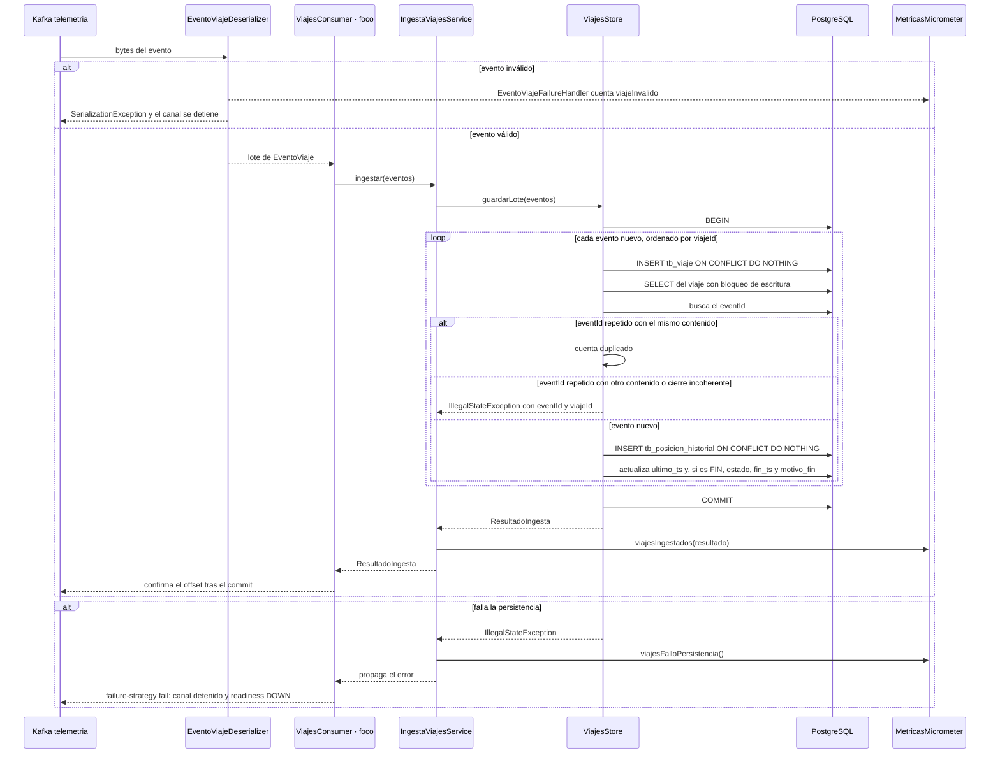

# Secuencia · Ingesta del historial de viajes desde Kafka

**Endpoint:** `KAFKA telemetria (grupo quarkus-viajes-postgres)` · **operación:** `ingestar-historial` · **procedencia:** `EXTRACTED`

**Foco:** `ViajesConsumer` (borde dark red 700).

## Capas que atraviesa

| Capa | Elemento | Código |
|---|---|---|
| infrastructure/in (messaging) | ViajesConsumer, EventoViajeDeserializer, EventoJson (validación) | [`ViajesConsumer.java`](../../../src/main/java/dev/bryan/infrastructure/in/messaging/viajes/ViajesConsumer.java) |
| application (port/in) | IngestarHistorialViajes → IngestaViajesService | [`IngestaViajesService.java`](../../../src/main/java/dev/bryan/application/service/IngestaViajesService.java) |
| application (port/out) | ViajesRepositorio, MetricasIngesta | [`ViajesRepositorio.java`](../../../src/main/java/dev/bryan/application/port/out/ViajesRepositorio.java) |
| infrastructure/out (persistence) | ViajesStore (idempotencia por eventId, bloqueo por viaje) | [`ViajesStore.java`](../../../src/main/java/dev/bryan/infrastructure/out/persistence/viajes/ViajesStore.java) |
| infrastructure/out (metrics) | MetricasMicrometer | [`MetricasMicrometer.java`](../../../src/main/java/dev/bryan/infrastructure/out/metrics/MetricasMicrometer.java) |

## Errores relevantes

| Efecto | Causa | Origen |
|---|---|---|
| canal detenido y readiness DOWN | evento inválido, conflicto de integridad o fallo de BD | `failure-strategy=fail`; `eventId` hace idempotente la reentrega tras reiniciar |
| evento legado excluido | `schemaVersion` nulo o 1 | cuenta en `viajes.eventos.legados` y no crea viaje |

## Pruebas que lo cubren

- [`ViajesConsumerTest`](../../../src/test/java/dev/bryan/infrastructure/in/messaging/viajes/ViajesConsumerTest.java)
- [`ViajesStoreTest`](../../../src/test/java/dev/bryan/infrastructure/out/persistence/viajes/ViajesStoreTest.java)
- [`RecuperacionTest`](../../../src/test/java/dev/bryan/infrastructure/in/messaging/viajes/RecuperacionTest.java)
- [`ViajesMetricasTest`](../../../src/test/java/dev/bryan/infrastructure/in/messaging/viajes/ViajesMetricasTest.java)

## Notas

- No existe `correlation ID` de entrada: el `requestId` nace en `GlobalExceptionMapper` y solo viaja en el cuerpo de los errores (`STD-ERR-001`).
- Sin autenticación ni autorización en el servicio (ver [documentation-review.md](../documentation-review.md)).

## Traceability

- Índice: [sequence-e2e.md](../sequence-e2e.md) · Diagrama: [`consumo-historial-viajes.mmd`](../diagrams/sequences/consumo-historial-viajes.mmd)
