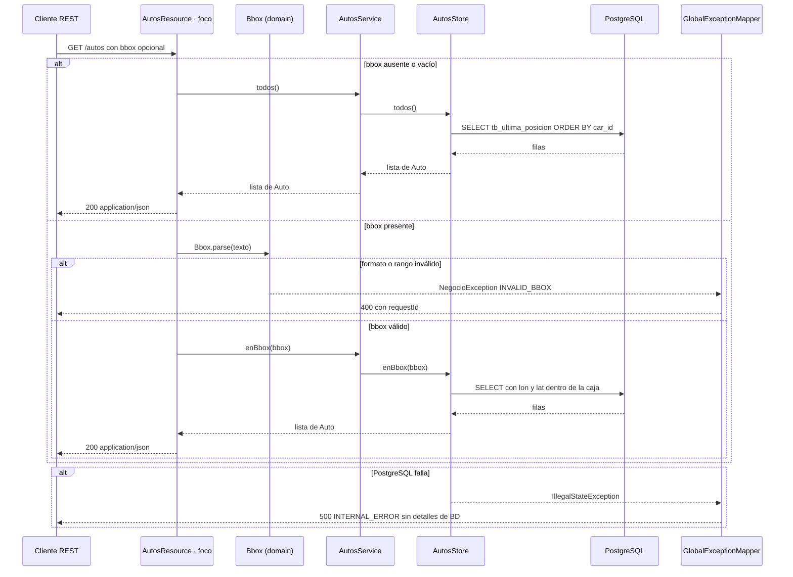

# Secuencia · GET /autos

**Endpoint:** `GET /autos` · **operación:** `listar` · **procedencia:** `INFERRED` (no hay OpenAPI; se dedujo del código del recurso)

**Foco:** `AutosResource` (borde dark red 700).

## Capas que atraviesa

| Capa | Elemento | Código |
|---|---|---|
| infrastructure/in (REST) | AutosResource, `@Blocking` | [`AutosResource.java`](../../../src/main/java/dev/bryan/infrastructure/in/rest/AutosResource.java) |
| domain | Bbox.parse | [`Bbox.java`](../../../src/main/java/dev/bryan/domain/model/Bbox.java) |
| application (port/in) | ConsultarAutos → AutosService | [`AutosService.java`](../../../src/main/java/dev/bryan/application/service/AutosService.java) |
| application (port/out) | AutosRepositorio | [`AutosRepositorio.java`](../../../src/main/java/dev/bryan/application/port/out/AutosRepositorio.java) |
| infrastructure/out (persistence) | AutosStore + UltimaPosicionRepository (Panache) | [`AutosStore.java`](../../../src/main/java/dev/bryan/infrastructure/out/persistence/autos/AutosStore.java) |

## Errores relevantes

| Código | Causa | Origen |
|---|---|---|
| 400 `INVALID_BBOX` | `bbox` con formato o rango inválido | `Bbox.parse` |
| 500 `INTERNAL_ERROR` | fallo de PostgreSQL (`IllegalStateException`) | `AutosStore`, `GlobalExceptionMapper` |

## Pruebas que lo cubren

- [`AutosResourceTest`](../../../src/test/java/dev/bryan/infrastructure/in/rest/AutosResourceTest.java)
- [`AutosStoreTest`](../../../src/test/java/dev/bryan/infrastructure/out/persistence/autos/AutosStoreTest.java)
- [`BboxTest`](../../../src/test/java/dev/bryan/domain/model/BboxTest.java)

## Notas

- No existe `correlation ID` de entrada: el `requestId` nace en `GlobalExceptionMapper` y solo viaja en el cuerpo de los errores (`STD-ERR-001`).
- Sin autenticación ni autorización en el servicio (ver [documentation-review.md](../documentation-review.md)).

## Traceability

- Índice: [sequence-e2e.md](../sequence-e2e.md) · Diagrama: [`get-autos.mmd`](../diagrams/sequences/get-autos.mmd)
