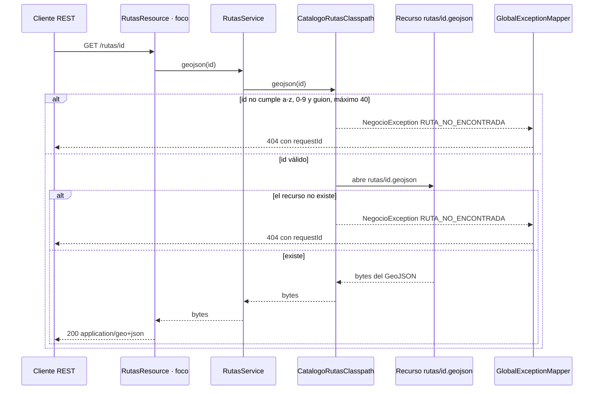

# Secuencia · GET /rutas/{id}

**Endpoint:** `GET /rutas/{id}` · **operación:** `ruta` · **procedencia:** `INFERRED` (no hay OpenAPI; se dedujo del código del recurso)

**Foco:** `RutasResource` (borde dark red 700).

## Capas que atraviesa

| Capa | Elemento | Código |
|---|---|---|
| infrastructure/in (REST) | RutasResource | [`RutasResource.java`](../../../src/main/java/dev/bryan/infrastructure/in/rest/RutasResource.java) |
| application (port/in) | ConsultarRutas → RutasService | [`RutasService.java`](../../../src/main/java/dev/bryan/application/service/RutasService.java) |
| application (port/out) | CatalogoRutas | [`CatalogoRutas.java`](../../../src/main/java/dev/bryan/application/port/out/CatalogoRutas.java) |
| infrastructure/out (classpath) | CatalogoRutasClasspath (valida el id contra un patrón) | [`CatalogoRutasClasspath.java`](../../../src/main/java/dev/bryan/infrastructure/out/classpath/CatalogoRutasClasspath.java) |

## Errores relevantes

| Código | Causa | Origen |
|---|---|---|
| 404 `RUTA_NO_ENCONTRADA` | id fuera del patrón o sin GeoJSON (impide recorrer rutas con `..`) | `CatalogoRutasClasspath` |

## Pruebas que lo cubren

- [`SimulacionResourceTest (incluye el intento `../..`)`](../../../src/test/java/dev/bryan/infrastructure/in/rest/SimulacionResourceTest.java)

## Notas

- No existe `correlation ID` de entrada: el `requestId` nace en `GlobalExceptionMapper` y solo viaja en el cuerpo de los errores (`STD-ERR-001`).
- Sin autenticación ni autorización en el servicio (ver [documentation-review.md](../documentation-review.md)).

## Traceability

- Índice: [sequence-e2e.md](../sequence-e2e.md) · Diagrama: [`get-rutas-id.mmd`](../diagrams/sequences/get-rutas-id.mmd)
