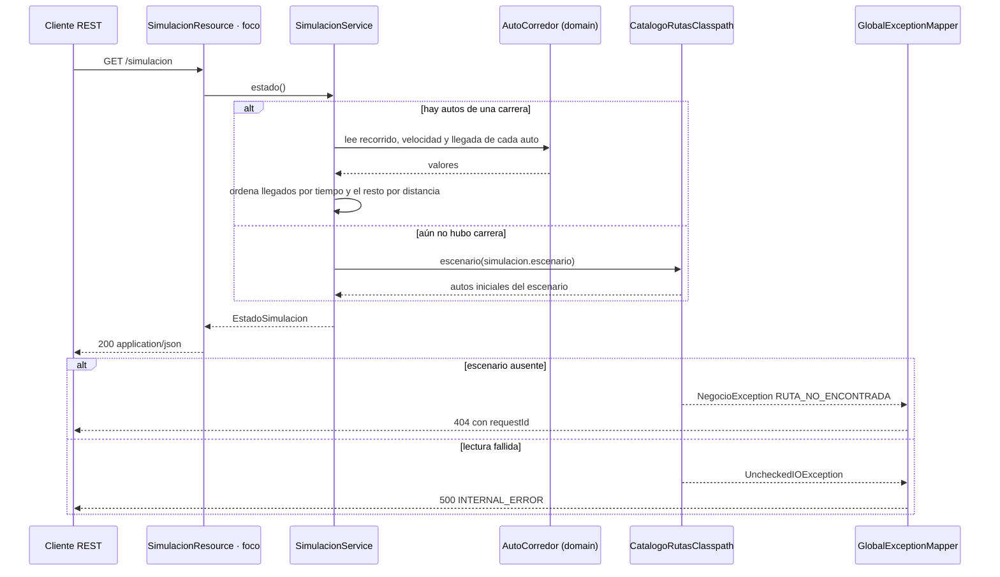

# Secuencia · GET /simulacion

**Endpoint:** `GET /simulacion` · **operación:** `estado` · **procedencia:** `INFERRED` (no hay OpenAPI; se dedujo del código del recurso)

**Foco:** `SimulacionResource` (borde dark red 700).

## Capas que atraviesa

| Capa | Elemento | Código |
|---|---|---|
| infrastructure/in (REST) | SimulacionResource | [`SimulacionResource.java`](../../../src/main/java/dev/bryan/infrastructure/in/rest/SimulacionResource.java) |
| application (port/in) | GestionarSimulacion → SimulacionService | [`SimulacionService.java`](../../../src/main/java/dev/bryan/application/service/SimulacionService.java) |
| domain | AutoCorredor, Clasificado, EstadoSimulacion | [`AutoCorredor.java`](../../../src/main/java/dev/bryan/domain/service/AutoCorredor.java) |
| application (port/out) | CatalogoRutas | [`CatalogoRutas.java`](../../../src/main/java/dev/bryan/application/port/out/CatalogoRutas.java) |

## Errores relevantes

| Código | Causa | Origen |
|---|---|---|
| 404 `RUTA_NO_ENCONTRADA` | `escenarios/carrera.json` ausente | `CatalogoRutasClasspath` |
| 500 `INTERNAL_ERROR` | fallo de lectura del escenario | `CatalogoRutasClasspath` |

## Pruebas que lo cubren

- [`SimulacionResourceTest`](../../../src/test/java/dev/bryan/infrastructure/in/rest/SimulacionResourceTest.java)
- [`SimuladorViajesTest`](../../../src/test/java/dev/bryan/application/service/SimuladorViajesTest.java)

## Notas

- No existe `correlation ID` de entrada: el `requestId` nace en `GlobalExceptionMapper` y solo viaja en el cuerpo de los errores (`STD-ERR-001`).
- Sin autenticación ni autorización en el servicio (ver [documentation-review.md](../documentation-review.md)).

## Traceability

- Índice: [sequence-e2e.md](../sequence-e2e.md) · Diagrama: [`get-simulacion.mmd`](../diagrams/sequences/get-simulacion.mmd)
