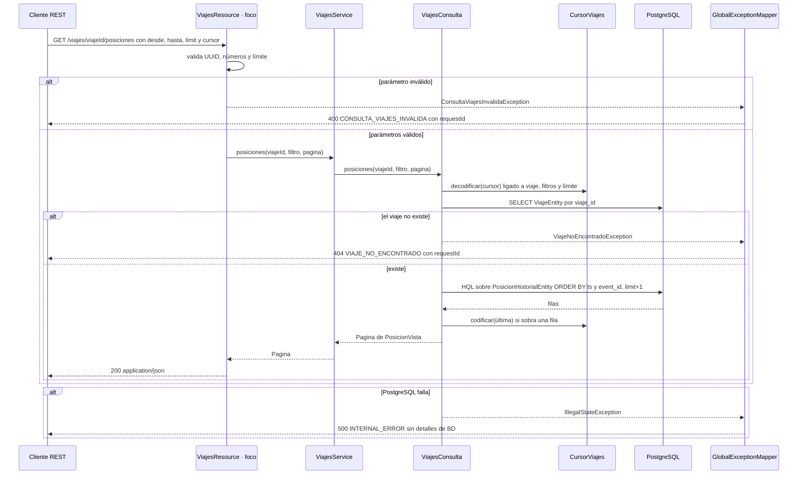

# Secuencia · GET /viajes/{viajeId}/posiciones

**Endpoint:** `GET /viajes/{viajeId}/posiciones` · **operación:** `posiciones` · **procedencia:** `INFERRED` (no hay OpenAPI; se dedujo del código del recurso)

**Foco:** `ViajesResource` (borde dark red 700).

## Capas que atraviesa

| Capa | Elemento | Código |
|---|---|---|
| infrastructure/in (REST) | ViajesResource | [`ViajesResource.java`](../../../src/main/java/dev/bryan/infrastructure/in/rest/ViajesResource.java) |
| domain | FiltroPosiciones, ConsultaPagina, PosicionVista | [`FiltroPosiciones.java`](../../../src/main/java/dev/bryan/domain/model/FiltroPosiciones.java) |
| application (port/in) | ConsultarViajes → ViajesService | [`ViajesService.java`](../../../src/main/java/dev/bryan/application/service/ViajesService.java) |
| application (port/out) | ViajesConsultaRepositorio | [`ViajesConsultaRepositorio.java`](../../../src/main/java/dev/bryan/application/port/out/ViajesConsultaRepositorio.java) |
| infrastructure/out (persistence) | ViajesConsulta + CursorViajes (keyset por ts y event_id) | [`ViajesConsulta.java`](../../../src/main/java/dev/bryan/infrastructure/out/persistence/viajes/ViajesConsulta.java) |

## Errores relevantes

| Código | Causa | Origen |
|---|---|---|
| 400 `CONSULTA_VIAJES_INVALIDA` | UUID, número, rango, límite o cursor inválidos | `ViajesResource`, `CursorViajes`, `ViajesConsulta` |
| 404 `VIAJE_NO_ENCONTRADO` | el viaje no existe | `ViajesConsulta` |
| 500 `INTERNAL_ERROR` | fallo de PostgreSQL | `ViajesConsulta` |

## Pruebas que lo cubren

- [`ViajesResourceTest`](../../../src/test/java/dev/bryan/infrastructure/in/rest/ViajesResourceTest.java)
- [`CursorViajesTest`](../../../src/test/java/dev/bryan/infrastructure/out/persistence/viajes/CursorViajesTest.java)

## Notas

- No existe `correlation ID` de entrada: el `requestId` nace en `GlobalExceptionMapper` y solo viaja en el cuerpo de los errores (`STD-ERR-001`).
- Sin autenticación ni autorización en el servicio (ver [documentation-review.md](../documentation-review.md)).

## Traceability

- Índice: [sequence-e2e.md](../sequence-e2e.md) · Diagrama: [`get-viajes-viajeid-posiciones.mmd`](../diagrams/sequences/get-viajes-viajeid-posiciones.mmd)
