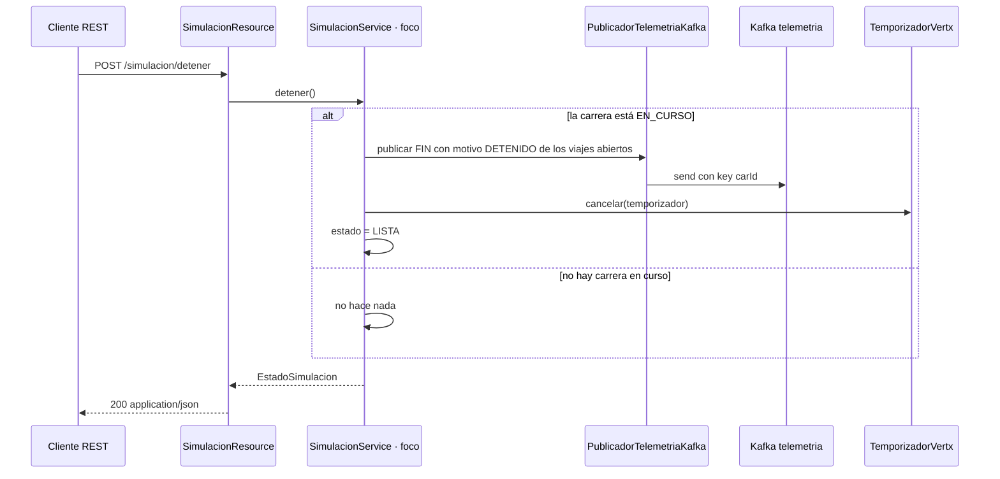

# Secuencia · POST /simulacion/detener

**Endpoint:** `POST /simulacion/detener` · **operación:** `detener` · **procedencia:** `INFERRED` (no hay OpenAPI; se dedujo del código del recurso)

**Foco:** `SimulacionService` (borde dark red 700).

## Capas que atraviesa

| Capa | Elemento | Código |
|---|---|---|
| infrastructure/in (REST) | SimulacionResource | [`SimulacionResource.java`](../../../src/main/java/dev/bryan/infrastructure/in/rest/SimulacionResource.java) |
| application (port/in) | GestionarSimulacion → SimulacionService (foco) | [`SimulacionService.java`](../../../src/main/java/dev/bryan/application/service/SimulacionService.java) |
| application (port/out) | PublicadorTelemetria, Temporizador | [`Temporizador.java`](../../../src/main/java/dev/bryan/application/port/out/Temporizador.java) |
| infrastructure/out | PublicadorTelemetriaKafka, TemporizadorVertx | [`TemporizadorVertx.java`](../../../src/main/java/dev/bryan/infrastructure/out/vertx/TemporizadorVertx.java) |

## Errores relevantes

No declara errores propios: es idempotente. Un fallo de Kafka al publicar los `FIN` solo se registra en el log del publicador.

## Pruebas que lo cubren

- [`SimulacionResourceTest`](../../../src/test/java/dev/bryan/infrastructure/in/rest/SimulacionResourceTest.java)
- [`SimuladorViajesTest`](../../../src/test/java/dev/bryan/application/service/SimuladorViajesTest.java)

## Notas

- No existe `correlation ID` de entrada: el `requestId` nace en `GlobalExceptionMapper` y solo viaja en el cuerpo de los errores (`STD-ERR-001`).
- Sin autenticación ni autorización en el servicio (ver [documentation-review.md](../documentation-review.md)).

## Traceability

- Índice: [sequence-e2e.md](../sequence-e2e.md) · Diagrama: [`post-simulacion-detener.mmd`](../diagrams/sequences/post-simulacion-detener.mmd)
