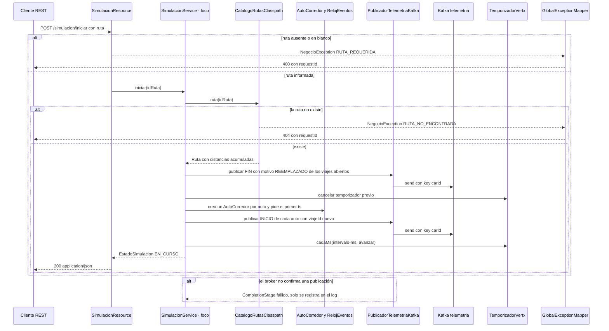

# Secuencia · POST /simulacion/iniciar

**Endpoint:** `POST /simulacion/iniciar` · **operación:** `iniciar` · **procedencia:** `INFERRED` (no hay OpenAPI; se dedujo del código del recurso)

**Foco:** `SimulacionService` (borde dark red 700).

## Capas que atraviesa

| Capa | Elemento | Código |
|---|---|---|
| infrastructure/in (REST) | SimulacionResource valida el cuerpo | [`SimulacionResource.java`](../../../src/main/java/dev/bryan/infrastructure/in/rest/SimulacionResource.java) |
| application (port/in) | GestionarSimulacion → SimulacionService (foco) | [`SimulacionService.java`](../../../src/main/java/dev/bryan/application/service/SimulacionService.java) |
| domain | AutoCorredor, RelojEventos, Ruta, TelemetriaEvento | [`AutoCorredor.java`](../../../src/main/java/dev/bryan/domain/service/AutoCorredor.java) |
| application (port/out) | CatalogoRutas, PublicadorTelemetria, Temporizador | [`PublicadorTelemetria.java`](../../../src/main/java/dev/bryan/application/port/out/PublicadorTelemetria.java) |
| infrastructure/out | CatalogoRutasClasspath, PublicadorTelemetriaKafka (Emitter `telemetria-out`), TemporizadorVertx | [`PublicadorTelemetriaKafka.java`](../../../src/main/java/dev/bryan/infrastructure/out/kafka/PublicadorTelemetriaKafka.java) |

## Errores relevantes

| Código | Causa | Origen |
|---|---|---|
| 400 `RUTA_REQUERIDA` | cuerpo vacío o `ruta` en blanco | `SimulacionResource` |
| 404 `RUTA_NO_ENCONTRADA` | ruta fuera del catálogo | `CatalogoRutasClasspath` |
| (sin código HTTP) | fallo de publicación en Kafka | `PublicadorTelemetriaKafka` registra el error; la respuesta ya fue 200 |

## Pruebas que lo cubren

- [`SimulacionResourceTest`](../../../src/test/java/dev/bryan/infrastructure/in/rest/SimulacionResourceTest.java)
- [`SimuladorViajesTest`](../../../src/test/java/dev/bryan/application/service/SimuladorViajesTest.java)
- [`PublicadorTelemetriaTest`](../../../src/test/java/dev/bryan/infrastructure/out/kafka/PublicadorTelemetriaTest.java)

## Notas

- No existe `correlation ID` de entrada: el `requestId` nace en `GlobalExceptionMapper` y solo viaja en el cuerpo de los errores (`STD-ERR-001`).
- Sin autenticación ni autorización en el servicio (ver [documentation-review.md](../documentation-review.md)).

## Traceability

- Índice: [sequence-e2e.md](../sequence-e2e.md) · Diagrama: [`post-simulacion-iniciar.mmd`](../diagrams/sequences/post-simulacion-iniciar.mmd)
