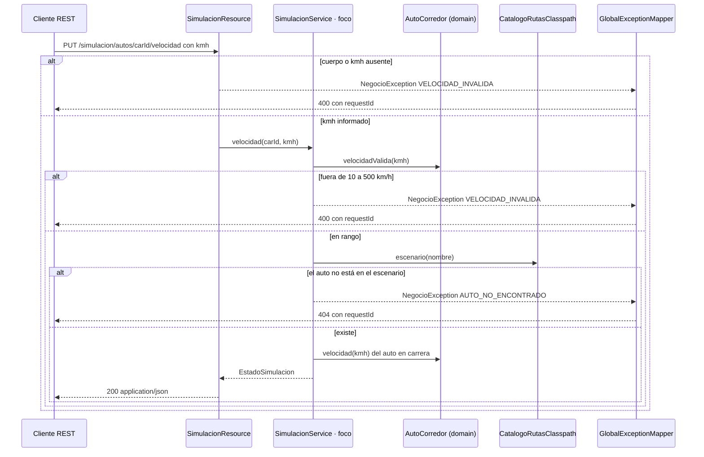

# Secuencia · PUT /simulacion/autos/{carId}/velocidad

**Endpoint:** `PUT /simulacion/autos/{carId}/velocidad` · **operación:** `velocidad` · **procedencia:** `INFERRED` (no hay OpenAPI; se dedujo del código del recurso)

**Foco:** `SimulacionService` (borde dark red 700).

## Capas que atraviesa

| Capa | Elemento | Código |
|---|---|---|
| infrastructure/in (REST) | SimulacionResource valida que exista `kmh` | [`SimulacionResource.java`](../../../src/main/java/dev/bryan/infrastructure/in/rest/SimulacionResource.java) |
| application (port/in) | GestionarSimulacion → SimulacionService (foco) | [`SimulacionService.java`](../../../src/main/java/dev/bryan/application/service/SimulacionService.java) |
| domain | AutoCorredor.velocidadValida y velocidad | [`AutoCorredor.java`](../../../src/main/java/dev/bryan/domain/service/AutoCorredor.java) |
| application (port/out) | CatalogoRutas (escenario) | [`CatalogoRutas.java`](../../../src/main/java/dev/bryan/application/port/out/CatalogoRutas.java) |

## Errores relevantes

| Código | Causa | Origen |
|---|---|---|
| 400 `VELOCIDAD_INVALIDA` | `kmh` ausente o fuera de 10 a 500 | `SimulacionResource`, `SimulacionService` |
| 404 `AUTO_NO_ENCONTRADO` | `carId` fuera del escenario | `SimulacionService` |

## Pruebas que lo cubren

- [`SimulacionResourceTest`](../../../src/test/java/dev/bryan/infrastructure/in/rest/SimulacionResourceTest.java)
- [`AutoCorredorTest`](../../../src/test/java/dev/bryan/domain/service/AutoCorredorTest.java)

## Notas

- No existe `correlation ID` de entrada: el `requestId` nace en `GlobalExceptionMapper` y solo viaja en el cuerpo de los errores (`STD-ERR-001`).
- Sin autenticación ni autorización en el servicio (ver [documentation-review.md](../documentation-review.md)).

## Traceability

- Índice: [sequence-e2e.md](../sequence-e2e.md) · Diagrama: [`put-simulacion-autos-carid-velocidad.mmd`](../diagrams/sequences/put-simulacion-autos-carid-velocidad.mmd)
