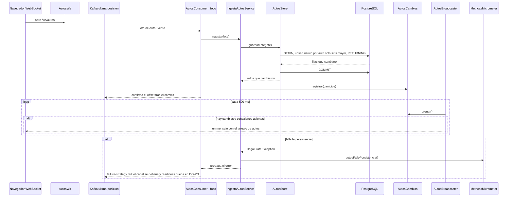

# Secuencia · WebSocket /ws/autos y difusión de posiciones

**Endpoint:** `WS /ws/autos` · **operación:** `ws-autos` · **procedencia:** `EXTRACTED`

**Foco:** `AutosConsumer` (borde dark red 700).

## Capas que atraviesa

| Capa | Elemento | Código |
|---|---|---|
| infrastructure/in (messaging) | AutosConsumer, `@Incoming("ultima-posicion")`, `@Blocking`, `POST_PROCESSING` | [`AutosConsumer.java`](../../../src/main/java/dev/bryan/infrastructure/in/messaging/autos/AutosConsumer.java) |
| application (port/in) | IngestarUltimasPosiciones → IngestaAutosService | [`IngestaAutosService.java`](../../../src/main/java/dev/bryan/application/service/IngestaAutosService.java) |
| application (port/out) | AutosRepositorio, DifusionAutos, MetricasIngesta | [`DifusionAutos.java`](../../../src/main/java/dev/bryan/application/port/out/DifusionAutos.java) |
| infrastructure/out | AutosStore, AutosCambios, AutosBroadcaster (timer Vert.x) | [`AutosBroadcaster.java`](../../../src/main/java/dev/bryan/infrastructure/out/ws/AutosBroadcaster.java) |
| infrastructure/in (ws) | AutosWs solo registra la apertura; no recibe mensajes | [`AutosWs.java`](../../../src/main/java/dev/bryan/infrastructure/in/ws/AutosWs.java) |

## Errores relevantes

| Efecto | Causa | Origen |
|---|---|---|
| canal detenido y readiness DOWN | fallo de BD o evento inválido | `failure-strategy=fail`; se recupera reiniciando la API |
| mensaje no entregado | la API cae entre el commit y el envío | el WebSocket no es durable; el cliente se recupera con `GET /autos` |

## Pruebas que lo cubren

- [`AutosWsTest`](../../../src/test/java/dev/bryan/infrastructure/in/ws/AutosWsTest.java)
- [`AutosConsumerTest`](../../../src/test/java/dev/bryan/infrastructure/in/messaging/autos/AutosConsumerTest.java)
- [`AutosCambiosTest`](../../../src/test/java/dev/bryan/infrastructure/out/ws/AutosCambiosTest.java)
- [`AutosStoreTest`](../../../src/test/java/dev/bryan/infrastructure/out/persistence/autos/AutosStoreTest.java)

## Notas

- No existe `correlation ID` de entrada: el `requestId` nace en `GlobalExceptionMapper` y solo viaja en el cuerpo de los errores (`STD-ERR-001`).
- Sin autenticación ni autorización en el servicio (ver [documentation-review.md](../documentation-review.md)).

## Traceability

- Índice: [sequence-e2e.md](../sequence-e2e.md) · Diagrama: [`ws-autos.mmd`](../diagrams/sequences/ws-autos.mmd)
